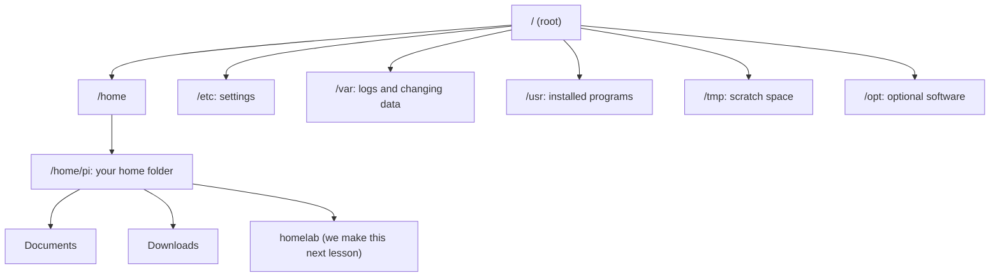

{:class="cover"}

---

By the end of this lesson you will be able to say where you are in the filesystem, list what is there, and move to any folder using absolute or relative paths.

## The filesystem is a tree

Everything on your Pi, from your photos to the robot code you wrote last week, lives in one big upside-down tree. The trunk is `/`, called **root**. Every folder branches off it.



You will spend nearly all your time inside your **home folder**, `/home/YOURNAME`. The other folders belong to the system. We will visit `/etc` (settings) and `/var` (logs) later when we look after services.

## Where am I? `pwd`

`pwd` stands for **print working directory**. It tells you the folder you are in right now:

```bash
$ pwd
/home/pi
```

{:class="w-100 img-fluid card-shadow rounded-3"}

## What is here? `ls`

`ls` lists the contents of the folder:

```bash
$ ls
Bookshelf  Desktop  Documents  Downloads  Music  Pictures  Public  Templates  Videos
```

{:class="w-100 img-fluid card-shadow rounded-3"}

The `-l` flag gives the **long** listing, with permissions, owner, size and date. Add `-a` to show hidden files (names that start with a dot) and `-h` to make sizes friendly:

```bash
$ ls -lah
total 96K
drwx------ 17 pi pi 4.0K Nov 24 09:14 .
drwxr-xr-x  3 root root 4.0K Aug 23  2024 ..
-rw-------  1 pi pi 2.1K Nov 24 09:10 .bash_history
-rw-r--r--  1 pi pi  220 Aug 23  2024 .bash_logout
-rw-r--r--  1 pi pi 3.5K Aug 23  2024 .bashrc
drwxr-xr-x  2 pi pi 4.0K Aug 23  2024 Documents
```

{:class="w-100 img-fluid card-shadow rounded-3"}

Don't worry about all the columns yet. We decode them in the permissions lesson. Also notice `.` (this folder) and `..` (the folder above), which come in handy in a moment.

## Moving around with `cd`

`cd` means **change directory**:

```bash
$ cd Documents
$ pwd
/home/pi/Documents
```

{:class="w-100 img-fluid card-shadow rounded-3"}

Three shortcuts you will use every day:

```bash
$ cd ..        # up one folder
$ cd ~         # straight home (typing just "cd" does the same)
$ cd -         # back to the folder you were in before
```

{:class="w-100 img-fluid card-shadow rounded-3"}

{:class="w-100 img-fluid card-shadow rounded-3"}

## Absolute and relative paths

A **path** is the address of a file or folder. There are two kinds:

- **Absolute**: starts at `/`, so it works from anywhere. Example: `/home/pi/Documents`.
- **Relative**: starts from where you are now. From `/home/pi`, the path `Documents` means the same folder.

```bash
$ cd /etc/apt        # absolute: works from anywhere
$ cd ../..           # relative: up two folders, from /etc/apt to /
$ pwd
/
$ cd home/pi         # relative: no leading slash, so from where we are
```

If a path fails, check the first character. A leading `/` means "from the very top".

## Typing less

The terminal helps you type:

- **Tab** completes names. Type `cd Doc` and press `Tab` to get `cd Documents/`. Press it twice to see all the choices.
- **Up arrow** brings back your last command, and again for the one before.
- `history` lists past commands as a numbered list. `!42` re-runs number 42, and `!!` re-runs the last one. Forgot `sudo`? Type `sudo !!`.
- **`Ctrl + R`** searches your history as you type.
- `clear` (or `Ctrl + L`) tidies the screen.

> **Careful**: `!42` runs whatever number 42 was, without asking. Look at the history first, so you do not re-run a delete.

Pi progress: you can now go anywhere on the Pi and know where you are. Next we make a tidy place for our Docker projects.

## Try it Yourself

1. Starting from your home folder, go to `/etc`, list it with `ls`, and come back home using `cd` with no arguments.
2. Use only relative paths to go from `/home/YOURNAME/Documents` to `/home/YOURNAME/Downloads` in one command (hint: `..`).
3. Use `ls -la` to find three hidden files in your home folder.
4. Challenge: use `Ctrl + R` to find the last `cd` command you ran, without scrolling.

## Common Issues

- **Problem**: `bash: cd: Documents: No such file or directory`.
- **Solution**: Run `pwd` and `ls` to check where you are, and check the capital letters.
- **Why**: Relative paths depend on your current folder, and Linux treats `Documents` and `documents` as different names.

- **Problem**: `cd My Projects` says `too many arguments`.
- **Solution**: Put the name in quotes (`cd "My Projects"`) or escape the space (`cd My\ Projects`). Better, avoid spaces in folder names.
- **Why**: The shell splits on spaces, so it thinks you gave `cd` two folders.

## Check your understanding


? Which path is absolute?
- [ ] Documents/robot
- [ ] ../Downloads
- [x] /home/pi/Documents
> An absolute path starts at the root `/` and works from anywhere.

? You are in `/home/pi/Documents`. What does `cd ..` do?
- [x] Moves you up to `/home/pi`
- [ ] Moves you down into a new folder
- [ ] Lists hidden files
> `..` always means the folder above the current one.

? Which flag shows hidden files, whose names start with a dot?
- [ ] ls -l
- [x] ls -a
- [ ] ls -h
> `-a` means all, including hidden files. `-l` is the long listing and `-h` makes sizes readable.

? You ran a command and forgot `sudo`. What re-runs it with sudo?
- [ ] !sudo
- [x] sudo !!
- [ ] history -sudo
> `!!` expands to your last command, so `sudo !!` runs it again with sudo in front.

