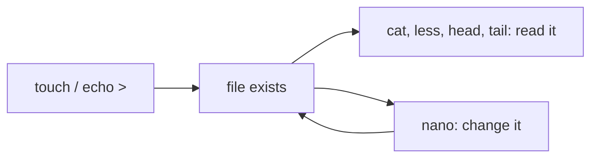

{:class="cover"}

---

By the end of this lesson you will be able to create a text file, read it in several ways, and edit it with `nano`.

## A notes file for your Pi

Every good maker keeps notes: which Pi is which, what you installed, what went wrong. Let's start `pi-notes.txt`, a plain text file that we will keep adding to as we get the Pi ready for Docker.

Files in Linux are just names with contents. There is no special "text file" type, which is why the same commands work on notes, scripts and configuration files.

## Creating files

`touch` creates an empty file, or if the file already exists it just updates its "last modified" time:

```bash
$ cd ~
$ touch pi-notes.txt
$ ls -l pi-notes.txt
-rw-r--r-- 1 pi pi 0 Nov 24 09:30 pi-notes.txt
```

{:class="w-100 img-fluid card-hover card-shadow rounded-3"}

The `0` is the file size in bytes. It is empty. `echo` prints text, and the `>` symbol sends that text into a file instead of the screen:

```bash
$ echo "Pi 4, 4GB, hostname raspberrypi" > pi-notes.txt
$ echo "Goal: get ready for Docker" >> pi-notes.txt
```

> **Careful**: a single `>` **replaces** everything in the file. Two, `>>`, **adds to the end**. Mixing them up is a classic way to lose your notes, so practise on this throwaway file first.

## Reading files

```bash
$ cat pi-notes.txt
Pi 4, 4GB, hostname raspberrypi
Goal: get ready for Docker
```

`cat` prints the whole file. For long files, you want something gentler. Let's use a real long file that every Pi has, the list of users, to try out the others:

```bash
$ head -n 3 /etc/passwd
root:x:0:0:root:/root:/bin/bash
daemon:x:1:1:daemon:/usr/sbin:/usr/sbin/nologin
bin:x:2:2:bin:/bin:/usr/sbin/nologin
$ tail -n 1 /etc/passwd
pi:x:1000:1000:,,,:/home/pi:/bin/bash
$ wc -l /etc/passwd
38 /etc/passwd
```

| Command | Best for |
|---|---|
| `cat file` | Short files, or joining files together |
| `less file` | Long files. Scroll with arrows, search with `/`, quit with `q` |
| `head -n 5 file` | The first lines, like the top of a config file |
| `tail -n 5 file` | The last lines, handy for logs |
| `tail -f file` | Watch a log file grow live. Press `Ctrl + C` to stop |
| `wc -l file` | Count the lines |
{:class="table table-single"}

We will use `tail` a lot in the services lesson, where the newest log lines are the interesting ones.

## Editing with `nano`

For more than a line or two, use a text editor. `nano` comes with Raspberry Pi OS and shows its shortcuts along the bottom of the screen:

```bash
$ nano pi-notes.txt
```

Type or change text as you would in any editor, then:

- `Ctrl + O` then `Enter` to **write out** (save)
- `Ctrl + X` to **exit** (it asks if you forgot to save)

The `^` in nano's menu means the `Ctrl` key, so `^X Exit` means `Ctrl + X`.



Pi progress: you have a notes file with the Pi's name and goal in it. Next we give our projects a proper home.

## Try it Yourself

1. Create `shopping.txt` with `touch`, then use `echo` and `>>` to add three lines naming parts for a robot.
2. Use `head -n 1` and `tail -n 1` to show only the first and last lines.
3. Open the file in `nano`, add a fourth line, save and exit, then check it with `cat`.
4. Challenge: run `sudo journalctl -f` to watch the system log scroll live (it works like `tail -f`), then press `Ctrl + C` to stop.

## Common Issues

- **Problem**: I used `>` and my old notes disappeared.
- **Solution**: Use `>>` to add to the end. Once it is gone, it is gone, so keep a copy of anything important.
- **Why**: A single `>` truncates (empties) the file before writing.

- **Problem**: `nano` asks `Save modified buffer?` and I am not sure what to do.
- **Solution**: Press `Y` to save, then `Enter` to accept the file name. Press `N` to throw away your changes.
- **Why**: nano is checking you do not lose edits when you exit with `Ctrl + X`.

- **Problem**: `Permission denied` when I open a system file in `nano`.
- **Solution**: Use `sudo nano /path/to/file` only if you really mean to change it.
- **Why**: System files belong to root, and only root can write them.

## Check your understanding


? What is the difference between `>` and `>>`?
- [ ] There is none
- [x] `>` replaces the file, `>>` adds to the end
- [ ] `>>` is for folders
> A single `>` overwrites, so use `>>` when you want to keep what is already there.

? Which command shows the last few lines of a file, useful for logs?
- [ ] head
- [x] tail
- [ ] touch
> `tail` shows the end of a file, and `tail -f` follows it as it grows.

? How do you save and quit in nano?
- [ ] Ctrl + S then Ctrl + Q
- [x] Ctrl + O, Enter, then Ctrl + X
- [ ] Press Esc and type :wq
> `Ctrl + O` writes the file out, and `Ctrl + X` exits. `:wq` belongs to vim.

