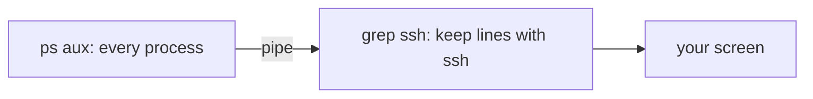
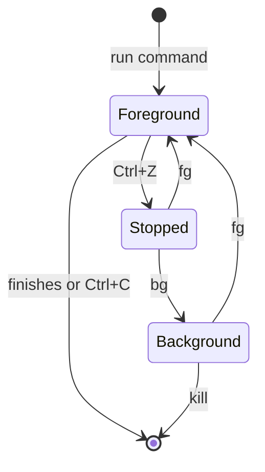

{:class="cover"}

---

By the end of this lesson you will be able to find a process with `ps` and `grep`, stop it with `kill`, and run a command in the background and bring it back.

## Programs that are running

A **process** is a program that is running right now. Your Pi is running dozens already: the desktop, the network, the clock. Every process has a number called its **PID** (process ID). When a program freezes, or a script you started needs stopping, the PID is how you point at it.

Later, every Docker container will show up as processes on your Pi too, so this is a skill you will use again.

## Listing processes: `ps`

Plain `ps` shows only what is running in your terminal:

```bash
$ ps
    PID TTY          TIME CMD
   2783 pts/0    00:00:00 bash
   2794 pts/0    00:00:00 ps
```

`ps aux` shows everything, for all users:

```bash
$ ps aux | head -5
USER         PID %CPU %MEM    VSZ   RSS TTY      STAT START   TIME COMMAND
root           1  0.0  0.5 169136 11168 ?        Ss   Aug23   0:00 /sbin/init splash
root           2  0.0  0.0      0     0 ?        S    Aug23   0:00 [kthreadd]
root           3  0.0  0.0      0     0 ?        S    Aug23   0:00 [pool_workqueue_release]
root           4  0.0  0.0      0     0 ?        I<   Aug23   0:00 [kworker/R-rcu_gp]
```

Too much to read. We need to filter it, which brings us to pipes.

## Pipes and `grep`

The `|` symbol, called a **pipe**, sends the output of one command straight into the next, like a pipe joining two taps. `grep` keeps only the lines that contain your word.



```bash
$ ps aux | grep ssh
root         741  0.0  0.3  15440  7168 ?        Ss   09:12   0:00 sshd: /usr/sbin/sshd -D
pi          3010  0.0  0.0   7332  1792 pts/0    S+   10:30   0:00 grep ssh
```

Notice that the `grep` itself shows up as a match. To avoid that, use `pgrep`, which is made for this:

```bash
$ pgrep -a sshd
741 sshd: /usr/sbin/sshd -D
```

## Practise on a harmless process

We never practise stopping real system processes. `sleep 600` just waits for ten minutes, so it is safe to start and stop.

```bash
$ sleep 600 &
[1] 3412
$ jobs
[1]+  Running                 sleep 600 &
```

The `&` at the end runs it **in the background**, so your prompt comes back straight away. `[1]` is the job number, and `3412` is its PID.



- `Ctrl + C` stops a program running in the foreground.
- `Ctrl + Z` pauses it. `bg` lets it carry on in the background, and `fg` brings it back to the front.

## Stopping a process: `kill`

```bash
$ kill 3412
[1]+  Terminated              sleep 600
```

`kill` sends a polite request to quit, called SIGTERM, which gives the program a chance to tidy up. `killall name` does the same for every process with that name:

```bash
$ sleep 600 &
$ sleep 700 &
$ killall sleep
```

If a stuck program ignores the polite request, the last resort is `kill -9 PID`, which ends it instantly with no clean-up.

> **Careful**: only kill processes you started and recognise. `killall` with the wrong name can close every program of that name, and killing a system process (or using `sudo kill -9`) can freeze or crash the Pi. Look at the name in `ps aux` first, and try plain `kill` before `kill -9`. Never kill PID 1.

Pi progress: you can see and control what runs on the Pi. Next up: the processes that start themselves at boot, called services.

## Try it Yourself

1. Start `sleep 300 &`, find it with `jobs`, then stop it with `kill %1`.
2. Start `sleep 500 &` and use `ps aux | grep sleep` to find its PID, then use `kill PID` with that number.
3. Run `sleep 400`, press `Ctrl + Z`, then `bg`, then check `jobs`. Bring it back with `fg` and stop it with `Ctrl + C`.
4. Challenge: open `htop`, press `F6` to sort by memory, and write down the three hungriest processes in `~/homelab/notes.txt`.

## Common Issues

- **Problem**: `kill: (1234) - No such process`.
- **Solution**: Run `ps aux | grep name` again to get the current PID.
- **Why**: The process had already finished, or you mistyped the number.

- **Problem**: `kill: (741) - Operation not permitted`.
- **Solution**: That process belongs to another user. Unless you are sure, leave it alone. If it is yours to manage, use `sudo`.
- **Why**: You can only stop your own processes unless you use `sudo`.

- **Problem**: `kill` does nothing and the program keeps running.
- **Solution**: Wait a few seconds, then try `kill -9 PID` as a last resort.
- **Why**: Some programs are stuck or ignore the polite signal.

## Check your understanding


? What does the `&` at the end of a command do?
- [ ] Runs it as root
- [x] Runs it in the background
- [ ] Repeats it forever
> The `&` gives your prompt back straight away while the command carries on.

? What does `ps aux | grep ssh` do?
- [ ] Starts the SSH service
- [x] Lists all processes and keeps only the lines containing ssh
- [ ] Kills every ssh process
> The pipe sends the process list to grep, which filters it.

? Which is the correct order of escalation when a program will not stop?
- [x] kill PID first, then kill -9 PID as a last resort
- [ ] kill -9 PID always
- [ ] sudo reboot
> A plain kill lets the program tidy up. `-9` ends it instantly with no clean-up, so keep it for stuck programs.

? Which key combination pauses a foreground program?
- [ ] Ctrl + C
- [x] Ctrl + Z
- [ ] Ctrl + X
> `Ctrl + C` stops it. `Ctrl + Z` pauses it so you can `bg` or `fg` it.

