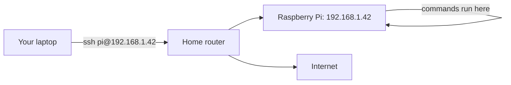

{:class="cover"}

---

By the end of this lesson you will be able to find your Pi's IP address, test whether it can reach the internet, and log in to it from another computer with SSH.

## A Pi you can reach from your sofa

A Pi that runs Docker usually lives on a shelf with no screen, so you manage it over the network. That needs three things: knowing where the Pi is (its **IP address**), knowing the network works, and a way to log in (**SSH**, the Secure Shell).



## Where am I on the network?

```bash
$ hostname -I
192.168.1.42
$ ip -brief address
lo               UNKNOWN        127.0.0.1/8 ::1/128
eth0             UP             192.168.1.42/24
wlan0            DOWN
```

`hostname -I` prints your Pi's address. `ip -brief address` (or `ip a` for the long version) lists each network interface: `lo` is the Pi talking to itself, `eth0` is the Ethernet socket and `wlan0` is Wi-Fi. `UP` with an address means it is connected. Your addresses will differ.

> The old `ifconfig` command does not come with current Raspberry Pi OS, and you will see it in many old tutorials. `ip` replaces it, so use `ip`. If you really want `ifconfig`, `sudo apt install net-tools` provides it.

Two more useful ones:

```bash
$ ip route
default via 192.168.1.1 dev eth0 proto dhcp src 192.168.1.42 metric 100
192.168.1.0/24 dev eth0 proto kernel scope link src 192.168.1.42
$ hostname
raspberrypi
```

The `default via 192.168.1.1` line is your **gateway**, the router that connects you to the internet.

## Is the network working?

`ping` sends a small message and waits for the reply. Always add `-c` and a number, or it runs forever:

```bash
$ ping -c 4 192.168.1.1
PING 192.168.1.1 (192.168.1.1) 56(84) bytes of data.
64 bytes from 192.168.1.1: icmp_seq=1 ttl=64 time=1.12 ms
64 bytes from 192.168.1.1: icmp_seq=2 ttl=64 time=0.98 ms
64 bytes from 192.168.1.1: icmp_seq=3 ttl=64 time=1.03 ms
64 bytes from 192.168.1.1: icmp_seq=4 ttl=64 time=0.95 ms

--- 192.168.1.1 ping statistics ---
4 packets transmitted, 4 received, 0% packet loss, time 3004ms
```

Ping in layers to find where a break is:

1. Ping your router, `192.168.1.1` (use your gateway from `ip route`). If this fails, the problem is the Pi's connection to your network.
2. Ping `8.8.8.8` (a public address). If this fails, the router has no internet.
3. Ping `google.com`. If 2 works but this fails, the problem is **DNS**, the system that turns names into numbers.

`traceroute` (install it with `sudo apt install traceroute`) shows each hop along the way, but you will rarely need it.

## Logging in with SSH

SSH needs to be turned on. In Raspberry Pi Imager you can enable it when writing the card, or on a running Pi:

```bash
$ sudo raspi-config
```

Choose **Interface Options**, then **SSH**, and answer yes. Or check the service you met in the last lesson:

```bash
$ systemctl is-active ssh
active
```

Now go to *another computer* (on Windows 10 and 11, macOS and Linux a terminal already has `ssh`) and connect with your username and the Pi's address:

```bash
$ ssh pi@192.168.1.42
The authenticity of host '192.168.1.42 (192.168.1.42)' can't be established.
ED25519 key fingerprint is SHA256:abc123...
Are you sure you want to continue connecting (yes/no/[fingerprint])? yes
pi@192.168.1.42's password:
(a welcome message and some licence text)
pi@raspberrypi:~ $
```

The first time, SSH asks you to trust the Pi's fingerprint. Type `yes` and it remembers. Your prompt now shows the Pi's name: every command you type runs on the Pi. Type `exit` (or `Ctrl + D`) to come back.

Many home networks let you use the name instead of the number: `ssh pi@raspberrypi.local`. This works through a service called Avahi, which was in our service list earlier.

> **Careful**: a Pi with SSH on and an easy password is a risk on any network that other people can reach. Use a strong password and, in the next lesson, SSH keys. Never forward port 22 from your router to the internet.

> **Teachers**: school and college networks often block SSH (port 22), block device-to-device traffic on Wi-Fi, and give each device a different address each lesson. Test that your learners' laptops can reach the Pis before the lesson. If they cannot, use a small unmanaged switch or a spare router and give each group a fixed list of addresses. Ping and `ip` work with no second computer at all, so learners can still do the first half alone.

Pi progress: you can find your Pi, test its network and log in from another computer.

## Try it Yourself

1. Run `hostname -I` and `ip route`, and find the Pi's address and its gateway.
2. Ping your gateway and `8.8.8.8` with `-c 3`, and note the typical `time=`.
3. SSH from another computer into your Pi, run `hostname`, then `exit`.
4. Challenge: use the three-layer ping test (router, then `8.8.8.8`, then a name) after unplugging Ethernet or turning off Wi-Fi, and note which step fails first.

## Common Issues

- **Problem**: `ssh: connect to host 192.168.1.42 port 22: Connection refused`.
- **Solution**: Turn SSH on with `sudo raspi-config` (Interface Options) or `sudo systemctl enable --now ssh` on the Pi.
- **Why**: The Pi is reachable but nothing is listening on port 22.

- **Problem**: `ssh: Could not resolve hostname raspberrypi.local`.
- **Solution**: Use the IP address instead, and check both computers are on the same network.
- **Why**: Name lookup with `.local` depends on your network and your computer supporting it.

- **Problem**: `Permission denied, please try again.`
- **Solution**: Check the username matches the one you created in Raspberry Pi Imager (`whoami` on the Pi), and retype the password.
- **Why**: Modern Raspberry Pi OS has no default `pi` user, so the name you chose is the one you need.

- **Problem**: `WARNING: REMOTE HOST IDENTIFICATION HAS CHANGED!`
- **Solution**: If you re-imaged the Pi yourself, remove the old entry with `ssh-keygen -R 192.168.1.42` and try again. If you did not change anything, stop and find out why.
- **Why**: A new install makes a new fingerprint. SSH warns you because a different machine at the same address could be an impostor.

## Check your understanding


? Which command prints your Pi's IP address?
- [ ] ping
- [x] hostname -I
- [ ] ssh
> `hostname -I` prints the addresses. `ip -brief address` shows them per interface.

? You can ping `8.8.8.8` but not `google.com`. What is the likely problem?
- [ ] The Pi has no power
- [ ] The router is broken
- [x] DNS, the name lookup
> The internet is working because the number answered. Turning names into numbers is DNS's job.

? Why add `-c 4` to ping on Linux?
- [x] It sends four pings and stops
- [ ] It colours the output
- [ ] It makes ping faster
> Without `-c`, Linux ping keeps going until you press `Ctrl + C`.

? What does SSH give you?
- [ ] A faster Wi-Fi connection
- [x] A secure remote command line on another computer
- [ ] A new IP address
> You type commands on one computer and they run on the other.

