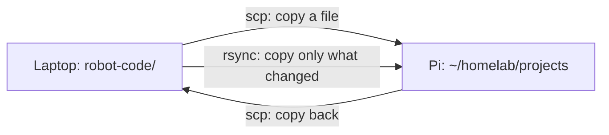

{:class="cover"}

---

By the end of this lesson you will be able to copy a file to and from your Pi with `scp`, synchronise a folder with `rsync`, and log in with an SSH key instead of a password.

## Moving files to a Pi with no screen

Once your Pi is on a shelf, you will want to send it files: a Docker project from your laptop, a config file, a photo from your robot's camera in the other direction. Both tools below work over SSH, so there is nothing extra to set up. Your Pi just needs to be reachable, as we did in the last lesson.



## `scp`: a quick copy

`scp` works like `cp`, except that a remote location looks like `user@host:path`. Run these on **your laptop**, not on the Pi, and swap in your username and the Pi's address:

```bash
$ scp notes.txt pi@192.168.1.42:/home/pi/homelab/
pi@192.168.1.42's password:
notes.txt                                     100%   62     0.1MB/s   00:00
```

Go the other way by swapping the two ends. This copies a file from the Pi to the folder you are in (the dot means "here"):

```bash
$ scp pi@192.168.1.42:/home/pi/homelab/notes.txt .
```

Add `-r` to copy a whole folder: `scp -r robot-code pi@192.168.1.42:/home/pi/homelab/projects/`.

> **Careful**: if the file already exists at the destination, `scp` overwrites it without asking. Check where you are sending to, and if in doubt, copy to a new name first.

## `rsync`: copy only what changed

`scp` copies everything every time. `rsync` compares the two sides and sends only the differences, which is much faster for a large project you update often. It also keeps file dates and permissions with `-a`.

```bash
$ rsync -avh robot-code/ pi@192.168.1.42:/home/pi/homelab/projects/robot-code/
sending incremental file list
./
main.py
config.yaml

sent 1.52K bytes  received 54 bytes  449.14 bytes/sec
total size is 1.34K  speedup is 0.85
```

The flags: `-a` archive (keep permissions and dates, copy folders), `-v` verbose (list the files), `-h` human readable numbers.

**Watch the trailing slash.** `robot-code/` means "the contents of the folder", and `robot-code` means "the folder itself". With the slash, the files land directly in the destination. Without it you get `robot-code/robot-code`. This catches everybody once.

If you do not have `rsync` on the Pi (or the other computer), install it with `sudo apt install rsync`.

### Do a dry run first

Add `-n` (`--dry-run`) to see what `rsync` *would* do, without doing it:

```bash
$ rsync -avhn robot-code/ pi@192.168.1.42:/home/pi/homelab/projects/robot-code/
sending incremental file list
main.py

sent 94 bytes  received 19 bytes  75.33 bytes/sec
total size is 1.34K  speedup is 11.86 (DRY RUN)
```

> **Careful**: the `--delete` option makes the destination an exact mirror by **deleting** files that are not in the source. Used on the wrong folder, it can wipe your backup. Always run it with `-n` first, and never point it at a folder you have not checked.

## SSH keys: no more passwords

Typing a password for each copy gets old quickly, and passwords can be guessed. An **SSH key** is a pair of files: a private key that stays on your laptop and a public key that you give to the Pi. Only a laptop holding the private key can log in.

Run these on **your laptop**:

```bash
$ ssh-keygen -t ed25519
Generating public/private ed25519 key pair.
Enter file in which to save the key (/home/you/.ssh/id_ed25519):
Enter passphrase (empty for no passphrase):
Your identification has been saved in /home/you/.ssh/id_ed25519
Your public key has been saved in /home/you/.ssh/id_ed25519.pub
$ ssh-copy-id pi@192.168.1.42
```

`ssh-copy-id` asks for your password once and installs the public key. From now on `ssh pi@192.168.1.42` logs in straight away, and so do `scp` and `rsync`. Use a passphrase if the laptop is shared. (On Windows, `ssh-keygen` is built in, but `ssh-copy-id` is not. Paste the contents of `id_ed25519.pub` into `~/.ssh/authorized_keys` on the Pi instead.)

> **Careful**: never share, copy or email the private key (`id_ed25519`, without `.pub`). Only the `.pub` file is safe to hand out.

Pi progress: you can reach the Pi, send it files, and log in securely. The Pi side of the checklist is done, and all that is left is automating our checks.

## Try it Yourself

1. From your laptop, create `hello.txt`, copy it to your Pi's `~/homelab/` with `scp`, then check with `ls` over SSH.
2. Copy `~/homelab/notes.txt` from the Pi back to your laptop.
3. Make a folder with two files, run `rsync -avhn` on it (a dry run), then run it for real and run it again to see that nothing is sent the second time.
4. Challenge: set up an SSH key, then run `ssh pi@... hostname` and confirm it needs no password.

## Common Issues

- **Problem**: `scp: /home/pi/homelab/: No such file or directory`, or the file landed in the wrong place.
- **Solution**: Check the destination path with `ssh pi@... ls ~/homelab`. Remember the colon after the host.
- **Why**: `user@host:path` is read as "this path on that machine", and a wrong path is just a wrong path.

- **Problem**: `rsync: command not found`.
- **Solution**: Install it on both machines (`sudo apt install rsync`).
- **Why**: `rsync` needs a copy at each end to compare the files.

- **Problem**: SSH still asks for a password after `ssh-copy-id`.
- **Solution**: On the Pi, check that `~/.ssh` is `700` and `~/.ssh/authorized_keys` is `600` using `ls -ld ~/.ssh` and `ls -l ~/.ssh`.
- **Why**: SSH ignores key files that other users could read or change.

## Check your understanding


? What does the trailing slash in `rsync -a robot-code/ dest/` mean?
- [ ] The folder is deleted afterwards
- [x] Copy the contents of the folder, not the folder itself
- [ ] Copy hidden files too
> With a slash, the files go straight into the destination. Without it you get a nested folder.

? Which option shows what rsync would do without changing anything?
- [ ] -v
- [x] -n (--dry-run)
- [ ] -h
> `-n` is a rehearsal, and it is the right way to check a `--delete` run.

? Which file must you never share?
- [ ] id_ed25519.pub
- [x] id_ed25519
- [ ] known_hosts
> The private key proves who you are, and the `.pub` file is the one you give out.

? Why is rsync better than scp for a project you update often?
- [x] It sends only what has changed
- [ ] It does not need SSH
- [ ] It is encrypted and scp is not
> Both use SSH. `rsync` skips files that are already the same.

