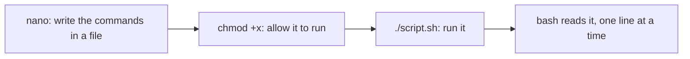

{:class="cover"}

---

By the end of this lesson you will be able to write a short bash script with `nano`, make it executable, and run it.

## Typing once, running forever

Everything we have typed so far runs once and is forgotten. A **shell script** is those same commands saved in a text file, so you can run them again with one word. It is how you turn "the five commands I run every Sunday" into a single command, and it is how people set up Pis again and again without remembering the steps.

Our scripts live in `~/homelab/scripts`, where we made a home for them earlier.



## Your first script

Open a new file with `nano`:

```bash
$ cd ~/homelab/scripts
$ nano hello.sh
```

Type this, then save with `Ctrl + O`, `Enter`, and quit with `Ctrl + X`:

```bash
#!/bin/bash
# hello.sh - greet the Pi's owner
echo "Hello from $(hostname)!"
echo "Today is $(date '+%A %d %B')"
echo "You are logged in as $(whoami)"
```

What is going on in each line:

- `#!/bin/bash` is the **shebang**. It must be the very first line and tells the system which program should run the file, here `bash`.
- A line starting with `#` is a **comment**. The shell ignores it, so it is a note for humans.
- `$(...)` runs a command and puts its output in place. So `$(hostname)` becomes `raspberrypi`.

## Running it

If you try right now, it will not work, just as we saw in the permissions lesson:

```bash
$ ./hello.sh
bash: ./hello.sh: Permission denied
$ chmod +x hello.sh
$ ./hello.sh
Hello from raspberrypi!
Today is Tuesday 24 November
You are logged in as pi
```

`chmod +x` gives the file the execute permission. The `./` means "the file in this folder". Without it, the shell only looks in the system program folders and says `command not found`.

You can also hand any script to bash directly, with no `chmod` needed, which is handy for a quick test:

```bash
$ bash hello.sh
```

## Writing output to a file

Scripts get more useful when they keep a record. Remember `>` and `>>` from the files lesson:

```bash
#!/bin/bash
# note.sh - add a timestamped line to the notes file
echo "$(date '+%Y-%m-%d %H:%M') $1" >> "$HOME/homelab/notes.txt"
echo "Saved your note."
```

`$1` is the first thing you type after the script's name:

```bash
$ chmod +x note.sh
$ ./note.sh "Installed tree and htop"
Saved your note.
$ tail -n 1 ~/homelab/notes.txt
2026-11-24 10:42 Installed tree and htop
```

`$HOME` is a built-in variable holding your home folder, which is more reliable than typing the path.

## About editors

`nano` is the friendliest editor and the one used in this course. If you like `vim`, it is not included in the default Pi OS image, so install it with `sudo apt install vim`. In vim, press `i` to type, `Esc` to stop, then `:wq` and `Enter` to save and quit. It has a steeper learning curve, but many people love it.

> **Careful**: a script does exactly what it says, with your permissions. Do not run scripts from the internet without reading them first, and be extra wary of any that need `sudo`. When you test your own, begin with harmless commands such as `echo`.

Pi progress: you have your first two scripts in `~/homelab/scripts`. Next we give them a brain, with variables, decisions and loops.

## Try it Yourself

1. Add a fourth line to `hello.sh` that prints the Pi's IP address using `$(hostname -I)`.
2. Write `uptime.sh` that prints `Up for:` followed by the output of `uptime -p`, make it executable and run it.
3. Change `note.sh` so it also prints how many lines are now in the notes file (hint: `wc -l`).
4. Challenge: write a script that creates a folder called `projects/` followed by today's date in `YYYY-MM-DD` form, with `mkdir -p`.

## Common Issues

- **Problem**: `bash: ./hello.sh: Permission denied`.
- **Solution**: Run `chmod +x hello.sh`.
- **Why**: The file has no execute permission yet.

- **Problem**: `bash: hello.sh: command not found`.
- **Solution**: Run it as `./hello.sh`, or give the full path.
- **Why**: The current folder is not on the shell's search path, so you must say where the script is.

- **Problem**: `bad interpreter: No such file or directory`, or odd `^M` characters.
- **Solution**: The file has Windows line endings. Run `sed -i 's/\r$//' hello.sh` to fix it.
- **Why**: A script written on Windows ends lines with an extra invisible character that confuses the shebang line.

## Check your understanding


? What does `#!/bin/bash` on the first line do?
- [ ] It is a comment that does nothing
- [x] It tells the system to run the file with bash
- [ ] It makes the file executable
> The shebang names the program that runs the script. `chmod +x` is a separate step.

? Why does `./hello.sh` say `Permission denied` straight after creating the file?
- [ ] The file is empty
- [x] It does not have the execute permission yet
- [ ] bash is not installed
> New files are not executable by default, so add it with `chmod +x`.

? What does `$(hostname)` do inside an echo?
- [ ] Prints the text $(hostname)
- [x] Runs the command and puts its output in place
- [ ] Creates a variable
> `$(...)` is command substitution, so it gets replaced by the output.

? What is `$1` in a script?
- [x] The first argument typed after the script name
- [ ] The first line of the script
- [ ] The number of arguments
> `./note.sh "text"` makes `$1` equal to `text`.

