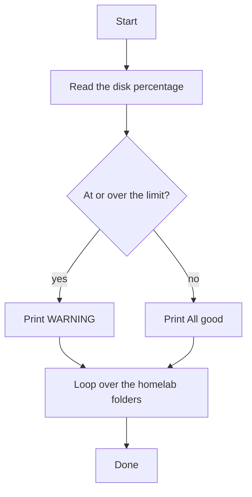

{:class="cover"}

---

By the end of this lesson you will be able to use variables, an `if` test, and `for` and `while` loops in a bash script, and build a script that warns you when the disk is nearly full.

## Scripts that make decisions

A script that only runs the same lines in order is handy, but the real power comes when it can decide: "if the disk is nearly full, shout", or repeat: "do this for each project folder". Every programming language has these ideas, so what you learn here carries over to Python and beyond.



## Variables

A **variable** is a name that holds a value. Set it with no spaces around `=`, and read it with a `$`:

```bash
#!/bin/bash
robot="SMARS"
echo "Building $robot on $(hostname)"
```

```bash
$ ./robot.sh
Building SMARS on raspberrypi
```

> **Careful**: `robot = "SMARS"` (with spaces) is the most common beginner error. The shell thinks `robot` is a command. Write `robot="SMARS"` with no spaces.

Always put quotes around variables that hold text, like `"$robot"`. It keeps names with spaces together.

**Arguments** are variables too: `$1` is the first word after the script name, `$2` the second. `${1:-80}` means "use `$1`, or 80 if nothing was given", a handy way to set a default.

## Decisions with `if`

`if` runs a test in square brackets. **The spaces inside the brackets matter.**

```bash
if [ -d "$HOME/homelab" ]; then
    echo "homelab exists"
else
    echo "homelab is missing"
fi
```

Common tests:

| Test | True when |
|---|---|
| `[ -f file ]` | `file` exists and is a regular file |
| `[ -d folder ]` | `folder` exists |
| `[ "$a" = "$b" ]` | the two texts are equal |
| `[ "$n" -gt 5 ]` | the number is greater than 5 (`-lt` less, `-ge` at least, `-le` at most, `-eq` equal) |
{:class="table table-single"}

## Loops

A `for` loop repeats once for each item in a list:

```bash
for folder in projects backups scripts; do
    echo "Checking $folder"
done
```

A `while` loop repeats as long as its test is true. This one counts down, using `$(( ))` for sums:

```bash
count=3
while [ "$count" -gt 0 ]; do
    echo "Cooling off... $count"
    count=$((count - 1))
done
```

> **Careful**: a `while` loop whose test never becomes false runs forever and may use up the Pi's CPU. If a script seems stuck, press `Ctrl + C`.

## Putting it together: `diskcheck.sh`

Save this as `~/homelab/scripts/diskcheck.sh`:

```bash
#!/bin/bash
# diskcheck.sh - warn when the main disk is getting full
# Usage: ./diskcheck.sh [limit-percent]

LIMIT=${1:-80}
USED=$(df --output=pcent / | tail -n 1 | tr -dc '0-9')

echo "The main disk is ${USED}% full (limit ${LIMIT}%)"

if [ "$USED" -ge "$LIMIT" ]; then
    echo "WARNING: time to clean up!"
else
    echo "All good."
fi

# Check that our homelab folders exist
for folder in projects backups scripts; do
    if [ -d "$HOME/homelab/$folder" ]; then
        echo "Found $folder"
    else
        echo "Missing $folder"
    fi
done

# Count down from 3
count=3
while [ "$count" -gt 0 ]; do
    echo "Cooling off... $count"
    count=$((count - 1))
done
echo "Done."
```

Make it executable and run it, once normally and once with a very low limit to see the warning:

```bash
$ chmod +x diskcheck.sh
$ ./diskcheck.sh
The main disk is 19% full (limit 80%)
All good.
Found projects
Found backups
Found scripts
Cooling off... 3
Cooling off... 2
Cooling off... 1
Done.
$ ./diskcheck.sh 10 | head -2
The main disk is 19% full (limit 10%)
WARNING: time to clean up!
```

How the pieces work: `df --output=pcent /` prints the used percentage of the main disk with a header line, `tail -n 1` keeps only the last line, and `tr -dc '0-9'` deletes everything that is not a digit, leaving just the number. This is a pipeline (the pipes from the process lesson) feeding a variable.

Pi progress: you can write scripts with decisions and loops, and you have a disk checker. In the final project we combine everything into `pi-checkup.sh`.

## Try it Yourself

1. Change the loop so it also checks for a folder called `notes`, and run it to see `Missing notes`.
2. Make the script print `Plenty of room` if usage is under 50%, using an `elif` branch between `if` and `else`.
3. Write a `for` loop that prints the size of each folder in `~/homelab` with `du -sh`.
4. Challenge: make the warning also print how many gigabytes are free, using `df -h --output=avail /`.

## Common Issues

- **Problem**: `[: missing ']'` or `unary operator expected`.
- **Solution**: Put spaces inside the brackets (`[ "$a" = "b" ]`) and quote your variables.
- **Why**: `[` is really a command, and its arguments (including the closing `]`) must be separate words.

- **Problem**: `integer expression expected`.
- **Solution**: Use `-gt`, `-lt`, `-ge` for numbers, and make sure the variable only holds digits.
- **Why**: `-ge` compares numbers, so a value like `19%` is not a number.

- **Problem**: `syntax error near unexpected token 'done'` or `'fi'`.
- **Solution**: Check every `if` ends with `fi`, every loop with `done`, and every `then` or `do` is in place.
- **Why**: Bash reads blocks by their opening and closing words, so one missing word breaks the lot.

## Check your understanding


? Which is the correct way to set a variable in bash?
- [ ] name = "Pi"
- [x] name="Pi"
- [ ] $name="Pi"
> No spaces around `=`, and no `$` when setting it.

? What does `${1:-80}` give you?
- [ ] The first argument, or an error
- [x] The first argument, or 80 if none was given
- [ ] Always 80
> The `:-` part supplies a default value.

? Which test checks that a folder exists?
- [ ] [ -f folder ]
- [x] [ -d folder ]
- [ ] [ -x folder ]
> `-d` is for directories and `-f` is for files.

? What happens if a while loop's test never becomes false?
- [ ] bash stops it after ten loops
- [x] It runs forever until you press Ctrl + C
- [ ] It deletes the script
> Nothing stops it automatically, so be sure something changes inside the loop.

