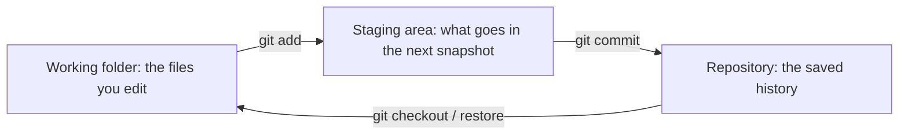

{:class="cover"}

---

By the end of this lesson you will be able to explain what Git is for, install it on your Pi, and set up your name and email so it can label your work.

## An undo button for your scripts

Have you ever edited a script, broken it, and wished you could go back to yesterday's version? **Git** is a tool that remembers every saved version of your files, who changed them and why. It is the same tool used by millions of programmers, and it is how most Docker projects, robot code and websites (including this one) are shared.

You do not need an account anywhere to use Git. It works entirely on your Pi, and later you can put a copy on a site such as GitHub if you want to share it. For our Docker-ready Pi, it means that the scripts and settings in `~/homelab` can be tracked and rolled back, so you can experiment without fear.



Git has three places, shown above. You edit files in the working folder, choose which changes to include with `git add`, and save a labelled snapshot (a **commit**) with `git commit`. The next lesson practises these.

## Installing Git

Check whether you already have it:

```bash
$ git --version
git version 2.x.x
```

If it says `command not found`, install it with the package manager from lesson 6:

```bash
$ sudo apt update
$ sudo apt install git
```

Run `git --version` again to confirm. The exact number does not matter.

## Telling Git who you are

Every commit is labelled with a name and an email. Set them once for your user:

```bash
$ git config --global user.name "Your Name"
$ git config --global user.email "you@example.com"
$ git config --global init.defaultBranch main
```

The third line makes new repositories start on a branch called `main`, which avoids a hint message you would otherwise see. Check what you saved:

```bash
$ git config --global --list
user.name=Your Name
user.email=you@example.com
init.defaultBranch=main
```

This is stored in a file called `~/.gitconfig`. You can read it with `cat ~/.gitconfig`.

> **Careful**: your commit email can become public if you push your work to a website. If that worries you, use an address your Git hosting site gives you for this, such as GitHub's `noreply` address, or any made-up address, since Git does not check it.

> **Teachers**: do not ask pupils to use personal email addresses for Git. Git does not verify the address, so a class code or a made-up address like `student1@example.com` works fine for local use. Only create accounts on sites such as GitHub with your school's agreement, and check their minimum age rules before anyone signs up. Everything in this course works with no account at all.

Pi progress: Git is installed and knows who you are. Next we put `~/homelab/scripts` under version control.

## Try it Yourself

1. Run `git --version`, and if needed install Git with `apt`.
2. Set your name and email, then use `git config --global user.name` to read the name back.
3. Open `~/.gitconfig` with `cat` and find the three lines you set.
4. Challenge: run `git help commit` (it uses the manual page viewer) and find what `-m` does.

## Common Issues

- **Problem**: `git: command not found`.
- **Solution**: Run `sudo apt install git`.
- **Why**: Git is not part of every Raspberry Pi OS image.

- **Problem**: Later, Git says `Please tell me who you are`.
- **Solution**: Run the two `git config --global` commands for name and email.
- **Why**: Git refuses to make a commit with no author information.

- **Problem**: I put the wrong name or email in.
- **Solution**: Run the same `git config --global` command again with the correct value.
- **Why**: Setting a value again simply overwrites the old one.

## Check your understanding


? What does Git do?
- [ ] Speeds up the Pi
- [x] Remembers every saved version of your files
- [ ] Backs up the SD card automatically
> Git records snapshots of your files, so you can see and restore older versions.

? What is a commit?
- [x] A saved, labelled snapshot of your changes
- [ ] A file permission
- [ ] A kind of branch
> Each commit is a point in history you can return to.

? Which command installs Git on Raspberry Pi OS?
- [ ] git install
- [x] sudo apt install git
- [ ] sudo systemctl enable git
> Git is a normal package, so `apt` installs it.

? Do you need an online account to use Git on your Pi?
- [ ] Yes, you must sign up first
- [x] No, it works locally
- [ ] Only for commits
> An account is only needed if you want to share your work on a hosting site.

