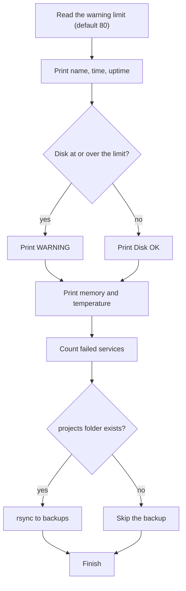

{:class="cover"}

---

By the end of this lesson you will be able to break a job down into small steps, match each step to a command you already know, and plan a script before you write it.

## The finish line

We have a tidy Pi: folders, permissions, software, services and SSH. The last job is to make the Pi look after itself. We will build a single command, `pi-checkup.sh`, that you can run (or schedule) to answer "is my Pi healthy and is my work safe?" before you start installing Docker containers on it.

It will:

1. Print the Pi's name, the time and how long it has been running.
2. Warn if the main disk is nearly full.
3. Show memory use and, on a Pi, the CPU temperature.
4. Report any services that have failed.
5. Back up `~/homelab/projects` into `~/homelab/backups`.

## Plan before you type

Experienced programmers plan on paper first. Write down the answers to these questions in `~/homelab/notes.txt` (with `nano`, or by appending with `echo >>`):

1. **What is the purpose of the tool?** A quick health report plus a backup.
2. **Which commands will it use?** We already know most of them (see below).
3. **Will it need input?** One optional input: the warning percentage, as an argument.
4. **How will we test it?** Run it normally, then run it with a tiny limit to force the warning, then with a missing folder.

## Match each step to a command

You have met every tool we need. The plan is simply the course in a list:

| Step | Command | Where we learned it |
|---|---|---|
| Name, time, uptime | `hostname`, `date`, `uptime -p` | Files, monitoring |
| Disk percentage | `df`, `tail`, `tr` | Monitoring, pipes |
| Warn if too full | `if` and `[ -ge ]` | Scripting constructs |
| Memory | `free -h`, `awk` | Monitoring |
| Temperature | `vcgencmd measure_temp` | Monitoring |
| Failed services | `systemctl --failed` | Services |
| Back up projects | `rsync -a` | Transferring files |
| Keep a history | `git commit` | Git |
{:class="table table-single"}

## The shape of the script

Notice how each box is something a few lines long. Big scripts are just lots of small, testable pieces. A good habit is to write one piece, run it, and only then move on to the next.

## Design choices worth thinking about

- **Is it safe to run again?** Our backup uses `rsync -a`, so running it twice just updates the copy. A script you run on a schedule must be safe to repeat.
- **Does it avoid deleting?** We deliberately do not use `rsync --delete` or `rm`. A health check script should never destroy anything.
- **Does it need `sudo`?** No. Everything we read is available to a normal user, which is safer. Avoid `sudo` inside scripts unless you really need it.
- **Does it work off a Pi?** `vcgencmd` only exists on a Pi, so the script checks it is there first and quietly skips it if not.

## Try it Yourself

1. Write your plan for the script in `~/homelab/notes.txt` using the four questions above.
2. Add one extra check of your own to the list of steps, for example "warn if the CPU is hotter than 70 degrees", and work out which commands you would use.
3. Sketch the flow of your own version of the script as a list of boxes, then count the decisions in it.
4. Challenge: decide how the script could tell you about problems when you are not watching. (Hint: the next lesson saves its report to a log file that you read later with `tail`.)

## Common Issues

- **Problem**: I do not know where to start.
- **Solution**: Write the first three steps only (name, time, uptime), run them, and add the next one each time.
- **Why**: Small working steps are easier to fix than one large untested script.

- **Problem**: My plan keeps growing.
- **Solution**: Keep a separate "later" list in your notes and finish the five steps above first.
- **Why**: A finished simple script beats an unfinished clever one.

## Check your understanding


? Why should a script that runs on a schedule be safe to run twice?
- [x] It may run more than once, and the result should not break
- [ ] It saves disk space
- [ ] Cron requires it
> Scheduled scripts run again and again, so they must not pile up damage or duplicates. `rsync -a` just updates the copy.

? Why does our script check `command -v vcgencmd` before using it?
- [ ] To install it
- [x] Only a Raspberry Pi has it, so it skips the step elsewhere
- [ ] To speed up the script
> The check lets the same script run on a laptop or a Pi without an error.

? Which of these should our health-check script avoid?
- [ ] df
- [x] rsync --delete on the wrong folder
- [ ] free
> A health check should only read and copy. Deleting is the risky part.

? What is the best way to build a larger script?
- [ ] Write it all, then run it once
- [x] Write one piece, run it, then add the next
- [ ] Copy one from the internet without reading it
> Small tested steps are much easier to debug.

