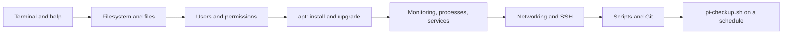

{:class="cover"}

---

By the end of this lesson you will be able to check that your Pi is ready for Docker, name the skills you now have, and choose what to learn next.

## What you built

You started with a Raspberry Pi and a blinking cursor. You now have a tidy, current, monitored Pi that you can run from another computer. Here is the journey:

## Is your Pi ready for Docker?

Run through this checklist. Each item names the lesson it came from:

| Check | Command | Lesson |
|---|---|---|
| Software is up to date | `sudo apt update && sudo apt upgrade` | Managing software |
| Plenty of disk space | `df -h /` shows under 80% | Monitoring |
| Enough memory | `free -h` shows a good `available` figure | Monitoring |
| No failed services | `systemctl --failed` | Services |
| You can log in over SSH | `ssh YOURNAME@PI-ADDRESS` | Networking |
| You know your groups | `id` | Users |
| A place for projects | `ls ~/homelab/projects` | Directories |
| A backup and a check | `~/homelab/scripts/pi-checkup.sh` | Final project |
{:class="table table-single"}

If all of those pass, your Pi is ready. Docker will add one more service (`docker`) and one more group (`docker`), and you already know how to handle both.

## Where to go next

- **[Docker](/learn/docker/)**: the natural next step. Run containers on the Pi you just prepared, using exactly the commands in this course.
- **[Podman](/learn/podman/)**: another way to run containers, without a background service.
- **[Docker Swarm](/learn/docker_swarm/)** and **[K3s](/learn/k3s/)**: link several Pis together into a cluster, perfect in a [mini rack](/learn/mini_rack/).
- **[OpenClaw on Raspberry Pi](/learn/openclaw_raspberry_pi/)**: an always-on AI assistant, built using the skills from this course.
- **[Git](/learn/git/)**: go deeper into branches and collaboration.
- **[Python](/learn/python/)**: automate bigger jobs than a shell script is good at.

## Resources

- **Raspberry Pi documentation**: the official guides at [raspberrypi.com/documentation](https://www.raspberrypi.com/documentation/) cover `raspi-config`, boot settings and the hardware.
- **The Linux Command Line** by William Shotts: a thorough book, and the author offers a free version at [linuxcommand.org](https://linuxcommand.org).
- **Manual pages**: you already have the best reference. `man` and `--help` are always one command away.
- **Communities**: the Raspberry Pi forums, Stack Overflow, and the r/linux and r/raspberry_pi communities on Reddit are friendly places to ask questions. Say what you tried, and paste the exact error message.

For a quick reference of the commands in this course, see the cheatsheet in the next lesson.

## Try it Yourself

1. Work through the Docker-ready checklist above on your own Pi, and note any item that does not pass.
2. Run `~/homelab/scripts/pi-checkup.sh`, then run `git log --oneline` inside `~/homelab/scripts` to confirm it is saved in your history.
3. Pick one of the next courses, and write down in `~/homelab/notes.txt` what you hope to build.
4. Challenge: teach one command from this course to a friend, without looking at the lesson.

## Common Issues

- **Problem**: One item on the checklist fails.
- **Solution**: Go back to the lesson named in the table and repeat the steps. Use `man` or `--help` for the command.
- **Why**: Each item maps to one lesson, so you know exactly where to look.

- **Problem**: I forgot a command.
- **Solution**: Check the cheatsheet, then `man` or `--help`, and `history | grep word` to find a command you used before.
- **Why**: Nobody remembers everything. Finding it quickly is the skill.

## Check your understanding


? Which command shows services that have crashed?
- [ ] ps aux
- [x] systemctl --failed
- [ ] df -h
> It lists failed units, and is part of our checkup script.

? Why do we keep projects in `~/homelab/projects`?
- [ ] Docker requires that folder
- [x] A tidy structure is easy to back up and manage
- [ ] It is the only writable folder
> Docker does not need that exact path, but one tidy place makes projects and backups easy to find.

? What is the best first thing to do when you forget a command?
- [ ] Reinstall the Pi
- [x] Try `man` or `--help`, or search your history
- [ ] Run it with sudo
> The help is on your Pi, even with no internet.

