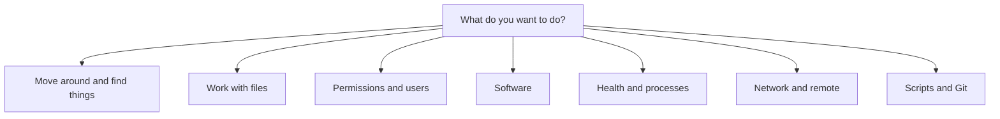

{:class="cover"}

---

By the end of this lesson you will be able to find the right command for a job quickly, and know which ones need extra care.

## How to use this page

Keep this open next to your terminal. The commands are grouped by what you want to do, and anything that can destroy data or change the system is marked **Careful**. Swap `pi` for your own username, and for each command, remember that `man command` and `command --help` tell you more.

## Moving around and getting help

| Command | What it does | Example |
|---|---|---|
| `pwd` | Show the folder you are in | `pwd` |
| `ls` | List files. `-l` long, `-a` hidden, `-h` readable sizes | `ls -lah` |
| `cd` | Change folder. `cd` alone or `cd ~` goes home | `cd ~/homelab` |
| `man` | Open the manual page | `man ls` |
| `--help` | Short usage summary | `mkdir --help` |
| `history` | List past commands | `history` |
| `clear` | Tidy the screen | `clear` |
{:class="table table-single"}

## Files and folders

| Command | What it does | Example |
|---|---|---|
| `touch` | Create an empty file, or update its date | `touch notes.txt` |
| `mkdir -p` | Make a folder, and any parents | `mkdir -p ~/homelab/projects` |
| `cp`, `cp -r` | Copy a file, or a folder | `cp -r projects backups/` |
| `mv` | Move or rename | `mv old.txt new.txt` |
| `cat`, `less` | Show a file, or page through it | `less /etc/passwd` |
| `head`, `tail` | First or last lines. `tail -f` follows a log | `tail -n 20 file.txt` |
| `nano` | Edit a file. `Ctrl + O` saves, `Ctrl + X` exits | `nano hello.sh` |
| `grep` | Find lines containing text | `grep "error" file.txt` |
| `find` | Search for files by name | `find ~ -name "*.txt"` |
| `rmdir` | Remove an empty folder (safe) | `rmdir scratch` |
| `rm -ri` | Delete files and folders, asking each time | `rm -ri old-stuff` |
{:class="table table-single"}

> **Careful**: `rm`, and especially `rm -rf`, cannot be undone, and with `sudo` it can wipe a system. List a path with `ls` before deleting it, and use `-i`.

## Permissions and users

| Command | What it does | Example |
|---|---|---|
| `id`, `groups` | Show your user and groups | `id` |
| `chmod +x` | Make a script executable | `chmod +x script.sh` |
| `chmod 600` | Owner only, for secrets | `chmod 600 secrets.env` |
| `chmod 755` | Owner everything, others read and run | `chmod 755 script.sh` |
| `chown` | Change owner and group | `sudo chown pi:pi file.txt` |
| `sudo` | Run one command as administrator | `sudo apt update` |
| `adduser`, `deluser` | Add or remove a user | `sudo adduser student` |
| `usermod -aG` | Add a user to a group | `sudo usermod -aG docker pi` |
| `passwd` | Change a password | `passwd` |
{:class="table table-single"}

## Software

| Command | What it does | Example |
|---|---|---|
| `apt update` | Refresh the package list | `sudo apt update` |
| `apt upgrade` | Install newer versions | `sudo apt upgrade` |
| `apt install` | Install a package | `sudo apt install tree` |
| `apt search`, `apt show` | Find, and read about, a package | `apt search htop` |
| `apt remove`, `apt purge` | Remove a package, or the package and its settings | `sudo apt purge cowsay` |
| `apt autoremove` | Clear out unused dependencies | `sudo apt autoremove` |
{:class="table table-single"}

## Health, processes and services

| Command | What it does | Example |
|---|---|---|
| `df -h` | Disk space | `df -h /` |
| `du -sh` | Size of a folder | `du -sh ~/homelab` |
| `free -h` | Memory | `free -h` |
| `top`, `htop` | Live view of what is busy | `htop` |
| `vcgencmd measure_temp` | Pi CPU temperature | `vcgencmd measure_temp` |
| `ps aux` | List every process (`pgrep -a name` finds one) | `ps aux` |
| `kill`, `killall` | Stop a process by number, or by name | `kill 1234` |
| `systemctl status` | Is a service healthy | `systemctl status ssh` |
| `systemctl start`, `stop`, `restart` | Control a service | `sudo systemctl restart cron` |
| `systemctl enable --now` | Start now and at every boot | `sudo systemctl enable --now docker` |
| `journalctl -u` | A service's log | `journalctl -u cron -n 20` |
{:class="table table-single"}

## Network and remote

| Command | What it does | Example |
|---|---|---|
| `hostname -I` | Your Pi's IP address | `hostname -I` |
| `ip -brief address` | Each interface and its address (replaces `ifconfig`) | `ip -brief address` |
| `ping -c 4` | Test a connection | `ping -c 4 8.8.8.8` |
| `ssh` | Log in to another computer | `ssh pi@192.168.1.42` |
| `ssh-keygen`, `ssh-copy-id` | Make and install an SSH key | `ssh-copy-id pi@192.168.1.42` |
| `scp` | Copy a file over SSH | `scp file.txt pi@192.168.1.42:~/` |
| `rsync -avhn` | Dry run of a folder sync (drop `n` to do it) | `rsync -avhn src/ pi@host:dst/` |
{:class="table table-single"}

## Scripts, scheduling and Git

| Command | What it does | Example |
|---|---|---|
| `#!/bin/bash` | First line of a bash script | `#!/bin/bash` |
| `./script.sh` | Run a script in this folder | `./pi-checkup.sh` |
| `crontab -e`, `crontab -l` | Edit or show your schedule | `crontab -l` |
| `git init`, `status` | Start tracking, and see what changed | `git status` |
| `git add`, `git commit -m` | Stage, then save a snapshot | `git commit -m "Add script"` |
| `git log --oneline` | Show the history | `git log --oneline` |
| `git clone` | Copy a repository | `git clone URL` |
{:class="table table-single"}

## What's next

Your Pi is tidy and ready. Head to the **[Docker course](/learn/docker/)** to start running containers on it, or see the full list on the previous page.

## Try it Yourself

1. Choose five commands from the tables that you have never used on your own, and run each with `--help`.
2. Without looking, write out the commands to create a folder, put a script in it, make it executable and run it.
3. Find which command is the answer to each: "how full is my disk?", "what is my IP address?", "is cron running?".
4. Challenge: make your own one-page cheatsheet in `~/homelab/cheatsheet.txt` with the ten commands you use most.

## Common Issues

- **Problem**: A command from the cheatsheet says `command not found`.
- **Solution**: Check the spelling, then see if it needs installing, for example `sudo apt install tree htop rsync`.
- **Why**: Some tools are not in every Raspberry Pi OS image.

- **Problem**: `ifconfig` or `traceroute` is missing, and a tutorial uses it.
- **Solution**: Use `ip -brief address`, or install them with `sudo apt install net-tools traceroute`.
- **Why**: Newer Raspberry Pi OS releases no longer include the old networking tools.

## Check your understanding


? Which command shows how full the SD card is?
- [x] df -h
- [ ] free -h
- [ ] ps aux
> `df` reports disk space and `free` reports memory.

? Which is the safe way to delete a folder you have just listed?
- [ ] sudo rm -rf folder
- [x] rm -ri folder
- [ ] mv folder /dev/null
> `-i` asks before each removal, so a mistake gets caught.

? Which command starts a service now and at every boot?
- [ ] sudo systemctl start name
- [x] sudo systemctl enable --now name
- [ ] sudo systemctl status name
> `enable` sets up the boot start and `--now` also starts it straight away.

