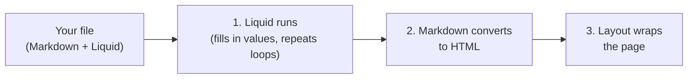

{:class="cover"}

By the end of this lesson you will be able to use Liquid to print site data, loop over your posts to build a "latest entries" list, and show a friendly message when there is nothing to list.

## Static, but not stuck

A Jekyll site is static once it is built, but while Jekyll is building it can think. **Liquid** is the small template language Jekyll uses to do that. Liquid runs first, filling in values and repeating blocks. Then your Markdown is converted to HTML. That order explains a lot of odd behaviour, including why showing Liquid as an example needs special handling, as you will see below.



## The three building blocks

| Kind | Looks like | Job |
| --- | --- | --- |
| Object | Two curly braces around a name | Prints a value |
| Tag | A curly brace and a percent sign | Logic, such as `if` and `for` |
| Filter | A pipe character after a value | Changes a value before it is printed |
{:class="table table-single"}

### Objects

Objects print data. `site` holds what is in `_config.yml` plus things Jekyll works out, such as `site.posts`. `page` holds the current page's front matter. Here is a header that uses both:


```liquid
<h1>{{ page.title }}</h1>
<p>Welcome to {{ site.title }}</p>
```


If `page.title` is "About my robot" and `site.title` is "Robot Log", the output is a heading reading "About my robot" and a paragraph saying "Welcome to Robot Log". Add your own variables to front matter (such as `robot: Wall-E Mk2`) and print them with `page.robot`.

### Tags: if and for

Use `if` to choose what to show:


```liquid

  <p>This entry is about {{ page.robot }}.</p>

  <p>This entry is about a robot we have not named yet.</p>

```


Use `for` to repeat something for every item. Here is a recent-entries list:


```liquid
<ul>

  <li>
    <a href="{{ post.url | relative_url }}">{{ post.title }}</a>
    <small>{{ post.date | date: "%-d %B %Y" }}</small>
  </li>

  <li>No posts yet. The workbench is quiet.</li>

</ul>
```


`site.posts` is every post, newest first. `limit: 5` stops after five. The `else` inside a `for` runs only if the list is empty, which is a tidy way to handle "nothing to show". Each loop also gives you `forloop.index`, which counts 1, 2, 3 and so on.

### Filters

Filters follow a pipe and can be chained left to right:


```liquid
{{ "wall-e mk2" | upcase }}
{{ page.title | downcase | replace: " ", "-" }}
{{ post.date | date: "%Y-%m-%d" }}
```


The first prints `WALL-E MK2`. The second turns a title into a slug, so "About My Robot" becomes `about-my-robot`. The third prints a date as year-month-day. Jekyll adds extras to Liquid's standard filters, including `relative_url` (lesson 6), `date_to_string` and `markdownify`, which converts Markdown held in a variable into HTML.

### Variables with assign

Save a value to reuse it:


```liquid

<p>Latest entry: {{ latest.title }}</p>
```


## Showing Liquid in your own lessons

Jekyll runs Liquid on every Markdown file that has front matter, even inside code blocks. So if you write a Liquid example in your Markdown and do not guard it, Jekyll will run it and print the result, not your example. To show the text literally, wrap it in `raw` and `endraw` tags. Every Liquid example in this lesson is wrapped that way. You only need `raw` when *showing* Liquid, never when using it.

## Try it Yourself

1. On your home page, print the site title with an `h1`, and `page.title` in a paragraph.
2. Add `robot: Wall-E Mk2` to a post's front matter and show it with an `if` that has an `else`.
3. Build the recent-entries list and add three posts. Then delete them all and check that the `else` message appears.
4. Challenge: change the loop to show the post number with `forloop.index`, and use `truncate: 80` on `post.excerpt` to show a short preview.

## Common Issues

- **Problem**: My loop prints nothing.
- **Solution**: Check there are post files in `_posts/` with the right file names and dates in the past, then restart the server.
- **Why**: `site.posts` only contains valid, published posts, so a mis-named file is simply left out.

- **Problem**: `Liquid syntax error: Unknown tag`.
- **Solution**: Check you closed every `if` with `endif` and every `for` with `endfor`, and that tag names are spelled correctly.
- **Why**: Liquid is strict about matching tags, and the error message names the line.

- **Problem**: My Liquid example in a lesson shows its output instead of my code.
- **Solution**: Wrap the example in `raw` and `endraw` tags.
- **Why**: Jekyll runs Liquid before Markdown, so an unguarded example is treated as real code.

## Check your understanding


? Which Liquid element prints a value?
- [x] An object, in double curly braces
- [ ] A tag with `for`
- [ ] A front matter line
> Objects print values, tags do logic and filters change values.

? What does the `else` inside a `for` loop do?
- [ ] Runs on every item
- [x] Runs only when there is nothing to loop over
- [ ] Stops the loop early
> It is a neat way to show an empty-state message.

? In what order do Liquid and Markdown run?
- [ ] Markdown first, then Liquid
- [x] Liquid first, then Markdown
- [ ] They run at the same time
> Liquid fills in the page, then the result is converted from Markdown to HTML.

