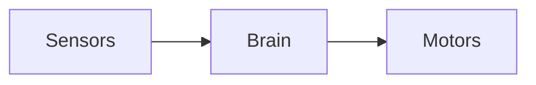

## Diagrams as code

Imagine you've built a line-following robot and you want to explain how it works. You could open a drawing app, drag out some boxes, type in each one, draw arrows between them, line everything up... and then do it all again next week when you add an obstacle sensor.

With **Mermaid** you write this instead:

```text
flowchart LR
    Sensors --> Brain --> Motors
```

And Mermaid draws this:



That's the whole idea. You describe *what* is in the diagram and how the parts connect, and Mermaid works out *where* everything goes. This is called **diagrams as code**: your diagram is a few lines of text, just like your program is.

Mermaid is free and open source. It's written in JavaScript and runs in a web browser, which is why so many websites and apps can draw Mermaid diagrams without you installing anything.

---

## Why text beats dragging boxes

- **It's quick.** Adding a step is one new line. Mermaid moves everything else out of the way for you.
- **It lives with your code.** Put the diagram in your project's `README.md` and it stays next to the code it describes.
- **It works with Git.** Because it's text, Git can show exactly what changed in a diagram, line by line. Try doing that with a PNG!
- **It's tidy.** Mermaid lines things up neatly every time, so your diagrams look consistent.
- **Nothing to lose.** No special file format, no app subscription. If you can open a text file, you can edit your diagram.

The trade-off is that you don't get pixel-perfect control. Mermaid decides the layout. For explaining how something works, that's usually exactly what you want.

---

## Where Mermaid diagrams are drawn

Lots of tools draw Mermaid automatically when you put it inside a Markdown code block marked `mermaid`:

Tool | How it works
-----|-------------
[Mermaid Live Editor](https://mermaid.live) | Type on the left, see the diagram on the right. Perfect for learning
GitHub | In READMEs, issues, pull requests, discussions and wikis
GitLab | In Markdown files, issues and merge requests
[Obsidian](/learn/obsidian/) | In any note, in reading view and live preview
Notion | Add a **Code** block and set the language to Mermaid
VS Code | Install a Mermaid preview extension for the Markdown preview
kevsrobots.com | Every diagram in this course is drawn live by Mermaid in your browser
{:class="table table-striped"}

> ## Versions matter a little
>
> Mermaid gets new features regularly, and each tool updates its copy of Mermaid at its own pace. A brand-new feature might work in the Live Editor but not in an app that hasn't updated yet. Everything in this course uses well-established syntax that works in all of the tools above.

---

## The kinds of diagram you can draw

Mermaid isn't just flowcharts. In this course we'll cover:

- **Flowcharts** - steps and decisions, like a robot's main loop
- **Sequence diagrams** - messages passed between things, like a Pico reading a sensor
- **State diagrams** - the modes a robot can be in
- **Class diagrams** - how your Python classes fit together
- **Entity relationship diagrams** - database tables and how they link
- **Gantt charts and timelines** - planning and history
- **Pie charts, mind maps, Git graphs and quadrant charts** - for everything else

---

## Try it yourself

1. Open [mermaid.live](https://mermaid.live) in your browser.
2. Delete the example code on the left and paste in the `Sensors --> Brain --> Motors` example above.
3. Add a fourth step: change the line to `Sensors --> Brain --> Motors --> Wheels`. Watch the diagram update as you type.
4. Challenge: change `LR` to `TD`. What happens?

---

## Common issues

- **Problem**: My diagram shows up as plain text on GitHub or in my notes
- **Solution**: Make sure the code block starts with three backticks followed straight away by the word `mermaid`
- **Why**: Tools only draw diagrams from code blocks marked as Mermaid. Any other code block is shown as text

- **Problem**: A diagram works in the Live Editor but not in another app
- **Solution**: Stick to the core syntax used in this course, or check which Mermaid version the app uses
- **Why**: The Live Editor always runs the newest Mermaid; other apps may be a version or two behind

---

## Check your understanding


? What does "diagrams as code" mean?
- [ ] Diagrams that can only show program code
- [x] You describe the diagram in text and a tool draws it for you
- [ ] You draw a diagram and it's turned into a program
> You write what's in the diagram and how it connects; Mermaid works out the layout.

? Why is a Mermaid diagram easier to keep in Git than a PNG image?
- [x] Git can show exactly which lines of the diagram changed
- [ ] PNG images can't be stored in Git
- [ ] Mermaid diagrams are encrypted
> Git can store images, but it can only tell you an image changed, not what changed. Text diffs line by line.


---
