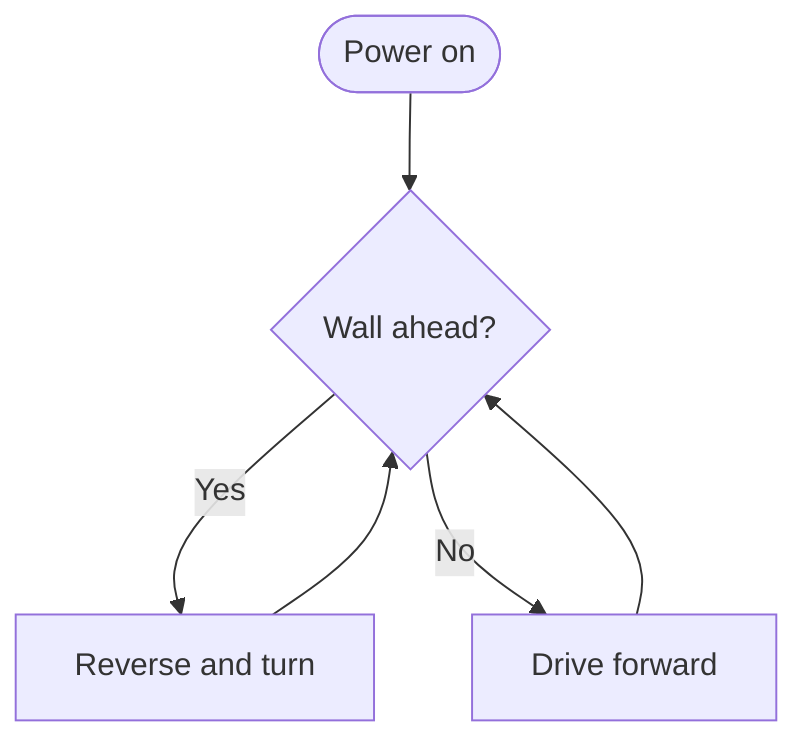
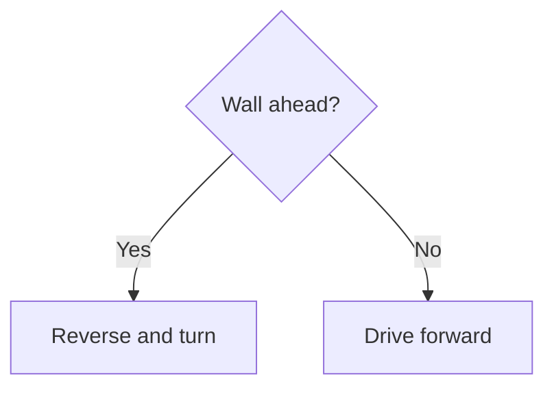

## The Mermaid Live Editor

The easiest place to learn Mermaid is the free **Mermaid Live Editor** at [mermaid.live](https://mermaid.live). There's nothing to install and you don't need an account.

The screen has two main parts:

- **Code** on the left, where you type your diagram
- **The diagram** on the right, which redraws as you type

If your code has a mistake, the diagram stops updating and an error appears under the code. Fix the mistake and it springs back to life. The editor also remembers your diagram in the page address, so you can bookmark it or send the link to a friend.

---

## Anatomy of a diagram

Let's draw a tiny flowchart for a robot that avoids obstacles. Type this into the editor:

```text
flowchart TD
    %% A robot that backs away from walls
    start([Power on]) --> check{Wall ahead?}
    check -- Yes --> reverse[Reverse and turn]
    check -- No --> forward[Drive forward]
    reverse --> check
    forward --> check
```

Here's what it draws:



Every Mermaid diagram follows the same pattern:

1. **The first line says what kind of diagram it is.** Here it's `flowchart`, and `TD` means "top down". Other diagrams start with words like `sequenceDiagram`, `stateDiagram-v2` or `pie`.
2. **Each line after that adds something.** A node, a connection, a message or a setting.
3. **Lines starting with `%%` are comments.** Mermaid ignores them, so use them to leave notes for yourself.

Indenting the lines isn't required, but it makes your diagram much easier to read.

### IDs and labels

Look at `check{Wall ahead?}`. The word `check` is the node's **ID**, a short name you use to refer to it. The text in the brackets, `Wall ahead?`, is its **label**, the words shown in the box. Once you've given a node a label, you only need its ID afterwards, like `reverse --> check`.

If you only write an ID, such as `Sensors`, Mermaid uses the ID as the label too.

---

## Putting a diagram in a Markdown file

To add a diagram to a GitHub README, an Obsidian note or a page on your own site, wrap it in a code block and set the language to `mermaid`:

~~~text
# My Obstacle Avoiding Robot

Here's how it decides where to go:


~~~

When GitHub or Obsidian shows that file, the code block is replaced by the drawn diagram. Anyone reading the raw file still sees readable text, which is a nice bonus. If you're new to Markdown, the [Markdown course](/learn/markdown/) covers code blocks and much more.

---

## Saving and sharing from the Live Editor

The **Actions** panel in the Live Editor lets you:

- Copy a link to your diagram, so others can open and edit it
- Download it as a **PNG** or **SVG** image
- Copy the image to paste into a document or slide

We'll look at exporting in more detail in the [Exporting and Sharing](12_exporting-and-sharing.html) lesson.

---

## Try it yourself

1. Paste the obstacle-avoiding flowchart into [mermaid.live](https://mermaid.live).
2. Add a comment line at the top describing your robot.
3. Change the label of `forward` to `Drive forward slowly`, without changing its ID.
4. Challenge: add a new decision after `forward`: `forward --> battery{Battery low?}`, then connect `battery` back to `check` for "No" and to a new `stop[Stop and beep]` node for "Yes".

---

## Common issues

- **Problem**: "Parse error on line 1"
- **Solution**: Check the first line is the diagram type, spelled exactly, such as `flowchart TD`
- **Why**: Mermaid reads the first line to decide which rules to use for the rest of the diagram

- **Problem**: A node appears twice with the same text
- **Solution**: Make sure you reuse exactly the same ID; IDs are case-sensitive, so `Check` and `check` are different nodes
- **Why**: Mermaid treats every new ID as a new node

- **Problem**: My comment shows up in the diagram
- **Solution**: Put `%%` at the very start of the comment, on its own line
- **Why**: Only whole lines beginning with `%%` are treated as comments

---

## Check your understanding


? What does the first line of a Mermaid diagram do?
- [ ] Sets the diagram's title
- [x] Tells Mermaid which type of diagram it is
- [ ] Creates the first node
> Lines like `flowchart TD` or `sequenceDiagram` choose the diagram type, and with it the rules for the rest of the code.

? In `check{Wall ahead?}`, what is `check`?
- [x] The node's ID, used to connect to it later
- [ ] The text shown in the box
- [ ] A Mermaid keyword
> `check` is the ID. `Wall ahead?` is the label that appears in the diagram.

? How do you write a comment in Mermaid?
- [ ] `# comment`
- [ ] `// comment`
- [x] `%% comment`
> Mermaid ignores any line that starts with `%%`.


---
