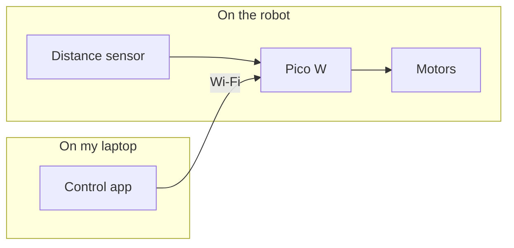
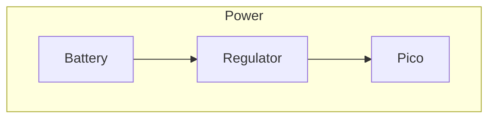
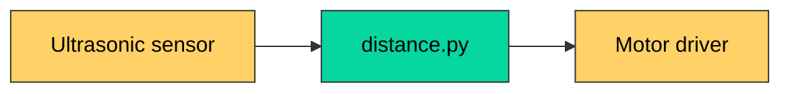
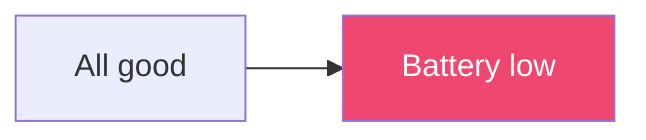
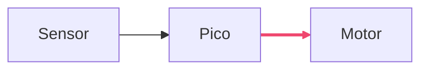
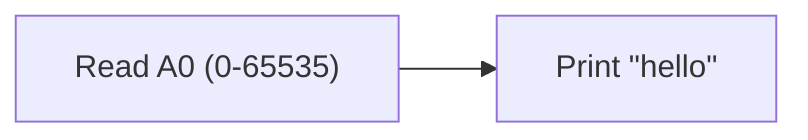

## Grouping with subgraphs

Bigger projects have parts that belong together: everything on the robot, everything on your laptop. A **subgraph** draws a box around a group of nodes.

```text
flowchart LR
    subgraph robot [On the robot]
        pico[Pico W] --> motors[Motors]
        sensor[Distance sensor] --> pico
    end
    subgraph laptop [On my laptop]
        app[Control app]
    end
    app -- Wi-Fi --> pico
```

Here's what it draws:



A subgraph starts with `subgraph`, an ID and an optional title in square brackets, and finishes with `end`. You can link to a whole subgraph by its ID too, like `app --> robot`.

You can also set a direction inside a subgraph with a `direction` line:

```text
flowchart TB
    subgraph power [Power]
        direction LR
        bat[Battery] --> reg[Regulator] --> pico[Pico]
    end
```



---

## Adding colour with classes

A **class** is a named style you can reuse. Define it once with `classDef`, then apply it to as many nodes as you like:

```text
flowchart LR
    classDef hardware fill:#ffd166,stroke:#333,color:#000
    classDef software fill:#06d6a0,stroke:#333,color:#000

    sensor[Ultrasonic sensor]:::hardware --> code[distance.py]:::software
    code --> motor[Motor driver]
    class motor hardware
```

Here's what it draws:



There are two ways to apply a class:

- Add `:::className` straight after a node
- Use a `class` line with one or more node IDs: `class motor,sensor hardware`

The style properties are like CSS: `fill` is the background, `stroke` is the border, `color` is the text, and you can add `stroke-width:2px` or `stroke-dasharray:5 5` for a dashed border.

---

## One-off styles

For a single node, `style` is quicker than a class:

```text
flowchart LR
    ok[All good] --> warn[Battery low]
    style warn fill:#ef476f,color:#fff
```



Links don't have IDs, so `linkStyle` uses their **position**, counting from 0 in the order you wrote them:

```text
flowchart LR
    a[Sensor] --> b[Pico] --> c[Motor]
    linkStyle 1 stroke:#ef476f,stroke-width:3px
```



Here link `0` is Sensor to Pico, and link `1` is Pico to Motor.

> Go easy on colour. Two or three colours that *mean* something (hardware, software, warnings) help a reader; a rainbow just gets in the way.

---

## The classic gotchas

These catch everyone at least once.

**1. A node called `end`.** `end` closes a subgraph, so this breaks:

```text
flowchart LR
    start --> end
```

Capitalise it or give it a different ID: `start --> End` or `start --> finish([End])`.

**2. IDs starting with `o` or `x`.** Mermaid reads `--o` and `--x` as special arrow heads, so `pico---ops` becomes a circle-ended line to a node called `ps`! Add a space, or capitalise: `pico --- ops` or `pico---Ops`.

**3. Special characters in labels.** Brackets, quotes and some symbols confuse Mermaid. Wrap the label in double quotes, and write a quote mark inside a label as `#quot;`:

```text
flowchart LR
    a["Read A0 (0-65535)"] --> b["Print #quot;hello#quot;"]
```



---

## Try it yourself

1. Draw your robot with two subgraphs: `Inputs` (sensors, buttons) and `Outputs` (motors, LEDs, buzzer), and a `Pico` node in the middle.
2. Create a `hardware` class and apply it to every physical part.
3. Challenge: use `linkStyle` to make every link going *to* an output thick and coloured.

---

## Common issues

- **Problem**: "Parse error" after adding a subgraph
- **Solution**: Check every `subgraph` has a matching `end`, and no node is called `end`
- **Why**: Mermaid uses `end` to know where the group finishes

- **Problem**: `linkStyle` colours the wrong arrow
- **Solution**: Count your links from 0, in the order they appear in the code, including links inside chains
- **Why**: Links are numbered by position, and `a --> b --> c` counts as two links

- **Problem**: My class has no effect
- **Solution**: Check the class name matches exactly, and that there's no space in `:::className`
- **Why**: Class names are case-sensitive and must be attached directly to the node

---

## Check your understanding


? Why does `start --> end` break a flowchart?
- [ ] `start` is a reserved word
- [x] `end` is the keyword that closes a subgraph
- [ ] Arrows can't point to the last node
> Use `End` or a different ID such as `finish([End])`.

? How do you apply the class `hardware` to a node called `motor`?
- [x] `motor:::hardware` or `class motor hardware`
- [ ] `style motor hardware`
- [ ] `motor.hardware`
> `:::` attaches a class to one node; the `class` line can apply it to several at once.

? In `a --> b --> c`, which number does `linkStyle` use for the arrow from `b` to `c`?
- [ ] 0
- [x] 1
- [ ] 2
> Links are counted from 0 in the order they're written, so `a --> b` is 0 and `b --> c` is 1.


---
