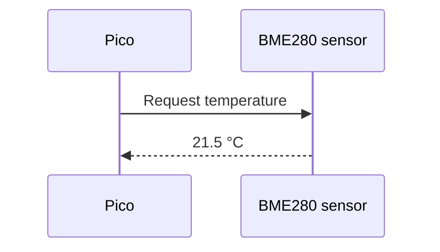
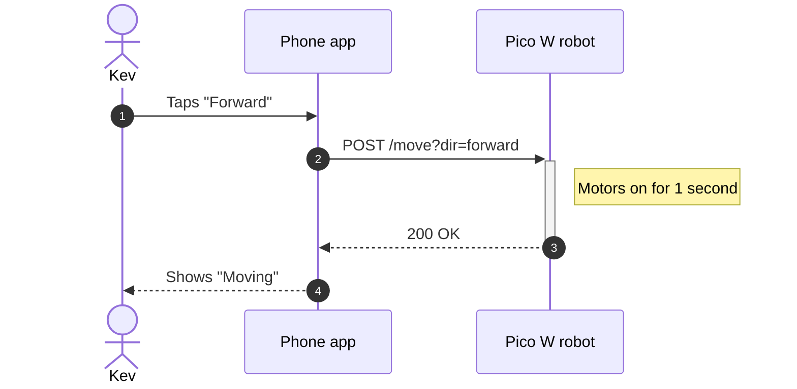
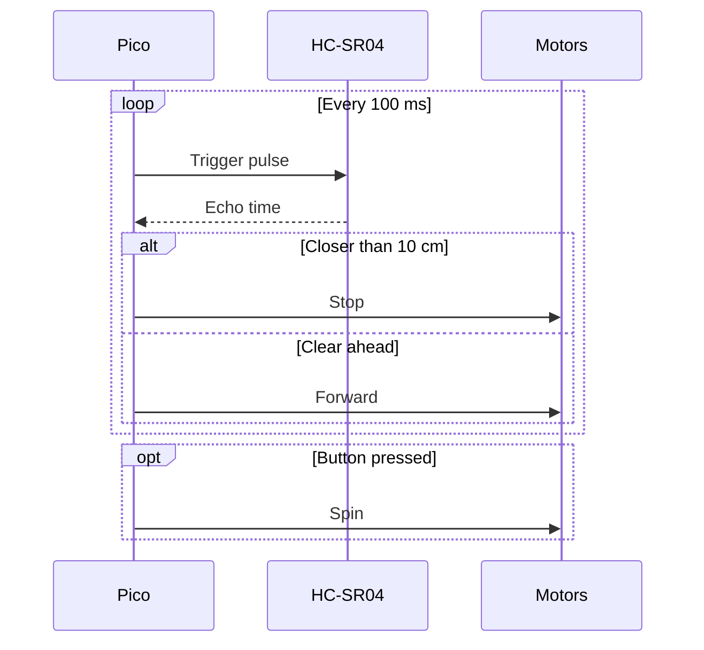

## What's a sequence diagram?

A flowchart shows *steps*. A **sequence diagram** shows *conversations*: who sends a message to whom, and in what order. Time runs from top to bottom.

They're brilliant for anything involving communication: a Pico asking a sensor for a reading over I2C, a phone app sending commands to a robot over Wi-Fi, or a web page talking to a server.

---

## Participants and messages

```text
sequenceDiagram
    participant Pico
    participant Sensor as BME280 sensor
    Pico->>Sensor: Request temperature
    Sensor-->>Pico: 21.5 °C
```

Here's what it draws:



- `participant` adds a box at the top with a lifeline running down from it. `as` gives it a longer display name.
- Each message is `From->>To: text`.
- Participants appear in the order you list them. If you don't list them, they appear in the order they're first mentioned.

Use `actor` instead of `participant` to draw a little stick person, handy for showing a human pressing a button.

---

## Arrow types

Arrow | Meaning
------|--------
`->>` | Solid line with arrowhead: a request or command
`-->>` | Dotted line with arrowhead: a reply
`->` | Solid line, no arrowhead
`-x` | Solid line ending in a cross: a message that failed or was lost
`-)` | Open arrowhead: a message sent without waiting for a reply
{:class="table table-striped"}

The usual convention is solid arrows for requests and dotted arrows for replies.

---

## Activations, notes and numbering

**Activation bars** show when a participant is busy. Add `+` after the arrow to switch one on and `-` to switch it off. **Notes** add comments, and `autonumber` numbers every message:

```text
sequenceDiagram
    autonumber
    actor Kev
    participant App as Phone app
    participant Robot as Pico W robot
    Kev->>App: Taps "Forward"
    App->>+Robot: POST /move?dir=forward
    Note right of Robot: Motors on for 1 second
    Robot-->>-App: 200 OK
    App-->>Kev: Shows "Moving"
```

Here's what it draws:



Notes can go `left of`, `right of`, or `over` one or two participants: `Note over App,Robot: Wi-Fi`.

---

## Loops and choices

Real conversations repeat and branch. Wrap messages in a `loop`, `alt`/`else` or `opt` block, and finish each with `end`:

```text
sequenceDiagram
    participant Pico
    participant Sonar as HC-SR04
    participant Motors
    loop Every 100 ms
        Pico->>Sonar: Trigger pulse
        Sonar-->>Pico: Echo time
        alt Closer than 10 cm
            Pico->>Motors: Stop
        else Clear ahead
            Pico->>Motors: Forward
        end
    end
    opt Button pressed
        Pico->>Motors: Spin
    end
```

Here's what it draws:



- `loop` - repeats
- `alt` / `else` - one choice or another, like `if` / `else` in Python
- `opt` - something that only happens sometimes, like an `if` with no `else`

---

## Try it yourself

1. Draw a sequence diagram of a Pico reading a button and turning on an LED: `Button`, `Pico` and `LED` participants.
2. Add `autonumber`, and activation bars on the Pico.
3. Challenge: draw a Pico W publishing a temperature to an MQTT broker, which passes it on to a dashboard. Use a `loop` for "every minute" and an `alt` for "temperature above 30 °C" that also sends an alert.

---

## Common issues

- **Problem**: An extra participant appears with a slightly different name
- **Solution**: Use exactly the same participant ID every time; `pico` and `Pico` are different
- **Why**: Any new name in a message creates a new participant automatically

- **Problem**: "Parse error" near a `loop` or `alt`
- **Solution**: Make sure each block has its own `end`, including nested ones
- **Why**: Mermaid needs to know where each block finishes

- **Problem**: My activation bar never ends
- **Solution**: Pair every `+` with a `-` on the reply
- **Why**: Mermaid keeps the participant "active" until it's told to stop

---

## Check your understanding


? Which way does time run in a sequence diagram?
- [x] Top to bottom
- [ ] Left to right
- [ ] Bottom to top
> Each message appears below the one before it.

? Which block is like an `if` / `else` in Python?
- [ ] `loop`
- [ ] `opt`
- [x] `alt` with `else`
> `alt` shows one choice or another. `opt` is for something that may or may not happen.

? What does `-->>` usually show?
- [ ] A failed message
- [x] A reply
- [ ] A comment
> Dotted arrows are the usual convention for replies; solid arrows for requests.


---
