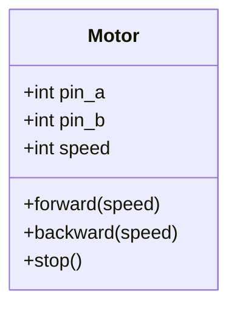
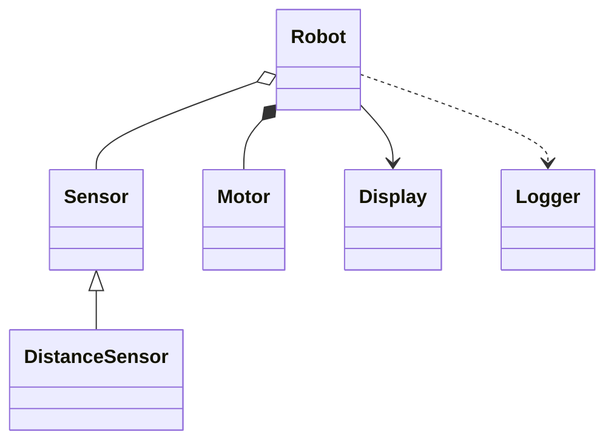
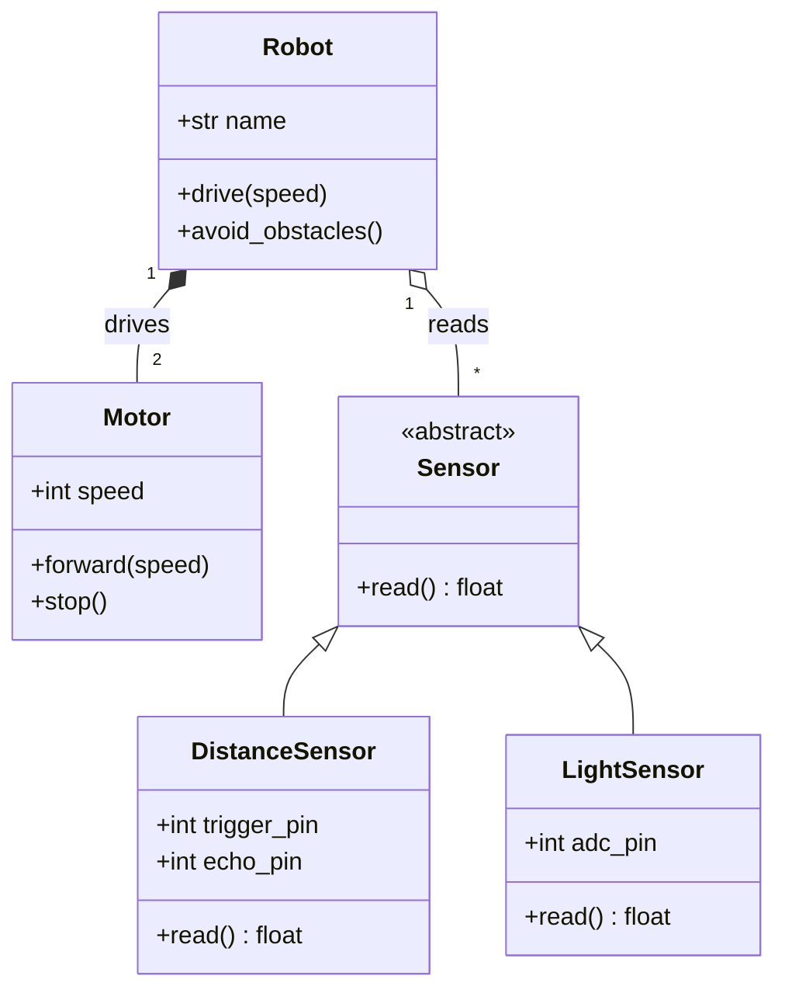

## Why draw your classes?

When a robot project grows past one file, you'll probably start using **classes**: a `Motor` class, a `Sensor` class, a `Robot` class that uses them. A **class diagram** shows what each class contains and how the classes fit together, which is a great way to plan code before you write it, or to explain it to someone afterwards.

If classes are new to you, the [Python object model course](/learn/object_model/) is a good companion to this lesson.

---

## A single class

```text
classDiagram
    class Motor {
        +int pin_a
        +int pin_b
        +int speed
        +forward(speed)
        +backward(speed)
        +stop()
    }
```

Here's what it draws:



A class box has three parts: the **name** at the top, the **attributes** (data) in the middle, and the **methods** (functions) at the bottom. Mermaid knows which is which because methods have brackets `()`.

The symbol at the start of each line is its **visibility**:

Symbol | Meaning | Python equivalent
-------|---------|------------------
`+` | Public | `speed`
`-` | Private | `__speed`
`#` | Protected | `_speed`
{:class="table table-striped"}

You can show a method's return type after the brackets, like `+read() float`.

---

## Relationships

The real power of a class diagram is showing how classes connect. Here are the most useful links:

```text
classDiagram
    Sensor <|-- DistanceSensor
    Robot *-- Motor
    Robot o-- Sensor
    Robot --> Display
    Robot ..> Logger
```

Here's what it draws:



- `<|--` **Inheritance**: `DistanceSensor` **is a** `Sensor`, like `class DistanceSensor(Sensor)` in Python
- `*--` **Composition**: `Robot` **owns** its motors; they're created with it and don't exist without it
- `o--` **Aggregation**: `Robot` **has** sensors, but they could exist on their own and be swapped
- `-->` **Association**: `Robot` **uses** a `Display`
- `..>` **Dependency**: `Robot` **depends on** `Logger` briefly, such as calling it in one method

Don't worry too much about the difference between composition and aggregation as a beginner. Inheritance and "has a" are the two you'll use most.

---

## Numbers and labels on links

Add **cardinality** (how many) in quotes at each end, and a label after a colon:

```text
classDiagram
    class Robot {
        +str name
        +drive(speed)
        +avoid_obstacles()
    }
    class Motor {
        +int speed
        +forward(speed)
        +stop()
    }
    class Sensor {
        <<abstract>>
        +read() float
    }
    class DistanceSensor {
        +int trigger_pin
        +int echo_pin
        +read() float
    }
    class LightSensor {
        +int adc_pin
        +read() float
    }
    Robot "1" *-- "2" Motor : drives
    Robot "1" o-- "*" Sensor : reads
    Sensor <|-- DistanceSensor
    Sensor <|-- LightSensor
```

Here's what it draws:



That reads as: "One robot drives two motors and reads any number of sensors. Distance sensors and light sensors are both kinds of sensor." `<<abstract>>` is an **annotation**: a label that says `Sensor` is a general idea that you'd never create directly.

---

## From diagram to code

The diagram maps neatly onto Python:

```python
class Sensor:
    def read(self) -> float:
        raise NotImplementedError

class DistanceSensor(Sensor):          # Sensor <|-- DistanceSensor
    def __init__(self, trigger_pin, echo_pin):
        self.trigger_pin = trigger_pin
        self.echo_pin = echo_pin

class Robot:
    def __init__(self, name, sensors):
        self.name = name
        self.motors = [Motor(2, 3), Motor(4, 5)]   # "1" *-- "2" Motor
        self.sensors = sensors                     # "1" o-- "*" Sensor
```

---

## Try it yourself

1. Draw a class diagram for an `LED` class with `pin`, `on()`, `off()` and `toggle()`.
2. Add an `RGBLED` class that inherits from `LED` and adds `set_colour(r, g, b)`.
3. Challenge: pick a Python project you've written with two or more classes and draw it. Did drawing it make you spot anything you'd change?

---

## Common issues

- **Problem**: An attribute shows up in the methods section, or the other way round
- **Solution**: Make sure methods have `()` and attributes don't
- **Why**: Mermaid decides which section a line belongs in by looking for brackets

- **Problem**: The inheritance arrow points the wrong way
- **Solution**: Put the parent on the arrowhead side: `Parent <|-- Child`
- **Why**: The hollow triangle always points at the parent class

- **Problem**: A class with spaces in its name breaks the diagram
- **Solution**: Use a name without spaces, like `DistanceSensor`
- **Why**: Class names follow the same rules as Python class names

---

## Check your understanding


? How does Mermaid know a line in a class is a method?
- [x] It has brackets `()`
- [ ] It starts with `+`
- [ ] It's written in capitals
> Lines with `()` go in the methods section; everything else is an attribute.

? What does `Sensor <|-- DistanceSensor` mean?
- [ ] Sensor inherits from DistanceSensor
- [x] DistanceSensor inherits from Sensor
- [ ] Sensor owns a DistanceSensor
> The triangle points at the parent. In Python it's `class DistanceSensor(Sensor)`.

? Which link shows that a robot owns its motors and they don't exist without it?
- [x] `*--` composition
- [ ] `..>` dependency
- [ ] `<|--` inheritance
> Composition is the strongest "has a" relationship: the parts belong to the whole.


---
