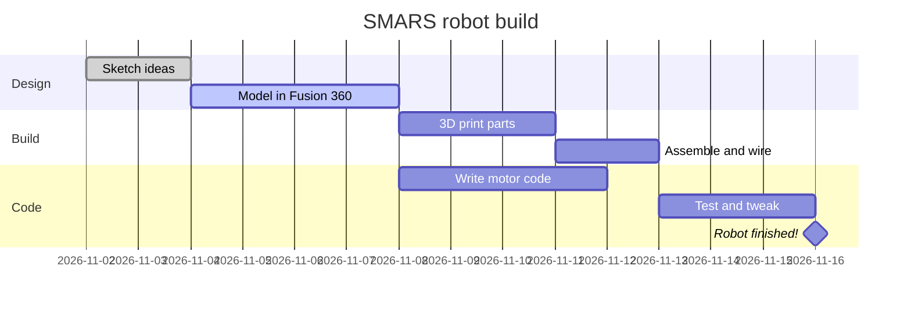
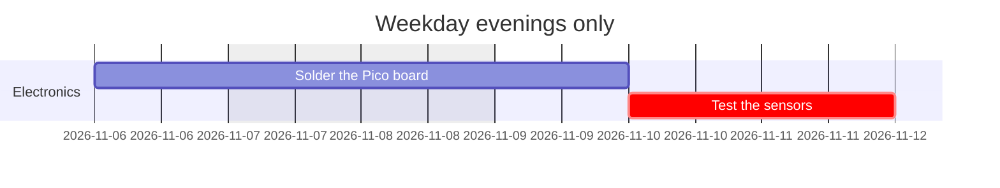
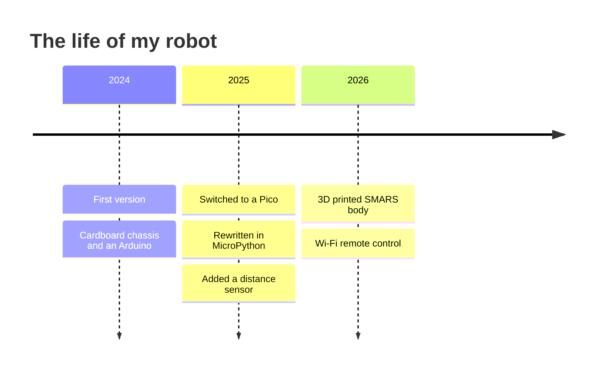

## Planning a build

Robot builds have a habit of taking longer than expected, usually because one thing depends on another. You can't test the motors until the chassis is printed, and you can't print the chassis until it's designed. A **Gantt chart** shows each task as a bar along a calendar, so you can see what depends on what and when it'll all be done.

---

## Your first Gantt chart

```text
gantt
    title SMARS robot build
    dateFormat YYYY-MM-DD
    section Design
        Sketch ideas          :done,   sketch, 2026-11-02, 2d
        Model in Fusion 360   :active, model, after sketch, 4d
    section Build
        3D print parts        :print, after model, 3d
        Assemble and wire     :wire, after print, 2d
    section Code
        Write motor code      :code, after model, 4d
        Test and tweak        :test, after wire, 3d
    Robot finished!           :milestone, after test, 0d
```

Here's what it draws:



Let's break that down:

- `title` adds a heading.
- `dateFormat` tells Mermaid how **you** will write dates. `YYYY-MM-DD` means `2026-11-02`.
- `section` groups tasks into coloured bands.
- Each task is `Name : details`, and the details are separated by commas.

### Task details

Details go in this order, and you can leave out the ones you don't need:

1. **Tags** (optional): `done`, `active`, `crit` (critical, shown in red) or `milestone`
2. **ID** (optional): a short name like `print`, so other tasks can refer to it
3. **Start**: a date like `2026-11-02`, or `after print` to start when another task finishes
4. **Length**: like `3d` for three days, `1w` for a week, or `12h` for hours, or an end date

Using `after` is the clever bit. If the design takes longer, change one number and every task after it moves along automatically.

---

## Skipping weekends

If you only build at weekends, or only on weekdays, tell Mermaid to skip some days with `excludes`:

```text
gantt
    title Weekday evenings only
    dateFormat YYYY-MM-DD
    excludes weekends
    section Electronics
        Solder the Pico board  :solder, 2026-11-06, 2d
        Test the sensors       :crit, after solder, 2d
```



The soldering starts on a Friday, so the second day of it moves to Monday.

---

## Timelines: telling a story

A Gantt chart looks forward. A **timeline** looks back, showing what happened when. It's great for a project's history in a README, or a "how this robot evolved" section on a blog post.

```text
timeline
    title The life of my robot
    2024 : First version : Cardboard chassis and an Arduino
    2025 : Switched to a Pico : Rewritten in MicroPython
         : Added a distance sensor
    2026 : 3D printed SMARS body : Wi-Fi remote control
```

Here's what it draws:



Each line is `period : event`, and you can add more events with more colons, or on the next line starting with `:`. The period doesn't have to be a date; it can be any text, like `Week 1` or `Prototype`.

You can group periods with `section` too, just like in a Gantt chart.

---

## Try it yourself

1. Make a Gantt chart for your next project with at least three sections. Use `after` so every task depends on another.
2. Mark the most important task as `crit`, and finish with a `milestone`.
3. Challenge: write a timeline of your own maker journey, from your first project to today.

---

## Common issues

- **Problem**: "Invalid date" or the bars are in strange places
- **Solution**: Check your dates match `dateFormat` exactly, such as `2026-11-02` for `YYYY-MM-DD`
- **Why**: Mermaid reads each date using the format you gave it

- **Problem**: A task using `after` doesn't appear
- **Solution**: Check the ID after `after` matches another task's ID exactly
- **Why**: Mermaid can't work out a start date for a task that follows something that doesn't exist

- **Problem**: A colon in a task name breaks the chart
- **Solution**: Remove the colon from the name, or use a dash instead
- **Why**: The first colon separates the task name from its details

---

## Check your understanding


? What does `after print` do in a Gantt task?
- [ ] Prints the chart
- [x] Starts the task when the task with ID `print` finishes
- [ ] Puts the task at the end of the chart
> Tasks that use `after` move automatically when the task before them changes.

? Which tag makes a task show as critical?
- [ ] `done`
- [ ] `active`
- [x] `crit`
> `crit` highlights tasks that would delay the whole project if they slipped.

? When would you use a timeline instead of a Gantt chart?
- [x] To show what happened in a project's history
- [ ] To plan tasks that depend on each other
- [ ] To show percentages
> Gantt charts plan the future; timelines tell the story of the past.


---
