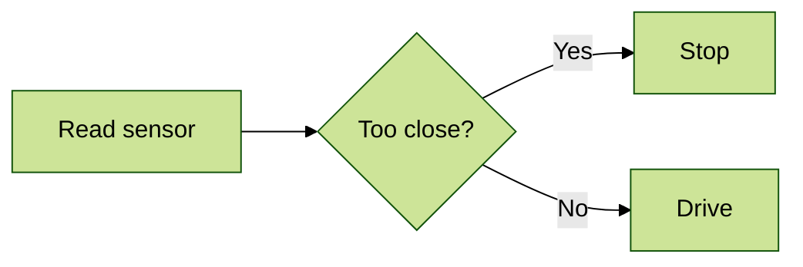
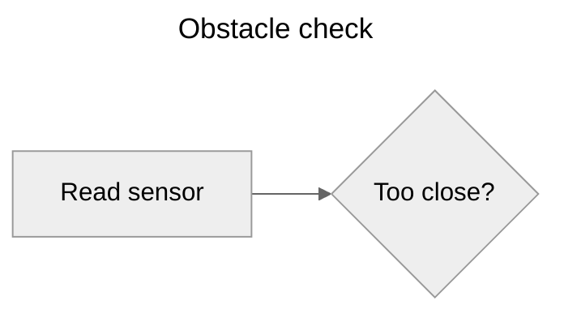
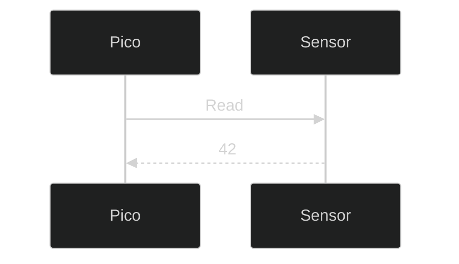
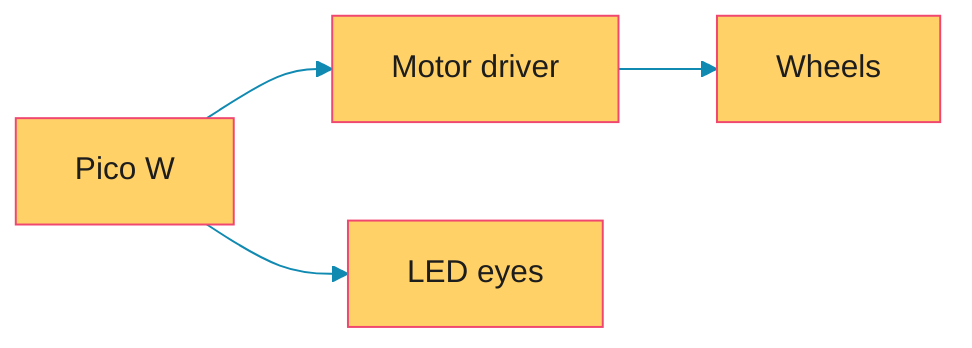
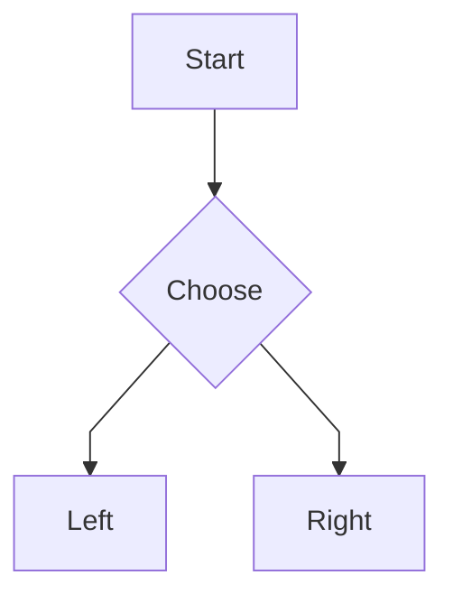

## Styling the whole diagram

In the [Flowcharts in Depth](04_flowcharts-in-depth.html) lesson we coloured individual nodes with `style` and `classDef`. That's great for highlighting one or two things. But what if you want to change the look of the *whole* diagram, to match your website or your project's colours? That's what **themes** are for.

---

## The built-in themes

Mermaid comes with five themes:

Theme | Looks like
------|-----------
`default` | The standard look you've seen in most of this course
`neutral` | Black, white and grey: great for printing
`dark` | Light lines on a dark background
`forest` | Shades of green
`base` | A plain theme designed to be customised with your own colours
{:class="table table-striped"}

---

## Choosing a theme with config

The modern way to set a theme is a small **config** block at the very top of the diagram, between two lines of three dashes:

```text
---
config:
  theme: forest
---
flowchart LR
    sensor[Read sensor] --> decide{Too close?}
    decide -->|Yes| stop[Stop]
    decide -->|No| go[Drive]
```

Here's what it draws:



That block is written in **YAML**, the same format used at the top of Jekyll pages and Obsidian notes. Indentation matters: `theme` must be indented under `config`.

You can also add a `title` in the same block, and it'll be shown above the diagram:

```text
---
title: Obstacle check
config:
  theme: neutral
---
flowchart LR
    sensor[Read sensor] --> decide{Too close?}
```



---

## The older way: init directives

You'll see lots of examples online that use an **init directive** instead, a special comment on the first line:

```text
%%{init: {"theme": "dark"}}%%
sequenceDiagram
    Pico->>Sensor: Read
    Sensor-->>Pico: 42
```



It does the same job. Directives still work, but the config block is the newer, recommended way, and it's easier to read. If an app you're using is running an older version of Mermaid and ignores the config block, try a directive instead.

---

## Your own colours with themeVariables

To use your own colours, pick the `base` theme and set some **theme variables**:

```text
---
config:
  theme: base
  themeVariables:
    primaryColor: "#ffd166"
    primaryTextColor: "#1d1d1d"
    primaryBorderColor: "#ef476f"
    lineColor: "#118ab2"
    fontFamily: "Courier New, monospace"
---
flowchart LR
    pico[Pico W] --> driver[Motor driver] --> wheels[Wheels]
    pico --> leds[LED eyes]
```

Here's what it draws:



The most useful variables are:

- `primaryColor` - the fill colour of nodes
- `primaryTextColor` - the text inside nodes
- `primaryBorderColor` - the border of nodes
- `lineColor` - arrows and lines
- `fontFamily` - the font

Mermaid works out lots of other colours from these, such as shading and contrasting text.

> **themeVariables only work properly with the `base` theme.** The other themes set their own colours and mostly ignore yours. If your colours aren't showing, check you've set `theme: base`.

Always put colour codes in quotes, like `"#ffd166"`. In YAML, `#` starts a comment, so without quotes your colour disappears!

---

## Other handy settings

Each diagram type has its own settings too. For example, you can make flowchart lines straight and angular instead of curved:

```text
---
config:
  flowchart:
    curve: linear
---
flowchart TD
    a[Start] --> b{Choose}
    b --> c[Left]
    b --> d[Right]
```



Newer versions of Mermaid (version 11 and later) also add a `look: handDrawn` setting that makes diagrams look like sketches. It's fun, but not every app supports it yet, so we won't use it on this site.

---

## Try it yourself

1. Take a flowchart from an earlier lesson and try each of the five themes.
2. Use the `base` theme and `themeVariables` to make a diagram in your favourite colours.
3. Challenge: make a "house style" config block for your projects and use it on two different diagram types. Which variables work on both?

---

## Common issues

- **Problem**: My theme colours are ignored
- **Solution**: Use `theme: base` when setting `themeVariables`
- **Why**: The other themes override most of the variables with their own colours

- **Problem**: A colour code vanishes
- **Solution**: Wrap it in double quotes: `primaryColor: "#ffd166"`
- **Why**: `#` starts a YAML comment, so everything after it is ignored

- **Problem**: The config block is shown as text, or causes an error
- **Solution**: Make sure the `---` line is the very first line of the diagram, with nothing before it
- **Why**: Mermaid only looks for config at the very top

---

## Check your understanding


? Which theme should you use with your own themeVariables?
- [ ] `default`
- [ ] `forest`
- [x] `base`
> `base` is designed to be customised; the other themes mostly ignore your variables.

? Why must colour codes like `#ffd166` be in quotes in the config block?
- [x] Because `#` starts a comment in YAML
- [ ] Because Mermaid only understands colour names
- [ ] Quotes make the colour brighter
> Without quotes, YAML treats `#ffd166` as a comment and the setting is empty.

? Where must the config block go?
- [ ] At the end of the diagram
- [x] At the very top, before the diagram type
- [ ] Anywhere, as long as it's indented
> The block between `---` lines has to be the first thing in the diagram.


---
