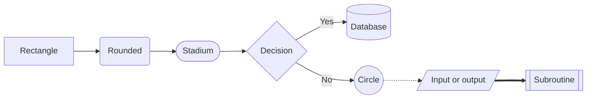

## Well done!

You can now draw flowcharts, sequence diagrams, state diagrams, class diagrams, entity relationship diagrams, Gantt charts, timelines, pie charts, mind maps, Git graphs and quadrant charts, and style and share them all. That's a seriously useful set of skills for documenting any project.

Here's everything in one place to come back to.

---

## Starting lines

Diagram | First line
--------|-----------
Flowchart | `flowchart TD` (or `LR`, `BT`, `RL`)
Sequence diagram | `sequenceDiagram`
State diagram | `stateDiagram-v2`
Class diagram | `classDiagram`
Entity relationship | `erDiagram`
Gantt chart | `gantt`
Timeline | `timeline`
Pie chart | `pie`
Mind map | `mindmap`
Git graph | `gitGraph`
Quadrant chart | `quadrantChart`
{:class="table table-striped"}

---

## Flowchart cheat sheet

```text
flowchart LR
    a[Rectangle] --> b(Rounded)
    b --> c([Stadium])
    c --> d{Decision}
    d -->|Yes| e[(Database)]
    d -- No --> f((Circle))
    f -.-> g[/Input or output/]
    g ==> h[[Subroutine]]
```



- Links: `-->` arrow, `---` line, `-.->` dotted, `==>` thick, `--x` cross, `--o` circle, `<-->` both ways
- Labels: `a -->|text| b` or `a -- text --> b`
- Groups: `subgraph id [Title]` ... `end`
- Styles: `classDef name fill:#hex,stroke:#hex,color:#hex`, then `node:::name` or `class a,b name`
- Gotchas: don't call a node `end`; add a space before IDs starting with `o` or `x`; quote labels with punctuation

---

## Sequence diagram cheat sheet

- `participant Pico` or `actor You`; `participant P as Long name`
- `A->>B: request`, `B-->>A: reply`, `A-xB: lost`, `A-)B: no reply needed`
- `A->>+B` and `B-->>-A` for activation bars
- `Note right of A: text`, `Note over A,B: text`
- `loop`, `alt` / `else`, `opt` ... `end`
- `autonumber` numbers every message

---

## State diagram cheat sheet

- `[*] --> First` start, `Last --> [*]` end
- `A --> B : event` transition
- `state "Long name" as Id`
- `state Parent { ... }` composite state
- `state pick <<choice>>` decision
- `note right of A` ... `end note`

---

## Class diagram cheat sheet

- `class Motor { +int speed  +stop() }` (methods have `()`)
- Visibility: `+` public, `-` private, `#` protected
- `Parent <|-- Child` inheritance, `A *-- B` composition, `A o-- B` aggregation, `A --> B` association, `A ..> B` dependency
- `A "1" *-- "2" B : label` for numbers and labels
- `<<abstract>>` or `<<interface>>` annotations

---

## ER diagram cheat sheet

- `A ||--o{ B : label` (quote labels with spaces)
- `||` exactly one, `o|` / `|o` zero or one, `}|` / `|{` one or more, `}o` / `o{` zero or more
- `ENTITY { type name PK "comment" }` with `PK`, `FK`, `UK`
- `--` solid (identifying), `..` dashed (non-identifying)

---

## Planning cheat sheet

- **Gantt**: `dateFormat YYYY-MM-DD`, `section Name`, `Task :tag, id, start, length`, tags `done`, `active`, `crit`, `milestone`; start with `after id`; `excludes weekends`
- **Timeline**: `period : event : event`, extra events on the next line starting with `:`
- **Pie**: `"Label" : value`, add `showData` to show values
- **Mind map**: structure by indentation; `root((Centre))`
- **Git graph**: `commit id: "msg" tag: "v1"`, `branch name`, `checkout name`, `merge name`
- **Quadrant**: `x-axis Low --> High`, `quadrant-1` top right, `Point: [x, y]` from 0 to 1

---

## Styling cheat sheet

```text
---
title: My diagram
config:
  theme: base
  themeVariables:
    primaryColor: "#ffd166"
    lineColor: "#118ab2"
---
```

- Themes: `default`, `neutral`, `dark`, `forest`, `base`
- `themeVariables` only work properly with `theme: base`
- Quote colour codes: `"#ffd166"`
- Older alternative: `%%{init: {"theme": "dark"}}%%` on the first line

---

## Debugging checklist

When a diagram won't draw:

1. Paste it into [mermaid.live](https://mermaid.live) and read the error and line number.
2. Check the first line is the diagram type, spelled exactly.
3. Look for unmatched brackets, quotes, or a missing `end`.
4. Put double quotes around any label with punctuation.
5. Comment out half the diagram with `%%` to find which line is the problem.

---

## What's next?

- Add diagrams to your project READMEs and track them with [Git for beginners](/learn/git/)
- Keep diagrams with your notes in [Obsidian](/learn/obsidian/)
- Brush up on Markdown with [Mastering Markdown](/learn/markdown/)
- Build the parts database you designed with [Create Databases with Python and SQLite3](/learn/sqlite3/)
- Explore the full [Mermaid documentation](https://mermaid.js.org) for even more diagram types and options

---

## Try it yourself

Pick a project you've already built and give it three diagrams: one showing how it's wired, one showing how it thinks, and one showing its history. Put them in its README, and share it with the community!

---

## Check your understanding


? Which first line starts a state diagram?
- [ ] `state`
- [x] `stateDiagram-v2`
- [ ] `flowchart state`
> `stateDiagram-v2` is the current version of the state diagram.

? A diagram won't draw and you can't spot why. What's a quick way to find the problem line?
- [x] Comment out half the diagram with `%%` and see if it draws
- [ ] Delete the first line
- [ ] Change the theme
> Halving the diagram again and again quickly narrows the error down to one line.

? Which of these is a valid Gantt task?
- [ ] `Print parts -> 3 days`
- [x] `Print parts :print, after model, 3d`
- [ ] `task(Print parts, 3)`
> Name, a colon, then the details: optional tags and ID, a start, and a length.


---
