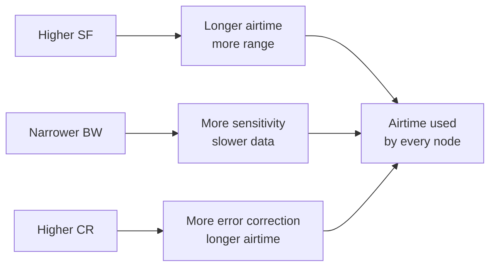

{:class="cover"}

---

By the end of this lesson you will be able to explain what spreading factor, bandwidth and coding rate each change, and why airtime is the real currency of a LoRa mesh.

Before we buy anything, it is worth a few minutes on what LoRa actually does, because three settings decide whether your mesh reaches the end of the street or the next town.

---

## The trick behind LoRa

LoRa stands for **Long Range**. It spreads a tiny amount of data across a slice of radio spectrum using a "chirp", a signal that sweeps up in frequency over time.

A receiver that knows the chirp pattern can dig the signal out from *below the noise floor*. WiFi needs a signal stronger than the background noise; LoRa does not. That is why a radio drawing a fraction of a watt can reach kilometres.

The price is speed. We are talking hundreds to a few thousand bits per second, not megabits.

---

## The three dials

{:class="img-fluid w-100"}

### Spreading Factor (SF)

**What it does:** controls how long each chirp lasts. Lower SF is faster and shorter; higher SF is slower and longer. MeshCore accepts SF 5 to 12.

**The trade:** every step up roughly doubles the time on air and buys a few dB of extra sensitivity.

**Why it matters:** SF12 sounds tempting until a single short message hogs the channel for seconds. In a shared mesh, everyone else has to wait.

### Bandwidth (BW)

**What it does:** how wide a slice of spectrum each transmission occupies. Common values are 62.5kHz, 125kHz and 250kHz.

**The trade:** halving the bandwidth halves the data rate and gains about 3dB of sensitivity. A narrow channel also slips between other people's interference in a busy licence-exempt band.

### Coding Rate (CR)

**What it does:** how much error correction is added. CR5 means 4 useful bits for every 5 sent; CR8 means 4 for every 8.

**The trade:** more correction survives more interference, at the cost of longer transmissions. The MeshCore FAQ's rule of thumb is CR5 for solid links, and 7 or 8 if a link is intermittent.

---

## Putting numbers on it

These figures come from the standard LoRa time-on-air formula for a 30 byte packet, so treat them as ballpark:

| Settings | Approx. data rate | Airtime for a 30 byte packet | Character |
|---|---|---|---|
| SF7, BW250, CR5 | ~10,900 bps | ~40ms | Fast, short range |
| SF8, BW62.5, CR8 | ~980 bps | ~350ms | The UK/EU "narrow" preset |
| SF11, BW250, CR5 | ~1,070 bps | ~410ms | The older MeshCore default |
| SF12, BW125, CR5 | ~290 bps | ~1.6s | Maximum range, hogs the channel |
{:class="table table-single"}

Notice the narrow SF8 setting and the old SF11 setting have similar data rates, but the narrow one uses a quarter of the spectrum and copes better with interference. That is why many regions moved to narrow presets in late 2025, according to the MeshCore FAQ.

---

## Airtime is the real currency

> Only one node can usefully talk at a time. Everything that makes a transmission longer takes airtime from everyone else.

That is why MeshCore avoids flooding and why repeaters are selective. It is also why many countries limit duty cycle, which we cover in lesson 4.

---

## Everyone must match

LoRa nodes do not negotiate like WiFi. **Two nodes can only hear each other if their frequency, bandwidth and spreading factor match exactly.** Coding rate is carried in the packet, so a CR5 node and a CR8 node can usually still hear each other, but set them the same anyway. If your repeater is on SF8 and your client on SF11, they are on different planets. This is the most common reason a new setup fails.

---

## Try it Yourself

1. Open an online LoRa airtime calculator and enter SF8, BW62.5, CR8 with a 30 byte payload. Note the airtime.
2. Change SF to 12. How many times longer is it?
3. Challenge: at a 10% duty cycle you may transmit 360 seconds in an hour. How many SF12/BW125 messages is that? Now do the same for SF8/BW62.5.

---

## Common Issues

- **Problem**: Higher spreading factor means better range, so I will use SF12.
- **Solution**: Use your local community's preset instead.
- **Why**: SF12 is antisocial in a shared mesh, and a node nobody else is set up to hear has infinite range to nowhere.

- **Problem**: My node shows a good RSSI but messages still fail.
- **Solution**: Check SNR as well, and consider a higher coding rate.
- **Why**: RSSI is how loud the signal is. SNR is how loud it is compared with the noise. Interference eats your margin even when RSSI looks fine.

## Check your understanding


? Which three settings must match exactly for two LoRa nodes to hear each other?
- [ ] Name, password and coding rate
- [x] Frequency, bandwidth and spreading factor
- [ ] Antenna gain, battery and cable
> Frequency, bandwidth and spreading factor have to match. Coding rate is carried in the packet, so it can differ.

? What happens to airtime when you raise the spreading factor by one step?
- [ ] It halves
- [x] It roughly doubles
- [ ] It stays the same
> Each SF step roughly doubles time on air, which is why SF12 hogs the channel.

? Why do many MeshCore regions prefer a narrow 62.5kHz bandwidth?
- [x] It fits between interference and keeps airtime low
- [ ] It makes the radio transmit with more power
- [ ] It removes the need for an antenna
> Narrow channels slip between other devices in a crowded band and, with a lower SF, keep transmissions short.


---
