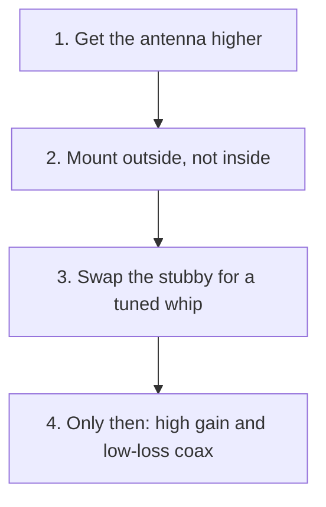

{:class="cover"}

---

By the end of this lesson you will be able to choose and fit an antenna safely, and explain the power and duty cycle limits that apply where you live.

Your antenna matters more than your transmit power. A better antenna in a better position can do more for your range than any firmware setting.

---

## The golden rule

> **Never power on a LoRa board without an antenna connected.**

**Why this matters:** with no antenna, the radio's output has nowhere to go and reflects back into the power amplifier. Transmitting like that can damage the radio permanently, and it looks like "my board mysteriously has terrible range now".

Fit the antenna *before* you plug in the USB cable, every time. It is a two second habit that saves a board.

---

## What makes a good antenna

**Tuned for your band.** An antenna cut for 433MHz or 2.4GHz radiates badly at 868MHz. Buy one sold for 868MHz (or 915MHz in the US).

**Vertical.** LoRa nodes normally use vertical polarisation. If your repeater's antenna is vertical and your client's lies flat on a desk, you can lose a great deal of signal.

**Gain, honestly stated.** A stubby antenna is typically a dBi or two. A half-wave whip is a little better. High-gain collinears squash the pattern flatter, which suits a rooftop repeater covering a town and is bad for a handheld on a hill.

**Height beats everything.** A few metres more height often beats any upgrade you can buy, because LoRa at these frequencies is dominated by line of sight.

---

## Coax matters

Thin coax is lossy at these frequencies. Cheap RG174 loses roughly a dB per metre or so, so five metres of it throws away more than half your transmit power and the same again on receive. Better to put the board in a small weatherproof box beside the antenna and run *power* up the pole instead.

---

## The legal bit: it depends on your country

LoRa uses licence-exempt bands, so you normally do not need an amateur licence, but you must stay inside your country's rules. They are not the same everywhere:

| Region | Typical band | What to check |
|---|---|---|
| UK | 868MHz | Ofcom Interface Requirement IR 2030, power and duty cycle by sub-band |
| EU | 868MHz | ETSI limits and your national regulator, including duty cycle |
| US | 915MHz | FCC rules for the 902-928MHz ISM band |
{:class="table table-single"}

For the UK and EU, the 869.4 to 869.65MHz sub-band that the MeshCore EU/UK preset sits in is commonly cited as allowing up to **500mW ERP** with a **10% duty cycle**, meaning no more than 6 minutes of transmitting in any hour. Your Heltec V3 transmits at around 21dBm (roughly 125 to 160mW), so with a typical small antenna you are normally under the ceiling.

The duty cycle is the limit to respect. Text messaging rarely hits it, but a repeater that adverts constantly can. Newer MeshCore firmware (v1.15 and later, per its docs) has `set dutycycle <percent>`, which we use in lesson 6.

433MHz is a different band with a much lower power allowance in the UK, and it is shared with other devices. Stick to your region's main preset unless you have a reason not to.

> ## Not legal advice
>
> Rules change, and this is a summary. Read the current rules from Ofcom, your national regulator, or the FCC yourself, especially before putting a node on a mast or adding an amplifier.

---

## Try it Yourself

1. Look at the antenna that came with your board. Is its band printed on it?
2. Stand your client's antenna vertically, move to the edge of your range, then tip it horizontal. Watch the signal drop.
3. Challenge: find the regulator's page for your country and write down the power and duty cycle limit for your band.

---

## Common Issues

- **Problem**: My range is poor even though both nodes are outside.
- **Solution**: Check antenna polarisation, and get at least one node higher.
- **Why**: Mismatched polarisation and blocked line of sight cost far more than any firmware setting.

- **Problem**: I powered the board without an antenna once. Is it dead?
- **Solution**: Probably not if it was brief, but compare its range against a known good board.
- **Why**: Damage comes from transmitting into an open circuit, and it can build up. Do not make it a habit.

- **Problem**: My neighbour says my node causes interference.
- **Solution**: Lower the transmit power with `set tx`, reduce advert frequency, and check your regulator's rules.
- **Why**: Licence-exempt does not mean rule-free, and your country's limits apply to you.

> **Teachers**: radio rules are national, so use your own country's page, not the UK figures here. Fit antennas before connecting USB and make that a classroom rule. A bare board left powered on a bench is the usual way boards get damaged.

## Check your understanding


? What must you do before powering a LoRa board?
- [ ] Set the duty cycle
- [x] Connect the antenna
- [ ] Update the app
> Transmitting without an antenna can reflect power back into the amplifier and damage the radio.

? Why does transmit power limit differ between users in different countries?
- [x] Each country's regulator sets its own limits for each band
- [ ] LoRa boards change power by themselves
- [ ] Only the antenna decides it
> The lesson lists Ofcom, ETSI and FCC rules separately because limits differ by region.

? Where should you spend your first range-upgrade effort?
- [ ] A very high-gain antenna
- [x] Getting the antenna higher
- [ ] Longer thin coax
> Height is the free, biggest upgrade, and thin coax wastes power.


---
