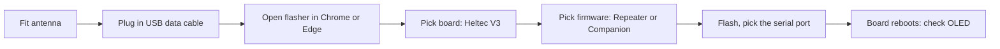

{:class="cover"}

---

By the end of this lesson you will be able to flash one board as a repeater and one as a Bluetooth companion, and check the flash worked.

This is the moment two identical boards become two different things. Node 1 gets **repeater** firmware; node 2 gets **companion** firmware.

---

## Before you start

- Fit the antennas to **both** boards (lesson 4, not optional)
- Use **Google Chrome or Microsoft Edge** on a computer. The flasher uses WebUSB, which Firefox and Safari do not support
- Have your **USB-C data cable** ready
- Label the boards with masking tape, "REPEATER" and "CLIENT"

---

## The firmware variants

At [flasher.meshcore.io](https://flasher.meshcore.io) you choose your device, then a firmware type. The names below follow the MeshCore FAQ and may be worded a little differently in the current version of the flasher, for example "Companion Bluetooth".

| Variant | What it is for |
|---|---|
| **Repeater** | Node 1. Forwards packets, no phone attached, has a command line |
| **Companion (Bluetooth / BLE)** | Node 2. Pairs to a phone over Bluetooth |
| **Companion (USB Serial)** | Node 2 alternative. Talks to a computer over USB |
| **Room Server** | A message store, not used in this course |
{:class="table table-single"}

**Which companion?** Choose the BLE build for the phone app. Choose USB Serial if you want to use the web client at [app.meshcore.nz](https://app.meshcore.nz) from a laptop. You can reflash later.



---

## Flashing node 1, the repeater

1. Fit the antenna, then plug the board in with the data cable
2. Open the flasher in Chrome or Edge
3. Select **Heltec V3** (it may be listed as Heltec WiFi LoRa 32 V3)
4. Select **Repeater**
5. Click flash and pick your board's serial port from the browser dialog
6. Wait until it finishes and the board restarts

Do **not** assume the flasher has set your region's radio settings. In lesson 6 we set and check them explicitly. The MeshCore FAQ says the flasher's repeater setup feature can set RF settings by region, and the console lets you check them either way.

---

## Flashing node 2, the client

The same process with one change: choose **Companion (Bluetooth)**. Unplug node 1 first so you cannot flash the wrong board.

---

## Did it work?

Look at the OLED screen.

- The **repeater** shows its name and some status
- The **companion** shows its name or a Bluetooth pairing prompt

If the screen stays blank, flash again.

---

## About the serial console

The flasher page has a built in **console**. Flash the repeater, then look for the console option on the same page and connect to the board. Type:

```text
ver
```

If a firmware version comes back, your console works. Other ways to reach the same commands:

- [config.meshcore.io](https://config.meshcore.io), a form-based UI for repeater settings over USB
- A serial terminal at 115200 baud such as `screen`, `minicom` or PuTTY

---

## Try it Yourself

1. Flash both boards, then swap the labels and see whether you can tell which is which from the OLED alone.
2. Connect the console to the repeater and run `ver`, `board` and `get role`. What do they report?
3. Challenge: reflash node 2 as Companion (USB Serial), connect it to the web client, then put it back to Bluetooth.

---

## Common Issues

- **Problem**: The browser shows no serial ports at all.
- **Solution**: Try a different USB-C cable first, then a different USB port.
- **Why**: Charge-only cables have no data lines.

- **Problem**: The Flash button does nothing, or says WebUSB is not supported.
- **Solution**: Use Chrome or Edge on a desktop computer.
- **Why**: Firefox, Safari and phone browsers do not implement WebUSB.

- **Problem**: The flash fails part way, or the board keeps rebooting.
- **Solution**: Put the board into bootloader mode using the board's BOOT or PRG button as the flasher page describes (the exact button sequence can vary by board and flasher version), then flash again.
- **Why**: Bootloader mode stops the half-written firmware running while you rewrite it.

- **Problem**: On Linux the flasher fails to open the port.
- **Solution**: Give your user permission to use the serial port, as the MeshCore FAQ describes.
- **Why**: The browser cannot open a serial device that your account does not own.

> **Teachers**: school computers often block WebUSB, serial access or browser installs. Test the flasher on one classroom machine before the lesson, and flash all the boards yourself in advance if it fails. Keep the labelled boards together so repeaters and clients never get mixed up.

## Check your understanding


? Which browsers can run the web flasher?
- [ ] Firefox and Safari
- [x] Chrome and Edge
- [ ] Any browser on a phone
> The flasher uses WebUSB, which only Chromium-based browsers provide.

? You flashed both boards with Companion firmware. What do you have?
- [ ] A repeater and a client
- [x] Two clients and no repeater
- [ ] Two repeaters
> Companions never forward other nodes' packets, so one board must be flashed as a repeater.

? What does the `ver` command check?
- [x] That the console works and which firmware version is running
- [ ] The antenna gain
- [ ] The phone's Bluetooth pairing
> It prints the firmware version, proving the console works.


---
