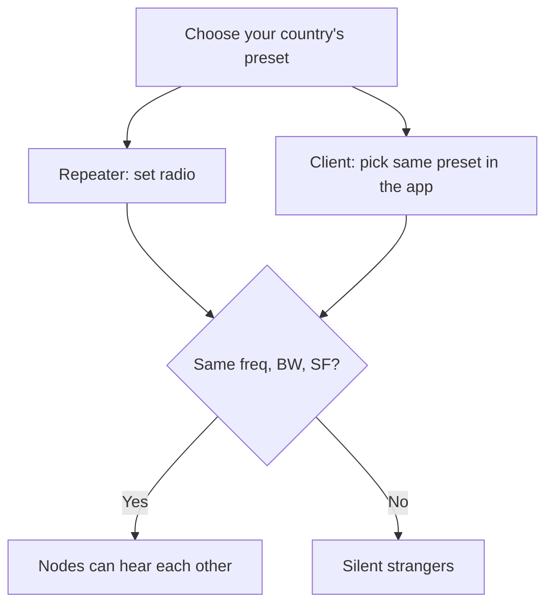

{:class="cover"}

---

By the end of this lesson you will be able to set and check the four radio settings on the repeater, and choose power and duty cycle values that suit your region.

Both boards are flashed. Now we make sure they can hear each other, and the other MeshCore nodes near you.

---

## The rule that catches everyone

**Frequency, bandwidth and spreading factor must match on every node that needs to talk.** There is no negotiation or fallback. If one is different, the nodes are silent strangers. That includes every other MeshCore node in your area, which is why communities agree on presets.

---

## Regional presets

MeshCore apps ship with named presets for each region. As I checked them while writing this lesson, the UK and EU preset is **EU/UK (Narrow)**:

| Setting | EU/UK (Narrow) |
|---|---|
| Frequency | 869.618 MHz |
| Bandwidth | 62.5 kHz |
| Spreading Factor | 8 |
| Coding Rate | 8 |
{:class="table table-single"}

For comparison, the USA preset I found was 910.525MHz, SF7, BW62.5, CR5. The MeshCore FAQ says many regions moved to narrow presets from October 2025, and an older EU/UK setting (869.525MHz, SF11, BW250) is now marked deprecated. **Presets change.** Before you commit, look at the preset list in the flasher or app, and ask your local community. Use the preset for *your* country, not the one in this lesson, and never transmit on a frequency your regulator does not allow.



---

## Setting them on the repeater

Connect the console (lesson 5) and check what is there:

```text
get radio
```

To set them explicitly (UK values shown):

```text
set radio 869.618,62.5,8,8
```

The command takes `frequency,bandwidth,spreading factor,coding rate`. Frequency is in **MHz** and bandwidth in **kHz**. Then confirm, and restart so the settings are definitely in use:

```text
get radio
reboot
```

---

## Setting them on the client

The companion is configured from the app. After pairing in lesson 9, open the app's settings for the node and choose your regional preset from the radio settings. The exact menu names depend on the app version.

---

## Transmit power

```text
get tx
```

MeshCore accepts a power in dBm (the docs list 1 to 22). Your board has its own hardware limit, around 21dBm on the Heltec V3. To change it:

```text
set tx 20
```

Lower power uses less battery. Check your region's limit from lesson 4 before raising it.

---

## Duty cycle

Newer firmware (v1.15 and later, per the MeshCore docs) has a duty cycle limit:

```text
get dutycycle
set dutycycle 10
```

The docs say the default is 50%. In the UK and EU the sub-band we use is commonly limited to 10%, so `set dutycycle 10` is the setting to try there. Older firmware used `set af <value>` (airtime factor), which the docs now call deprecated. If `get dutycycle` is not recognised, your firmware is older: update it, or use `af`. Whichever you use, the responsibility for staying legal is yours.

---

## Try it Yourself

1. Run `get radio` on your repeater and write the four numbers down. You need them for the client.
2. Deliberately set your client to a different spreading factor and try to see the repeater. Confirm that nothing happens, then put it back.
3. Challenge: calculate the airtime of a 30 byte packet at SF8/BW62.5 and at SF7/BW62.5 with a LoRa calculator. How much airtime does the lower SF save?

---

## Common Issues

- **Problem**: `set freq 869618` does not work.
- **Solution**: Frequency is in MHz, so use `869.618`.
- **Why**: MeshCore expects megahertz with a decimal point.

- **Problem**: My nodes cannot hear each other even though I believe the settings match.
- **Solution**: Run `get radio` on the repeater, read the app's settings on the client, and reboot both.
- **Why**: Assuming is not checking; one digit different is enough to silence a node.

- **Problem**: I hear my own nodes but not the local community repeaters.
- **Solution**: Ask your local group which preset they use.
- **Why**: Regional presets have changed over time and some repeaters run older settings.

> **Teachers**: the preset must be legal in your own country, so decide it once and write it on the board, then have every pair copy it. A wrong frequency is the cause of nearly every "it does not work" moment, and a mistyped frequency is also the main way a learner might transmit outside the permitted band.

## Check your understanding


? Which command shows the repeater's current frequency, bandwidth, SF and CR?
- [x] `get radio`
- [ ] `get name`
- [ ] `advert`
> `get radio` prints all four values, and `set radio` takes them in the same order.

? In `set radio 869.618,62.5,8,8`, what is 62.5?
- [ ] Spreading factor
- [x] Bandwidth in kHz
- [ ] Transmit power
> The order is frequency, bandwidth, spreading factor, coding rate.

? Why should you check the preset list before copying this lesson's numbers?
- [ ] Presets never change
- [x] Regional presets change, and yours must be legal where you live
- [ ] The app picks a random one
> The lesson explains that presets have moved over time and rules differ by country.


---
