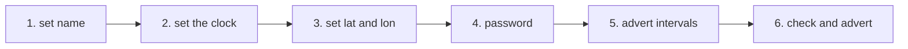

{:class="cover"}

---

By the end of this lesson you will be able to give a repeater a name, location, admin password and sensible advert schedule using console commands.

Node 1 has repeater firmware. Now we give it an identity. Everything here is done from the command line.

---

## Getting a console

Plug node 1 in (antenna fitted!) and connect with any of these:

- The **console** on [flasher.meshcore.io](https://flasher.meshcore.io)
- [config.meshcore.io](https://config.meshcore.io), a form-based UI
- A serial terminal at **115200 baud**, such as `screen`, `minicom` or PuTTY

Test it with `ver`. If a version comes back, you are in.



---

## Step 1: give it a name

```text
set name Kev-Repeater-01
```

Everyone in range sees this name when the repeater adverts, so make it useful and short, for example `<nickname>-<town>-01`. Use a nickname, not a full name.

---

## Step 2: set the clock

```text
clock sync
```

If your console does not offer `clock sync`, use `time <unix-epoch-seconds>` with the current Unix time. Check the result with `clock`. The MeshCore docs list both commands. A repeater with a very wrong clock can behave strangely and be hard to debug, so set it early.

---

## Step 3: set the location

```text
set lat 53.4084
set lon -2.9916
```

Use your own coordinates, which you can copy from any online map. Coordinates let a repeater appear on [map.meshcore.io](https://map.meshcore.io). If you do not want your exact address public, round to three decimal places (roughly 100 metres) or use a nearby landmark.

---

## Step 4: change the admin password

**Do this. Do not skip it.**

```text
password <your-new-password>
```

The MeshCore docs list the default admin password as `password`. Anyone within radio range who knows that could log in over the air and change your node. Write the new password down somewhere safe.

---

## Step 5: set the advert intervals

An **advert** announces "I exist, here is my name and public key". There are two kinds:

- A **zero-hop** advert is heard only by nodes in direct radio range
- A **flood** advert is repeated across the whole mesh

```text
set advert.interval 60
set flood.advert.interval 12
```

`advert.interval` is in **minutes** (the docs say 60 to 240) and `flood.advert.interval` is in **hours** (3 to 168). Mixing up the units is a classic mistake: `12` here means twelve *hours*.

A factory-fresh node starts with a short two minute zero-hop advert for easy testing. The docs warn that saving settings can reset an interval below 60 minutes to zero (off), so set an explicit value as above if you want zero-hop adverts to keep running. Check with `get advert.interval`.

Flood adverts are expensive because every repeater rebroadcasts them. Aggressive flood intervals annoy your local mesh.

You can also cap how far floods travel through your repeater:

```text
set flood.max 3
```

---

## Step 6: confirm and advertise

```text
get name
get radio
get tx
get lat
get lon
get role
stats-core
```

Then announce yourself:

```text
advert
```

Plain `advert` sends a **flood** advert. To reach only nodes in direct range use `advert.zerohop`.

---

## Commands worth remembering

| Command | What it does |
|---|---|
| `ver` / `board` | Firmware version and board type |
| `stats-core` | Uptime, battery, queue length (serial only) |
| `stats-radio` | Noise floor, last RSSI and SNR (serial only) |
| `stats-packets` | Packets received and sent (serial only) |
| `neighbors` | Repeaters you can hear directly |
| `discover.neighbors` | Look for zero-hop neighbours |
| `advert` / `advert.zerohop` | Flood advert / direct-range advert |
| `log start`, `log stop`, `log` | Capture and print an rx log |
| `reboot` | Restart the node |
| `erase` | Factory reset (serial only, destructive) |
{:class="table table-single"}

---

## Try it Yourself

1. Run `stats-radio` and note the noise floor. Switch on a microwave nearby and run it again.
2. Set a silly name, run `advert`, then set it back. You will watch the client pick up the change in lesson 10.
3. Challenge: run `log start`, leave the repeater for a while, then `log` to print what it heard.

---

## Common Issues

- **Problem**: The console shows garbage characters.
- **Solution**: Set the baud rate to 115200.
- **Why**: Any other rate decodes the serial stream as noise.

- **Problem**: My repeater is not on the map.
- **Solution**: Check `get lat` and `get lon`, send an `advert`, and be patient.
- **Why**: Map listings depend on adverts being heard by nodes that report to the map, so a quiet area may not show you yet.

- **Problem**: I forgot the admin password.
- **Solution**: Connect over USB and run `password <new-password>`, or `erase` and start again.
- **Why**: The serial console is trusted because you have physical access. The password protects access over the air.

> **Teachers**: every learner should change the default password and record it, or a classmate's client in range may reconfigure their repeater. Use a different node name per pair so the contact list stays readable. `erase` wipes the board, so make learners confirm before they run it.

## Check your understanding


? What unit does `set flood.advert.interval` use?
- [ ] Seconds
- [ ] Minutes
- [x] Hours
> The flood advert interval is in hours, while `advert.interval` is in minutes.

? Why change the admin password straight away?
- [x] The default is widely known and gives anyone in range admin access
- [ ] A new password improves range
- [ ] The repeater will not advert otherwise
> The docs list the default as `password`, so you must change it to protect the node over the air.

? What does plain `advert` send?
- [ ] A zero-hop advert
- [x] A flood advert
- [ ] A text message
> `advert` is a flood advert; `advert.zerohop` reaches direct range only.


---
