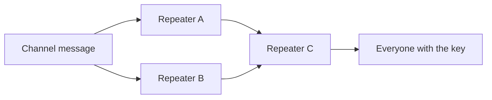

{:class="cover"}

---

By the end of this lesson you will be able to create a private channel, explain why channel messages flood, and limit flood range on your repeater.

Direct messages are one to one. Channels are how a group talks: a family, a hiking club, a village.

---

## What a channel is

A channel in MeshCore is **a name and a shared secret key**. Anyone holding the same key can read and post. There is no server, no membership list and no admin.

Adding someone means giving them the key. Removing someone means making a new channel with a new key and giving it to everyone else. It is simple and entirely in your hands.

---

## The public channel

MeshCore apps come with a well-known public channel. Its key is published so strangers can find each other. The MeshCore FAQ gives:

```text
Hex:    8b3387e9c5cdea6ac9e5edbaa115cd72
Base64: izOH6cXN6mrJ5e26oRXNcg==
```

The third character of the Base64 string is a capital letter O, not a zero. That catches people out.

**Use it for** saying hello to the local mesh and testing. **Do not use it for** anything private: assume everyone in range can read it. Do not rely on it for emergencies either, because a hobby mesh has no guarantee anyone is listening.

---

## Creating your own channel

In the app, add a channel and either generate a random key or type in a shared one. The easiest way to share it is a **QR code** from the app, which the other person scans, so there is nothing to type.

A worked example, a family channel:

1. Create a channel called `Family`
2. Let the app generate a random key
3. Show the QR code to each family member
4. Everyone with the key now sees every message

---

## Channels always flood

Direct messages learn a **path** and follow it. A channel has no single destination, so the MeshCore FAQ says channel messages always **flood**.



Why this matters:

- Channel traffic is expensive in airtime
- Repeater owners can limit how far floods travel with `set flood.max <hops>`
- Prefer direct messages for one to one chat, and keep channels for what the group needs to see

---

## Channel etiquette

- **Keep messages short.** Every character costs airtime for everyone
- **Test with direct messages**, not on the public channel
- **Respect the local public channel**
- **Do not bridge a channel to the internet** without telling the people on it

---

## Limiting flood range on your repeater

```text
set flood.max 3
```

This caps how many hops a flooded packet goes through your repeater. The docs give a range of 0 to 64, with 64 as the default. On a small local mesh, 3 is generous.

---

## Try it Yourself

1. Add the public channel to your client and post a short hello. Does anyone answer?
2. Create a private channel, generate a key, and export the QR code. Scan it on a second phone if you have one.
3. Challenge: with `log start` running on your repeater, post a channel message then run `log` to print the capture. Can you see it?

---

## Common Issues

- **Problem**: I typed the public channel key and it does not work.
- **Solution**: Check the third Base64 character is a capital O, or use the hex version.
- **Why**: O and 0 look nearly identical in most fonts, so transcription errors are common.

- **Problem**: My friend cannot see my channel messages.
- **Solution**: Confirm you have the exact same key and matching radio settings.
- **Why**: A channel with a different key is a different channel, even with the same name. The name is only a label.

- **Problem**: My channel messages take ages to arrive.
- **Solution**: Nothing is necessarily wrong. Try a direct message for one to one chat.
- **Why**: Floods are retransmitted by every repeater in range and queued, so a busy mesh slows them.

> **Teachers**: the public channel is read by strangers, so have learners stick to a private class channel and a simple rule: no names, addresses or photos of themselves. A private channel's key is a shared password, so share it in class, not in public.

## Check your understanding


? What defines a MeshCore channel?
- [ ] A server account
- [x] A name and a shared secret key
- [ ] A phone number
> Anyone with the same key can read and post.

? Why do channel messages flood?
- [x] A channel has no single destination, so no path can be learned
- [ ] Repeaters are broken
- [ ] The phone forces it
> Paths are for one-to-one messages; channels go to everyone with the key.

? Which command limits how many hops a flood travels through your repeater?
- [ ] `set tx`
- [x] `set flood.max`
- [ ] `advert`
> `set flood.max <hops>` caps flood hops.


---
