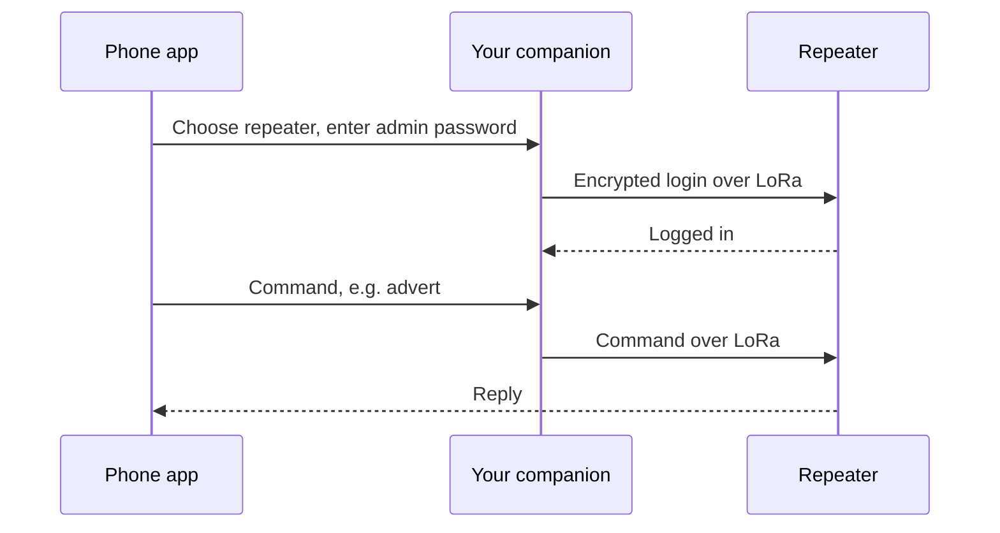

{:class="cover"}

---

By the end of this lesson you will be able to log in to your repeater over the air, run a few safe commands, and explain why you must never change its radio settings remotely.

Your repeater is in the loft or on a roof. Fetching a ladder every time you want to change a setting would get old fast. You do not have to.

---

## Three ways in

| Method | Where you need to be | Good for |
|---|---|---|
| **USB serial console** | Physically at the node | First setup, recovery, forgotten passwords |
| **[config.meshcore.io](https://config.meshcore.io)** | Plugged in by USB, in Chrome or Edge | A form-based UI over the same settings |
| **Over the mesh, from the app** | Anywhere in radio range | Day to day admin and checks |
{:class="table table-single"}

The third is what this lesson is about. The MeshCore README says repeaters can be managed over LoRa in the mobile app using its **Remote Management** feature.



---

## Logging in over the air

1. In the app, find your repeater in the contacts list
2. Choose the admin, manage or login option (the wording depends on the app version)
3. Enter the admin password you set in lesson 7

You are now talking to the repeater's command line over LoRa, encrypted, from wherever you stand.

> ## About the wait timer
>
> According to the MeshCore FAQ, the apps have a wait timer before remote management becomes available, and an optional in-app purchase removes it. The feature works without paying. You just wait.

---

## What you can do remotely

Many commands from lesson 7 work over the air. Note that the MeshCore command reference marks some commands as **serial only**: `stats-core`, `stats-radio`, `stats-packets`, `get acl` and `erase` only work with a cable. Over the air, rely on what the app shows, and try a command to see whether your version accepts it.

**Tuning**

```text
set advert.interval 60
set flood.advert.interval 12
set flood.max 3
```

**Housekeeping**

```text
set name Kev-Loft-01
set owner.info Kev - kevsrobots.com
advert
reboot
```

Being able to `reboot` a wedged node without a ladder is worth the whole exercise.

---

## Security

Your admin password is the thing between your repeater and anyone in range with a MeshCore client.

- Change it from the default straight away, which you did in lesson 7
- Write it down somewhere safe
- Set `owner.info` so people can contact you instead of fiddling

The repeater has an access control list (ACL). From the console you can view it with `get acl` (serial only) and grant a node a permission level with `setperm <public-key> <permission>`, where the docs list `0` guest, `1` read-only, `2` read-write and `3` admin. Omitting the permission removes the entry. This helps when a repeater is shared infrastructure.

There is also an `allow.read.only` flag. The docs list it under room servers, so it will not apply to a plain repeater. Ask about it in the follow-on course.

---

## Reading the numbers

At the cable, `stats-core` gives uptime, battery and queue length. A queue that is regularly non-zero means the repeater is receiving faster than it can retransmit, so the mesh around it is busy.

`stats-radio` gives RSSI, SNR and the **noise floor**. Note the noise floor over time. A rising noise floor means new interference near your repeater, and it quietly eats your range.

---

## Recovering a locked-out node

With physical access:

1. Plug in over USB
2. Run `password <new-password>`

The serial console is trusted and the password gates access over the air. If that is not enough, `erase` resets the node to defaults.

---

## Try it Yourself

1. Log in to your repeater from the app and read what it shows. What is its name?
2. Change the repeater's name remotely, send an advert, and watch the new name appear.
3. Challenge: use `setperm` over USB to give a second client read-only access, then log in with it and check it cannot change settings.

---

## Common Issues

- **Problem**: Remote login times out.
- **Solution**: Check you can see and message the repeater normally first, and that you are in range.
- **Why**: Remote admin runs over the mesh, so if messaging does not work, admin cannot.

- **Problem**: The app says the password is wrong but I am sure it is right.
- **Solution**: Try the default `password`, in case a reflash or `erase` reset it.
- **Why**: Flashing can reset stored settings.

- **Problem**: I changed a setting remotely and now the repeater is unreachable.
- **Solution**: Go to the repeater, connect over USB, and put the setting back.
- **Why**: Changing frequency, bandwidth or SF remotely moves the node off the channel you used to talk to it. **Never change radio settings on a remote node unless you can physically reach it.**

> **Teachers**: only share admin passwords with the learner who owns the repeater, and never put a classroom password on the wall where another pair can read it. If two pairs share a room, a classmate who guesses the default password could reconfigure someone else's node, so change it first.

## Check your understanding


? Which radio changes are risky to do remotely?
- [ ] Changing the node name
- [x] Changing frequency, bandwidth or spreading factor
- [ ] Sending an advert
> Changing radio settings moves the node off the channel you used to reach it.

? Where does the console always trust you?
- [x] Over USB, because you have physical access
- [ ] Over the air with no password
- [ ] Only in the app
> The serial console is trusted, and the password gates access over the air.

? What does the app's wait timer do?
- [ ] Locks the repeater
- [x] Delays remote management unless you buy the optional unlock
- [ ] Resets the password
> The FAQ says an optional purchase removes the wait.


---
