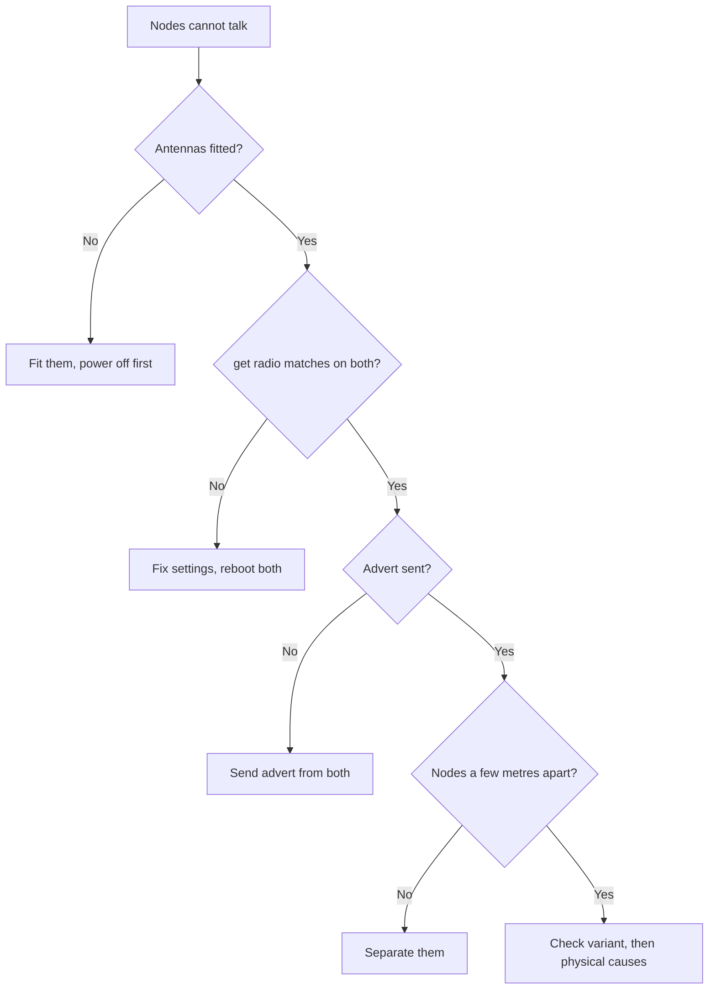

{:class="cover"}

---

By the end of this lesson you will be able to work down a checklist to find why two nodes cannot talk, and read RSSI and SNR to judge a link.

Something is not working. Do not change settings at random: work down the list in order. Most problems are in the first few items.



---

## The five minute checklist

1. **Antennas fitted to both boards?**
2. **Same frequency, bandwidth and spreading factor on both?** Run `get radio` on the repeater and read the app's settings on the client, digit by digit
3. **Have you sent an advert?** Clients do not advertise by themselves
4. **Are the boards a few metres apart?** Touching on a desk can overload the receiver
5. **Did you flash the right variants?** One repeater and one companion

---

## The board is not detected

**Symptoms:** no serial port appears, or the flasher shows an empty list.

1. **Try a different USB-C cable.** Charge-only cables are the number one cause
2. Try a different USB port, directly on the machine rather than a hub
3. Check your system's device list for a serial device
4. Put the board into bootloader mode using its BOOT or PRG button, as the flasher page describes
5. Use Chrome or Edge, as WebUSB does not exist in Firefox or Safari

---

## The OLED is blank

1. Is the board getting power? Look for an LED
2. Reflash the firmware, as a partial flash can leave a board that boots to nothing
3. Some builds blank the screen after a timeout, so press the user button

---

## The two nodes cannot hear each other

This is the big one, and it is almost always settings.

1. **Frequency.** Does `get radio` show the preset you intended?
2. **Bandwidth and spreading factor.** They must match exactly, though a coding rate difference is tolerated
3. **Reboot both** after any settings change
4. **Distance.** Move them 5 to 10 metres apart
5. **Advert.** Run `advert` on the repeater while watching the client's contacts
6. **Frequency variant.** Is one board a different-band variant? Check the sticker

---

## Messages send but never arrive

1. **Trace the contact** and look at the path and SNR at each hop
2. **Reset the path** and let it rediscover
3. **Check the repeater is running** with `stats-core` over USB
4. **Check queue length** in `stats-core`. A large queue means congestion

---

## Range is much worse than expected

| Cause | Fix |
|---|---|
| Antenna lying horizontal | Stand it vertical at both ends |
| Wrong band antenna | Confirm it matches your band |
| Long thin coax | Move the board to the antenna, run USB instead |
| Foil-backed insulation | Get the antenna outside the roof space |
| Node too low | Height beats everything |
| Possible damage | Did you ever power it without an antenna? Compare with a known good board |
| Local interference | Check the noise floor with `stats-radio` |
{:class="table table-single"}

---

## The repeater keeps dropping off

1. **Power bank auto-shutdown.** Use a mains charger
2. **Brownouts.** A weak supply can cause resets on transmit peaks
3. **Overheating.** A closed dark box in the sun gets very hot, so shade or vent it
4. **Water.** Check for condensation inside the enclosure

---

## I can see my nodes but nobody else's

1. **Ask your local community which preset they use.** Some areas still run older settings
2. **Check the map** at [map.meshcore.io](https://map.meshcore.io). There may genuinely be nobody in range
3. **Get higher**, as community repeaters are often kilometres away

---

## Signal quality guide

These are rough rules of thumb, not hard limits:

| RSSI | Meaning |
|---|---|
| -30 to -60 dBm | Very strong, possibly too close |
| -60 to -90 dBm | Comfortable |
| -90 to -110 dBm | Working, but marginal |
| Below -115 dBm | At the edge, expect losses |
{:class="table table-single"}

| SNR | Meaning |
|---|---|
| Above 0 dB | Signal stronger than the noise, excellent |
| 0 to -7 dB | Normal for LoRa at range |
| Below about -7 to -10 dB | Marginal for the SF8 preset, near the decoding limit |
{:class="table table-single"}

---

## Starting over

Sometimes the fastest fix is a clean slate. Over USB on the repeater:

```text
erase
reboot
```

Then reflash and reconfigure from lesson 5. It takes ten minutes and removes every accumulated mistake. `erase` is destructive and serial-only, so you lose the name, location and password you set.

---

## Try it Yourself

1. Deliberately break your setup by changing the client's spreading factor, then work down this checklist to find it.
2. Record your normal RSSI and SNR to the repeater from one spot. A baseline makes later problems obvious.
3. Challenge: write a one-page troubleshooting card for your own setup and tape it inside the repeater's enclosure lid.

---

## Common Issues

- **Problem**: I have tried everything on this list and it still does not work.
- **Solution**: Erase and reflash both boards, then configure them side by side on the same desk, about 5 metres apart.
- **Why**: Debugging two variables at once is hard, and starting from a known good state removes one.

- **Problem**: It works on the desk but not once the repeater is in place.
- **Solution**: The problem is physical: height, obstruction, antenna direction or coax loss.
- **Why**: Settings problems are all or nothing, while physical problems are gradual.

- **Problem**: A board is hot, or a battery is warm, swollen or smells.
- **Solution**: Unplug it, move it somewhere non-flammable away from other things, and do not use that battery again.
- **Why**: A damaged LiPo can overheat and catch fire, and this is a safety issue before it is a debugging one.

> **Teachers**: set up a "break it, then fix it" session in pairs. One partner changes one setting on the other's node while they look away, and the other finds it with this checklist. Keep a spare working pair of boards for comparison, and have a plan for what to do with a hot or swollen LiPo.

## Check your understanding


? What is the most common cause when two nodes cannot hear each other?
- [ ] A damaged screen
- [x] Mismatched radio settings
- [ ] A bad phone case
> The lesson says it is almost always settings: frequency, bandwidth or spreading factor.

? Settings problems and physical problems differ how?
- [x] Settings problems are all or nothing; physical problems are gradual
- [ ] Settings problems only happen outdoors
- [ ] There is no difference
> If settings were wrong it would not work on the desk either.

? What should you do first with a warm or swollen LiPo?
- [ ] Keep charging
- [x] Unplug it and move it somewhere safe
- [ ] Put it in a sealed box outside
> A damaged cell is a safety risk and must stop being used.


---
