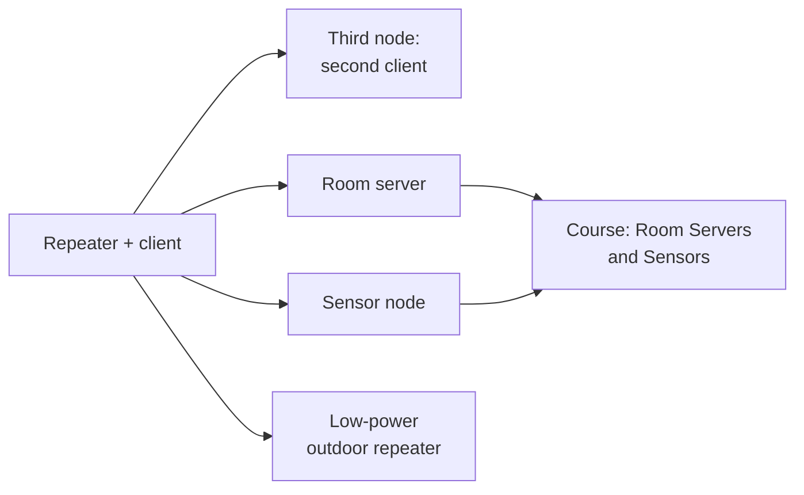

{:class="cover"}

---

By the end of this lesson you will be able to review what you built, and choose your next MeshCore project.

You have a working mesh: a repeater extending your range, a client in your pocket, and a network that owes nothing to anybody's infrastructure.

---

## What you built

- A **repeater** with a name, a location, a password and a sensible advert schedule
- A **client** paired to your phone, sending encrypted messages
- Radio settings matched to your region and checked against local rules
- The ability to administer the repeater over the air, and to troubleshoot the whole chain

---

## Add a third node

The best upgrade is a **third board flashed as a companion**. Now two humans can message each other, and you can test paths and see hop counts that are not zero. Give it to a family member or a neighbour.

---

## Build a room server and sensors

A **room server** stores posts for people who were out of range. A **sensor** node reports readings such as temperature or battery voltage into the mesh. Both are one flash away on the same hardware, and the MeshCore FAQ recommends running a room server on its own board rather than turning on `repeat`, because that loses repeater admin features.

The follow-on course covers both in full: [MeshCore Room Servers and Sensors](/learn/meshcore_rooms_sensors/).

---

## Go low-power

For a battery or solar repeater, pick a board designed for low power, such as the Heltec T114 mentioned in the MeshCore FAQ, and size the battery and panel from measured current, not guesses. Enable `powersaving on` on a repeater that runs from a battery. Remember batteries need safe handling, outdoors especially.

---

## Join the community

A mesh with one owner is a hobby. A mesh with fifty owners is infrastructure.

- **[map.meshcore.io](https://map.meshcore.io)**: see who is on air near you
- **[meshcore.io](https://meshcore.io)** and **[docs.meshcore.io](https://docs.meshcore.io)**: official site and documentation
- **[The MeshCore repository on GitHub](https://github.com/meshcore-dev/MeshCore)**: the firmware, its README and FAQ
- Your local community group, for example [localmesh.co.uk](https://localmesh.co.uk) in the UK

Tell people where your repeater is and who looks after it. Someone, one day, will be glad it was there.

---

## Your capstone challenge

> **Get a message from one end of your town to the other, with at least one hop, and record the path and signal quality at each step.**

That needs a well-placed repeater, matching settings, a client that can trace, and enough understanding of RSSI and SNR to know whether the link is healthy or lucky.

---

## Try it Yourself

1. Write down the settings of your repeater (name, preset, advert intervals, flood limit) on a card, so you can rebuild it from scratch.
2. Draw a map of where a second and third repeater would go to cover your town.
3. Challenge: plan the capstone. List the nodes, heights, antennas and the legal limits you must respect, then test it with a friend.

---

## Common Issues

- **Problem**: I want to expand, but my town already has repeaters and I am not sure how mine fits.
- **Solution**: Check the map and ask your local community before adding another.
- **Why**: Extra repeaters add traffic, and a well-placed one helps more than several badly placed ones.

- **Problem**: My project works indoors but I want to take it outside.
- **Solution**: Revisit lessons 4 and 8 for antenna, weatherproofing, battery and legal checks.
- **Why**: Outdoor installs add water, heat, height and regulation that a desk test never meets.

> **Teachers**: the capstone makes a good group project. Agree beforehand where learners may place nodes, get permission from whoever owns the site, and keep to indoor or ground-level locations unless an adult is responsible for any work at height.

## Check your understanding


? Why does a third board make a better test of your mesh?
- [ ] It doubles the transmit power
- [x] Two humans can message each other and you can test paths
- [ ] It removes the need for a repeater
> A two node mesh has one human; a third node lets people message and shows real hop counts.

? What does the MeshCore FAQ recommend for a room server?
- [x] Run it on its own board rather than enabling repeat
- [ ] Always enable repeat
- [ ] Run it on the same board as the phone
> Enabling `repeat` on a room server loses the full repeater admin features.

? What is the first step before adding another repeater?
- [ ] Buy a bigger antenna
- [x] Check the map and ask your local community
- [ ] Raise the transmit power to maximum
> A badly placed extra repeater adds traffic without helping coverage.


---

## Related courses

- [MeshCore Room Servers and Sensors](/learn/meshcore_rooms_sensors/), part two, building the other two node types in full
- [Raspberry Pi Pico with MicroPython: GPIO Mastery](/learn/micropython_gpio/), for sensor projects
- [Mini-Rack 3D Design Tutorial](/learn/mini_rack/), if your repeater ends up in a home lab
- [Introduction to Linux](/learn/linux_intro/), useful if you go down the bridging and gateway route

Thanks for working through this one. If you spot something out of date, tell me: radio conventions move fast. Now go and put something on a roof, safely.

---
