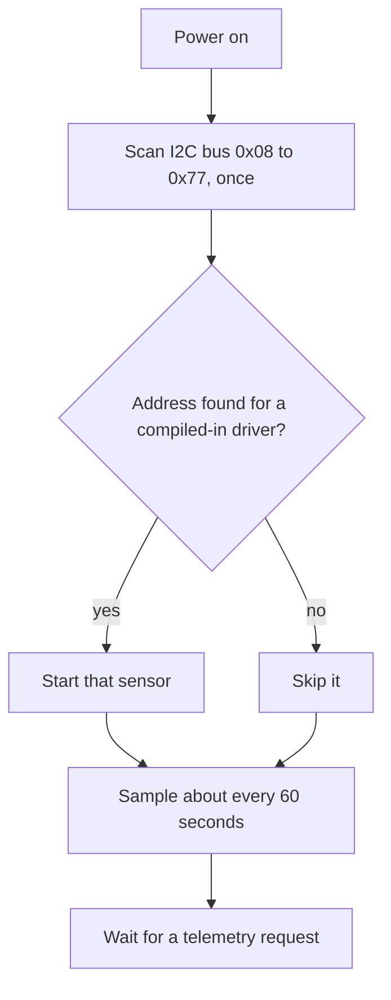

{:class="cover"}

---

By the end of this lesson you will be able to flash a sensor node, wire it before first boot, and use `sensor list` to see what the firmware detected.

Third board, third firmware variant. The process is identical; the interesting part comes at first boot, when the firmware goes looking for sensors.

---

## Flashing

1. Fit the antenna
2. Plug the board in with a USB-C **data** cable
3. Open [flasher.meshcore.io](https://flasher.meshcore.io) in Chrome or Edge
4. Select **Heltec V3**
5. Select the **Sensor** firmware variant, if your flasher version offers one (see the box below)
6. Select the radio preset your mesh uses (the UK one in part one was **EU/UK (Narrow)**; wording may differ)
7. Flash

> ## If there is no Sensor variant listed
>
> Sensor support is compiled per board, and a prebuilt sensor image may not be offered (the MeshCore README lists Companion, Repeater and Room Server as the flasher's types). If there is no sensor build for you:
>
> - Check whether a newer firmware release has added one
> - Build it yourself from [the MeshCore repository](https://github.com/meshcore-dev/MeshCore). It contains a Heltec V3 sensor build environment that sets the sensor-bus pins to GPIO33 and GPIO34, and you enable the `ENV_INCLUDE_...` flag for each sensor driver you want, such as `ENV_INCLUDE_BME280`
> - Check that the build you flash actually includes your sensor's driver: if `sensor list` shows only battery with correct wiring, a missing driver flag is the usual reason
>
> Lesson 13 covers the custom build route in more detail.

---

## Wire the sensor before first boot

**Do this now, before you power it up properly.** The firmware scans the I2C bus **at boot** only. A sensor plugged in afterwards will not be noticed until the next reset.

The wiring is four wires, and lesson 11 walks through it properly. For now:

| Sensor pin | Heltec V3 pin |
|---|---|
| VCC / VIN | 3V3 |
| GND | GND |
| SDA | **GPIO33** |
| SCL | **GPIO34** |
{:class="table table-single"}

**Not GPIO17 and GPIO18.** Those are the OLED's bus. The sensor firmware scans a separate bus - see lesson 2.

If you would rather flash first and wire later, that is fine - just remember to `reboot` afterwards.

---

## First boot and auto-detection

Connect the console and check the basics:

```text
ver
board
get role
get radio
```

Then ask what it found:

```text
sensor list
```

**This is the moment of truth.** If your BME280 is wired correctly and supported by this build, it appears here. If the list is empty or shows only battery, the firmware did not find your sensor.

`sensor list` takes an optional starting index if you have more sensors than fit in one response:

```text
sensor list 5
```

---

## The other two sensor commands

```text
sensor get <key>
sensor set <key> <value>
```

`sensor get` reads a single value by its key, which is useful for checking one thing without pulling the whole telemetry set. `sensor set` adjusts a sensor setting - the classic example being turning a GPS module on or off at runtime.

The available keys depend entirely on what is attached, which is why `sensor list` is where you always start.

---

## Confirm the radio settings

Same as every other node:

```text
get radio
```

Expect the same four numbers as the rest of your mesh (869.618 MHz, 62.5 kHz, SF8, CR8 in the UK setup from part one). If not:

```text
set radio 869.618,62.5,8,8
reboot
```

---

## Name it and place it

```text
set name Greenhouse-Sensor
set lat <your-latitude>
set lon <your-longitude>
set owner.info <your name or club> - <contact>
```

**Name it after where it is, not what it is.** `Greenhouse` tells you something useful when the reading looks odd. `Sensor-02` does not.

---

## Transmit power on a battery node

```text
get tx
set tx 17
```

Full power makes sense for mains nodes. For a battery sensor, lowering the transmit power reduces the current drawn while transmitting, at the cost of range. If your sensor has a repeater within easy reach, that is a good trade; if it is right at the edge, keep the power up. The setting accepts 1 to 22 dBm, and your country's rules set the legal maximum.

---

## Send an advert

```text
advert
```

Your client will not know the sensor exists until it hears an advert. Plain `advert` floods across the mesh; `advert.zerohop` announces only to nodes in direct range.

---

## What happens at boot



> **Teachers**: Building firmware from source needs PlatformIO and a good network connection, and the first build downloads a lot of code, so allow a whole session or prepare the firmware in advance. Keep the antenna fitted on every powered board, and do not hot-plug sensors onto a powered board: unplug USB first.

---

## Try it Yourself

1. Run `sensor list` with nothing wired up. What does it report? (Battery and uptime should still be there.)
2. Wire the BME280, reboot, and run `sensor list` again. Compare the two.
3. Challenge: unplug the sensor while the node is running, then run `sensor list`. Does it notice? Now reboot and check again. This tells you a lot about when detection actually happens.

---

## Common Issues

- **Problem**: `sensor list` shows nothing but battery.
- **Solution**: Check the wiring, confirm the sensor is on the supported list, then `reboot` so the I2C scan runs again.
- **Why**: Detection happens at boot. A sensor connected after startup is invisible until the next reset.

- **Problem**: `sensor list` is not a recognised command.
- **Solution**: You are on repeater or companion firmware, or a build without sensors compiled in.
- **Why**: The sensor commands only exist when sensor support is compiled into that firmware image.

- **Problem**: I wired the sensor to GPIO17 and GPIO18 and nothing was detected.
- **Solution**: Move it to GPIO33 and GPIO34, then `reboot`.
- **Why**: GPIO17 and GPIO18 are the OLED's bus. The sensor firmware scans a second, separate bus - so a perfectly wired sensor on the wrong bus is invisible.

- **Problem**: The sensor works on USB but not on battery.
- **Solution**: Check the Vext rail. On the Heltec V3, GPIO36 controls power to the external 3V3 rail.
- **Why**: Some power-saving configurations switch the external rail off, which cuts power to anything you have wired to 3V3.

---

## Check your understanding


? When does the sensor firmware look for connected I2C sensors?
- [x] At boot only
- [ ] Every second
- [ ] Only when a request arrives
> A sensor added later is invisible until you reboot.

? What does `sensor list` showing only battery usually mean?
- [x] The sensor was not detected: check wiring, pins, driver and reboot
- [ ] The radio is broken
- [ ] The sensor is too accurate
> Either the bus is wrong, the part is unsupported, or the build lacks its driver.

? Why name a sensor after its location?
- [x] A name like Greenhouse helps interpret odd readings
- [ ] The firmware requires it
- [ ] It lowers power use
> A location name tells you what a reading should look like.


