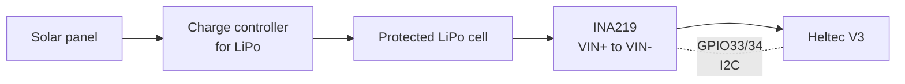

{:class="cover"}

---

By the end of this lesson you will be able to read a node's battery voltage, calibrate it against a multimeter, and monitor solar current with an INA219.

The most useful sensor on a remote node is not a thermometer. It is the battery gauge. A node that tells you it is at 3.4V and falling gives you a week's warning; a node that just goes quiet gives you a mystery and a walk up a hill.

---

## The free sensor you already have

Battery voltage needs **no extra hardware**. Every MeshCore node reads its own supply through an onboard ADC, and reports it as basic device telemetry.

On the Heltec V3 the battery voltage is read on **GPIO1** through an onboard divider.

Check it from the USB serial console (the CLI reference lists `stats-core` as serial only):

```text
stats-core
```

It reports battery, uptime, queue length and debug flags. And because battery is treated as basic health data rather than gated telemetry, it is available at a lower permission level than environmental readings - which is exactly right. Anyone should be able to see whether infrastructure is alive.

---

## Calibrating the reading

Board-level battery reading uses an ADC multiplier to compensate for the voltage divider fitted to that particular hardware. If your reported voltage is consistently wrong, that multiplier is the thing to adjust:

```text
get adc.multiplier
set adc.multiplier <value>
```

Valid values run from 0.0 to 10.0, and 0.0 means "use the board's own value". The Heltec V3 board code defaults to **5.42**, reflecting the divider fitted to that board. The command returns an error on boards that do not support it.

**How to calibrate properly:**

1. Measure the actual cell voltage with a multimeter, at the battery terminals
2. Read what the node reports via `stats-core`
3. New multiplier = current multiplier × (measured ÷ reported)
4. Set it, reboot, and check again

**Worth doing?** If you are going to make decisions based on the number - "go and swap the battery when it hits 3.5V" - then yes. A 5% error is the difference between a healthy node and a dead one. If you only care about the trend, the uncalibrated figure is fine.

---

## Reading a LiPo voltage

A single-cell LiPo tells you a lot if you know the shape of its discharge curve:

| Voltage | State |
|---|---|
| 4.2V | Fully charged |
| 4.0V | ~85% |
| 3.8V | ~50% |
| 3.7V | Nominal - the long flat middle |
| 3.6V | ~20%, start paying attention |
| 3.4V | ~10%, act now |
| Below about 3.0V | Never run a cell this low: the protection circuit may cut off, and deep discharge damages it |
{:class="table table-single"}

**The awkward truth about that curve:** LiPo cells spend most of their life between 3.9V and 3.7V. Voltage is a poor guide to remaining capacity in the middle and an excellent one at the ends. Treat 3.6V as your alarm threshold rather than trying to read a percentage.

**In cold weather**, voltage sags under load and recovers when idle. A node reading 3.5V mid-transmit on a January morning may be considerably healthier than it looks.

---

## Proper power monitoring with an INA219

The onboard ADC gives you voltage. If you want to know what your solar panel is actually *doing*, you need current as well - and that means an INA-series sensor.

MeshCore's sensor driver code supports **INA219, INA226, INA260 and INA3221**, when the matching build flag is enabled. Their default addresses in that code are 0x40 (INA219), 0x44 (INA226), 0x41 (INA260) and 0x42 (INA3221).

| Part | Channels | Good for |
|---|---|---|
| INA219 | 1 | Simple battery or panel monitoring |
| INA226 | 1 | Better accuracy, wider range |
| INA260 | 1 | Integrated shunt - simplest wiring |
| **INA3221** | **3** | Panel, battery and load all at once |
{:class="table table-single"}

**For a solar node the INA3221 is the interesting one.** Three channels lets you watch the panel, the battery and the load simultaneously, which tells you the whole story: is the panel producing, is the battery accepting charge, and is the load what you expected?

### Wiring an INA219

I2C, exactly like the BME280:

| INA219 pin | Heltec V3 pin |
|---|---|
| VCC | 3V3 |
| GND | GND |
| SDA | **GPIO33** |
| SCL | **GPIO34** |
| VIN+ | Supply side of the circuit you are measuring |
| VIN- | Load side |
{:class="table table-single"}

The INA219 chip itself runs from 3 to 5.5V (datasheet), but the voltage it measures on VIN+ and VIN- can be up to 26V, so keep your battery and panel within that. The last two pins are the difference from a BME280. **The INA measures current by sitting in series with the load**, across an internal shunt resistor. VIN+ goes to the source, VIN- to the thing being powered. Get these the wrong way round and you get negative current readings - which is actually useful for telling charge from discharge.

Then, as always:

```text
reboot
sensor list
```

---

## What a healthy solar node looks like

Watch these over a few days and the pattern becomes obvious:

**Good:** battery peaks near 4.2V in the afternoon, drops overnight to maybe 3.9V, recovers the next day. Panel current positive through daylight.

**Marginal:** battery peaks around 4.0V, never quite reaching full. Surviving, but with no reserve for a bad week.

**Failing:** each day's peak is lower than the last. You have a few days before it goes dark. Either the panel is undersized, something is shading it, or the node is using more than you thought.

**The winter reality in the UK:** a panel sized for July will not carry a node through December. Size for the worst month or accept a seasonal outage - and a battery telemetry reading is how you find out which one you have, before the node vanishes.

---

## Cutting the load

If telemetry shows you are losing the battle:

```text
set tx 17
set advert.interval 240
set flood.advert.interval 168
```

Lower transmit power (within your legal limits), and advertise as rarely as the ranges allow. Each of these directly reduces transmit time, which is where nearly all the energy goes.

Beyond that, the honest answer is hardware: the nRF52840-based **Heltec T114** is designed for much lower idle current than the ESP32-S3 and is a popular choice for solar nodes. Check its datasheet for numbers.

---

## The power chain on a solar node



> **Teachers**: LiPo cells need care. Use only protected single cells, charge them with a charger designed for LiPo (never directly from a bare solar panel), check polarity before connecting, and never charge unattended. Do not short the cell's terminals, and bin any swollen cell safely through a battery recycling point. Measuring with a multimeter is safe at these voltages, but take care not to touch the probes across the terminals.

---

## Try it Yourself

1. Run `stats-core` and note the battery voltage. Check it against a multimeter at the terminals. How close is it?
2. Calibrate `adc.multiplier` if the two disagree by more than a couple of percent.
3. Unplug USB, let the node run on battery for a day, and check the voltage morning and evening.
4. Challenge: wire an INA219 in series with a small solar panel behind a proper charge controller and log panel current across a full day. When does your panel actually start producing? Never connect a bare panel straight to a LiPo.

---

## Common Issues

- **Problem**: Battery voltage reads zero or wildly wrong.
- **Solution**: Check `get adc.multiplier` and calibrate against a multimeter.
- **Why**: The multiplier compensates for a board-specific voltage divider. A wrong value gives a plausible-looking but wrong number.

- **Problem**: Voltage reads high on USB and low on battery.
- **Solution**: That is expected.
- **Why**: On USB the board is running from the 5V rail through its regulator and the cell is charging. The reading only reflects true battery state when it is actually running from the battery.

- **Problem**: My INA219 shows negative current.
- **Solution**: Swap VIN+ and VIN-, or leave it and remember the sign.
- **Why**: The INA measures the direction of flow across its shunt. Negative simply means current is flowing the other way - which on a battery channel is exactly how you tell charging from discharging.

- **Problem**: My LiPo is hot, swollen or smells strange.
- **Solution**: Disconnect it, move it somewhere non-flammable, and do not charge or reuse it.
- **Why**: Damage, overcharging or a reversed connection can make a LiPo overheat, so treat any swelling as a stop sign.

- **Problem**: The node dies overnight even though voltage looked fine at dusk.
- **Solution**: Check the reading under load rather than idle, and suspect the cell's capacity rather than its voltage.
- **Why**: An aged LiPo holds voltage but not charge. It reads 4.0V, then collapses the moment it is asked for real current.

---

## Check your understanding


? The reported voltage is wrong. Which setting do you adjust?
- [x] adc.multiplier
- [ ] set tx
- [ ] advert.interval
> The multiplier compensates for the board's voltage divider; new = current x (measured / reported).

? An INA219 measures current by sitting...
- [x] in series with the load, across a shunt resistor
- [ ] in parallel across the battery
- [ ] next to the antenna
> VIN+ goes to the source and VIN- to the load.

? Which tool do you use to compare the node's reading with the true cell voltage?
- [x] A multimeter at the battery terminals
- [ ] The OLED brightness
- [ ] The advert counter
> Measure the actual cell voltage, then scale the multiplier by measured divided by reported.

? Why should you not connect a bare solar panel directly to a LiPo?
- [x] It can overcharge the cell, so use a charge controller
- [ ] It makes the radio quieter
- [ ] Panels are always 3.3V
> Cells need controlled charging.


