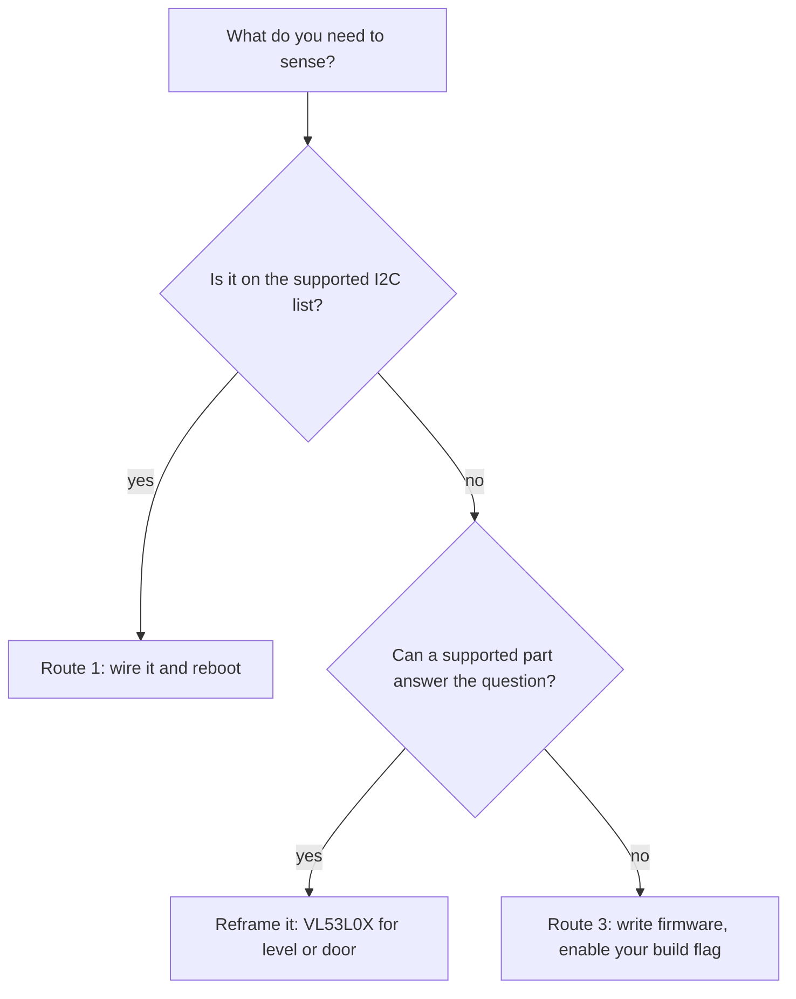

{:class="cover"}

---

By the end of this lesson you will be able to choose between a supported I2C sensor, a GPIO expander and custom firmware for door, level and switch sensing.

"Is the shed door open?" and "how full is the water tank?" are two of the most requested things people want from a remote sensor. This lesson is an honest account of how to get them, because the obvious approach is not the supported one.

---

## The honest starting point

MeshCore's stock sensor firmware **auto-detects I2C sensors**. That is its model. It scans the bus at boot, finds parts it recognises, and reports them.

It does **not** give you a general "read this GPIO pin as a switch" feature in the prebuilt firmware. A reed switch wired to a spare pin will not turn up in `sensor list`.

That is worth stating plainly, because plenty of guides imply otherwise. You have three real routes, in increasing order of effort.

---

## Route 1: use a supported sensor that answers the question

The most reliable approach is to reframe the question so a supported I2C part can answer it.

### Water tank level - VL53L0X

A **VL53L0X** is a time-of-flight distance sensor: it measures how far away a surface is, up to around two metres according to ST. It sits at I2C address 0x29 and its chip runs from about 2.6 to 3.5V, so feed the breakout from 3V3. It uses an invisible infrared laser (a Class 1 device, safe in normal use), so do not stare into it from close range with magnifying optics.

Mount it in the top of a tank looking down at the water. Distance to the surface *is* the level, inverted. A full tank reads a short distance; an empty one reads the tank's depth.

| Tank depth | Reading when full | Reading when empty |
|---|---|---|
| 1.0m | ~0.1m | ~1.0m |
{:class="table table-single"}

**Practical notes:**

- Mount it looking straight down, and keep the lens clean and out of splash
- Condensation on the lens will ruin readings - a small vented shroud helps
- It measures to the *surface*, so a floating lid or heavy foam gives you nonsense
- Range is limited, so this suits IBC totes and butts rather than deep cisterns

### Door open or shut - VL53L0X again

Same part, different framing. Mount it on the door frame looking at the door. Closed reads a few centimetres; open reads the distance across the shed.

It is a slightly odd way to sense a door, but it uses supported hardware and works today, with no firmware building.

### Soil moisture - RAK12035

If the question is really about a growing thing rather than a tank, the **RAK12035** reports soil moisture and temperature directly over I2C, and is supported.

---

## Route 2: an I2C GPIO expander

If you genuinely need contact closures - several of them, or a specific switch you already have - an I2C GPIO expander puts digital inputs on the bus.

**The honest caveat:** the MeshCore driver list we checked (BME280, INA219 and so on) does not include a GPIO expander, so an expander will not show up in `sensor list`. Treat it as part of route 3, where you write the driver yourself. It is still the right hardware for that job.

---

## Route 3: build your own firmware

This is the proper answer for anything the stock builds do not cover, and it is more approachable than it sounds.

MeshCore's sensor support is built around a **`SensorManager`** base class. Individual sensors are compiled in through build flags in `platformio.ini` - `ENV_INCLUDE_BME280` and its siblings. Adding a new sensor, or a plain digital input, means:

1. Clone [the MeshCore repository](https://github.com/meshcore-dev/MeshCore)
2. Install PlatformIO - the VS Code extension is the easy path
3. Find the sensor manager for your board
4. Implement `querySensors()` for your input, respecting the permission flags (read how an existing driver does it, and the repository's own docs, rather than copying from this lesson)
5. Add your build flag and compile for your board
6. Flash the result

**What you need to know:** enough C++ to read existing code and copy its shape. You are not designing anything - the interface is already there and there are working examples for a dozen sensors to imitate.

**When it is worth it:** you have several nodes to build, or the measurement genuinely matters. For a single hobby node, route 1 is usually the better use of an evening.

---

## What about a DS18B20 or a DHT22?

Both are extremely common, and neither is I2C.

- **DS18B20** is one-wire
- **DHT22 / AM2302** uses its own proprietary single-wire protocol

Neither is auto-detected. For temperature, a **BME280 works today without custom firmware**, which makes it the sensible choice for this course. Keep the DS18B20 for a project where you are already building firmware - it is a genuinely excellent waterproof probe.

---

## Choosing your route

| You want | Best route |
|---|---|
| Water tank level | VL53L0X, route 1 |
| Door open or shut | VL53L0X, route 1 |
| Soil moisture | RAK12035, route 1 |
| Temperature outdoors | BME280, route 1 |
| Several contact switches | GPIO expander plus custom firmware, routes 2 and 3 |
| A specific existing switch | Custom firmware, route 3 |
| Waterproof probe temperature | DS18B20 + custom firmware, route 3 |
{:class="table table-single"}

---

## Wiring a VL53L0X

Identical to the BME280 - it is just another I2C device:

| VL53L0X pin | Heltec V3 pin |
|---|---|
| VCC / VIN | 3V3 |
| GND | GND |
| SDA | **GPIO33** |
| SCL | **GPIO34** |
{:class="table table-single"}

Then:

```text
reboot
sensor list
```

This assumes your firmware build has the VL53L0X driver switched on (`ENV_INCLUDE_VL53L0X`). You can run the VL53L0X (0x29) and a BME280 (0x76 or 0x77) on the same bus at the same time - different addresses, no conflict. A tank monitor that also reports the temperature of the water shed is a nice build.

---

## Which route for which sensor?



> **Teachers**: Water and electricity do not mix, so keep the electronics well above any water tank, sealed from splash, and powered from USB or a protected LiPo only, never mains. Custom firmware needs a computer with PlatformIO and a free afternoon, so treat route 3 as an extension activity, not a core task.

---

## Try it Yourself

1. Wire a VL53L0X and measure the distance to your desk. Move your hand over it and watch the number change.
2. Work out what "full" and "empty" read for a bucket, and write down the two numbers. That is your calibration.
3. Challenge: clone the MeshCore repository and find the `platformio.ini` build flags for sensors. You do not have to build anything - just seeing how the flags map to sensors demystifies route 3 completely.

---

## Common Issues

- **Problem**: My reed switch on a GPIO pin does not appear anywhere.
- **Solution**: It will not. Use a supported I2C part, or build custom firmware.
- **Why**: The stock sensor firmware detects I2C devices from a known list. Arbitrary GPIO pins are not part of that model.

- **Problem**: My VL53L0X readings jump around.
- **Solution**: Check the lens is clean and dry, and that the target surface is not shiny or angled.
- **Why**: Time-of-flight sensors need a reflection coming back. Water surfaces, glass and steep angles all scatter the beam.

- **Problem**: Two I2C sensors, only one detected.
- **Solution**: Check for an address clash, and use the address-select jumper on one breakout.
- **Why**: Two devices at the same address on one bus is a genuine collision. Most breakouts have a jumper or a pin to move one of them.

---

## Check your understanding


? Does a reed switch on a spare GPIO pin show up in `sensor list` on the stock firmware?
- [x] No, the stock firmware only detects I2C parts from a known list
- [ ] Yes, any pin is scanned
- [ ] Only if it is on 5V
> A GPIO input needs custom firmware.

? How can a VL53L0X measure a water tank's level?
- [x] Mounted at the top looking down, the distance to the surface gives the level
- [ ] By touching the water
- [ ] By measuring its temperature
> A full tank reads a short distance and an empty one reads the depth.

? What is the VL53L0X's I2C address?
- [x] 0x29
- [ ] 0x76
- [ ] 0x40
> That differs from the BME280 so both can share the bus.


