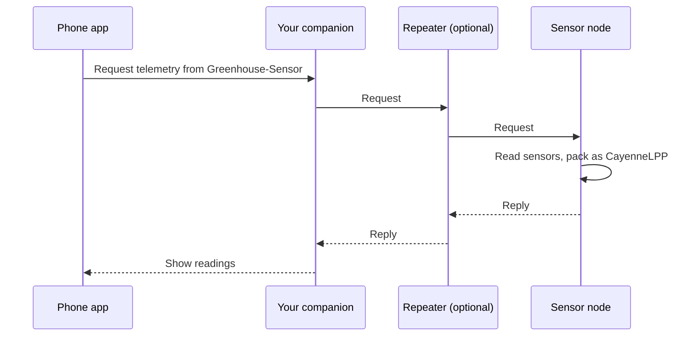

{:class="cover"}

---

By the end of this lesson you will be able to request telemetry from a sensor over the mesh, and explain why some readings come back and others do not.

The sensor is built and wired. Now let's ask it something from the other end of the mesh.

---

## Requesting telemetry from the app

1. Open the MeshCore app and connect to your client node
2. Find your sensor node in the **contacts list** - it needs to have adverted at least once
3. Tap it
4. Choose the telemetry or request-telemetry option

The request travels across the mesh to the sensor. The sensor wakes, reads its sensors, encodes the values in CayenneLPP, and sends them back.

**How long should it take?** Seconds, not milliseconds. A direct link answers quickly; two hops through repeaters take longer. If nothing comes back at all, work through the Common Issues below.

From `meshcore-cli`, a command-line tool for companion nodes, there is a telemetry request command (`req_telemetry`). Check `meshcore-cli`'s own help for its exact arguments in your version.

---

## What comes back

Depending on what is wired and what permission you have:

| Reading | Source | Typical permission |
|---|---|---|
| Battery voltage | Onboard ADC | Always included |
| Uptime | Firmware status frame | Base tier |
| Temperature | BME280 or similar | May need permission |
| Humidity | BME280 | May need permission |
| Pressure | BME280 | May need permission |
| Bus voltage and current | INA219 / INA3221 | May need permission |
| Distance | VL53L0X | May need permission |
| Position | GPS module | Usually restricted |
{:class="table table-single"}

**The split is deliberate.** In the sensor source, battery voltage is always added to the reply, and the other readings can be filtered by permission flags. Exactly which reading needs which level depends on your build, so test with a second node rather than trusting the table above as law.

---

## Permissions in practice

A sensor can filter readings by permission before it puts them in the response, using the same access-list idea as the room server, so lesson 7 applies.

**To grant a node a permission level over USB or as an admin:**

```text
setperm <their-public-key> <level>
```

The levels are 0 guest, 1 read-only, 2 read-write and 3 admin, as in the CLI reference. Start with the lowest level that shows what you want, and test what the second node can see.

**To keep a GPS position private,** do not fit a GPS to a node that you cannot trust everyone with, or do not grant higher levels freely. Check what your build exposes before relying on it.

---

## Interpreting what you get

**Battery** - see lesson 12. Watch the trend across days rather than reacting to a single reading, and remember voltage sags under load.

**Temperature** - if it looks a degree or two high, suspect self-heating before you suspect the weather.

**Humidity** - slow to settle. A reading taken right after moving the sensor is the sensor catching up, not the air changing.

**Pressure** - trust the trend, not the absolute value. Falling pressure means weather is coming; the exact hPa figure may be a few off.

**Uptime** - the most underrated reading on the list. A node whose uptime keeps resetting has a power problem, and that is worth knowing before the battery data misleads you.

---

## Logging intervals and history

Sensor builds keep a **rolling time-series buffer**, which supports min, max and average queries over a window. That is what lets you ask "what was the lowest temperature overnight?" rather than only "what is it right now?". In `meshcore-cli` a min/max/average request command exists (`req_mma`); check its help for arguments.

**Reading is local and cheap.** The node samples its sensors roughly every minute into that buffer, and the shipped example keeps about a day of battery history in five-minute slots. None of that costs airtime - it is all happening on the board.

**Transmitting is what costs.** Which is exactly why the model is pull-based: sample often, transmit only when asked.

**The read interval is compile-time**, not a CLI setting (the sensor source defines `SENSOR_READ_INTERVAL_SECS` as 60). If you need it different, you are building your own firmware image.

**The rolling buffer is not an archive.** If you want months of history, log it at the receiving end - see the next lesson.

---

## Threshold alerts

Sensor builds support **threshold-triggered alerts**: when a reading crosses a limit, the node sends an acknowledged message to contacts holding the alert permission bits.

This is the exception to the pull-based model, and it is the right exception. "Tell me if the greenhouse drops below 2°C" is exactly the sort of thing you want pushed rather than polled.

**The catch:** thresholds live in the firmware source, not in a CLI setting - the shipped example calls `alertIf(batt_voltage < 3.4f, ...)` and `alertIf(batt_voltage < 3.6f, ...)` in C++. Changing the limit means building your own image, which puts this in the same territory as lesson 13's route 3.

**Use it sparingly when you do get there.** Each alert is an unsolicited transmission. A threshold sitting inside the reading's normal wobble will chatter every time it crosses, which is annoying and expensive in airtime.

**Do not build a safety system on it.** It is a hobby-grade notification over a best-effort radio link. Useful, not guaranteed.

---

## Building a habit

The nodes that stay useful are the ones people actually check:

- **Check battery weekly** on every remote node. Two minutes, and it prevents the walk up the hill
- **Check uptime at the same time.** Resets are the early warning
- **Note the season.** A solar node that is fine in August needs watching in November
- **Write down what normal looks like.** When something reads oddly in six months, a baseline is worth a great deal

---

## What a telemetry request looks like



> **Teachers**: Threshold alerts are a notification, not a safety system: do not rely on them for frost protection, fire, flooding or anything that matters to people or animals. In a school, decide who may request telemetry from shared sensor nodes, and keep any GPS-equipped node's location private.

---

## Try it Yourself

1. Request telemetry from your sensor and note every value that comes back.
2. Move the sensor somewhere colder, wait ten minutes, and request again. Did everything change that you expected to?
3. Set a permission level for a second node with `setperm` and confirm it sees a different set of readings than an unauthenticated one does.
4. Challenge: request telemetry from a node two hops away and time it. Compare against a direct one-hop request. That difference is your mesh's latency, measured.

---

## Common Issues

- **Problem**: The telemetry request times out.
- **Solution**: Confirm you can message the sensor normally first, then check it is powered and in range.
- **Why**: Telemetry rides on ordinary mesh messaging. If messaging does not work, telemetry cannot.

- **Problem**: I only get battery and uptime.
- **Solution**: Check your permission level on that node, and confirm `sensor list` on the node itself shows the sensor.
- **Why**: Either the sensor is not detected, or you are not authorised for gated readings. Checking `sensor list` locally distinguishes the two immediately.

- **Problem**: The historic min/max figures do not match what I just read live.
- **Solution**: Both are correct - they answer different questions.
- **Why**: A live telemetry request samples now. A min/max/average query summarises the rolling buffer over a window. If the window includes last night, its minimum will be lower than this afternoon's reading.

- **Problem**: My alerts fire constantly.
- **Solution**: Move the threshold further from the normal operating range.
- **Why**: A threshold sitting inside the reading's normal wobble triggers every time it crosses, which on a noisy measurement is very often.

---

## Check your understanding


? Why does reading sensors locally cost far less than transmitting?
- [x] Local reads use no airtime and little power, while transmitting is the costly part
- [ ] Local reads use the radio
- [ ] They do not
> That is why sensors sample about every minute but only transmit on request.

? You only get battery and uptime back. What are the two likely causes?
- [x] The sensor is not detected, or you lack permission for the other readings
- [ ] The antenna is too long
- [ ] The room server is full
> `sensor list` on the node tells you which.

? Where does the threshold for an alert live?
- [x] In the firmware source, so changing it means building firmware
- [ ] In a CLI setting
- [ ] In the phone app
> The shipped example hardcodes 3.4V and 3.6V.


