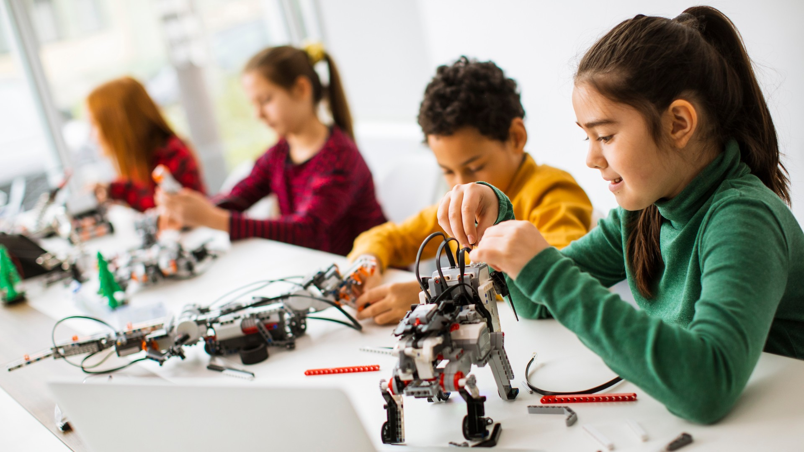
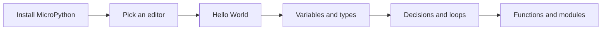

{:class="cover"}

---

Ahoy there makers! Every robot needs a brain, and one of the friendliest ways to program that brain is MicroPython. In this course we'll go from a blank Raspberry Pi Pico to confidently writing your own programs, one small idea at a time.

If you'd rather watch than read, Kev recorded this course as a video series too. Here is the first one, and the others are in the next lesson.



---

## Overview

Welcome to `Learn MicroPython - The basics`. This course is for people who are new to MicroPython, and to programming in general. We'll take each concept step by step, show you ***real code*** you can run, and explain ***how*** and ***why*** it works.

Our target board is the Raspberry Pi Pico family: the Pico, Pico W, Pico 2 and Pico 2 W. Every program in the course also runs in the simulator inside [Snakie](/learn/snakie_getting_started/), so you can start learning before your board arrives.

## Course Content

In this course you will learn:

* What MicroPython is, why you should use it, where to download it and which editor to write it in
* Your first program: `Hello World`
* Variables, constants and the different types of value
* Reserved words
* `if`, `elif` and `else`, loops, and operators
* Functions, the REPL and modules

## Key Results

After you have completed this course you will be able to:

* Install MicroPython on a Raspberry Pi Pico and run a program on it
* Store and combine values using variables and the main data types
* Make a program choose what to do, and repeat things, with `if` and loops
* Write your own functions and import modules
* Use the REPL to test ideas and explore your board

That is the solid foundation you need before moving on to motors, sensors and robots.

## What you'll need

* A computer, tablet or phone to read the course material from
* A computer that can connect to a MicroPython board such as the [Raspberry Pi Pico](https://www.raspberrypi.com)
* A Raspberry Pi Pico, Pico W, Pico 2 or Pico 2 W
* A micro USB cable that carries data, not just power (every Pico board uses micro USB)
* An editor: [Snakie](/learn/snakie_getting_started/) (recommended) or [Thonny](https://www.thonny.org)

You don't need to know any programming already. The lessons on loops and functions use only a couple of buttons or an LED, and most of the course needs no wiring at all.

## How the course works

New keywords are introduced, explained and highlighted, like `this`, inline in the text.

Longer examples are shown in boxes you can read, copy, and often run straight in Snakie:


print('this is an example')



Every lesson starts with what you'll be able to do by the end, and finishes with **Try it Yourself** exercises, a **Common Issues** list and a short quiz. Your quiz score is saved in your browser and shown in the sidebar. Mistakes are normal, so check Common Issues before you decide something is broken.

Important notes are highlighted in sections like these:

> ## This is a note
>
> Important notes are highlighted like this.

> ## Another aside
>
> Asides are also highlighted, in a different colour.
{:.bg-blue}

## Where next

This is the first course in the MicroPython learning pathway. When you finish, try [GPIO Mastery](/learn/micropython_gpio/) to control LEDs and motors, [MicroPython Robotics Projects](/learn/micropython_robotics/) to build real robots, or [Intermediate MicroPython](/learn/intermediate_micropython/) for classes and packages.

> **Teachers**: this course suits learners aged about 10 and up with no coding background. Allow 20 to 30 minutes per lesson, so roughly 8 to 10 hours in total. Each learner or pair needs one Pico and a data-capable USB cable, but lessons 1, 4, 8 to 14, 16 (partly) and 17 to 18 can all be done with no hardware at all using the simulator in the Snakie web app. School computers are often locked down, so test early that you can install Thonny, or that the web app opens, and that the USB port is not blocked. Lessons 2 and 3 involve flashing firmware, which is best done once by the teacher on a shared set of boards.
