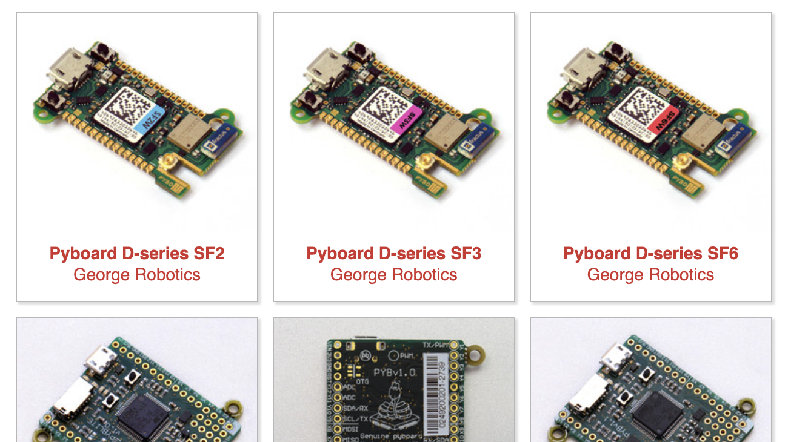
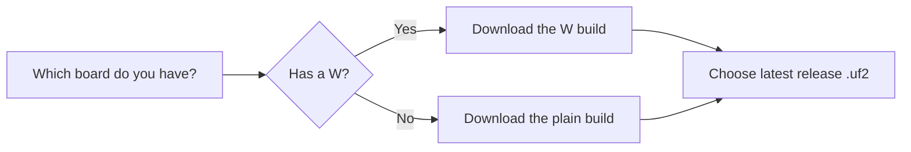

{:class="cover"}

---

By the end of this lesson you will be able to find and download the right MicroPython firmware file for your Raspberry Pi Pico.

## The official download page

[MicroPython](https://www.micropython.org) is actively developed and maintained by a team of volunteers. Visit <https://www.micropython.org> for the latest version, documentation and tutorials.

On the website there is a link to [Downloads](https://www.micropython.org/download/). There is a build of MicroPython for lots of different microcontrollers, as long as the chip is 32 bit. You'll see a small picture of each board along with its name. Click on the board you have, then pick the most recent **release**.

Here are the pages for the Pico family, so you can go straight to the right one:

| Your board | Download page |
|---|---|
| Raspberry Pi Pico | <https://micropython.org/download/RPI_PICO/> |
| Raspberry Pi Pico W | <https://micropython.org/download/RPI_PICO_W/> |
| Raspberry Pi Pico 2 | <https://micropython.org/download/RPI_PICO2/> |
| Raspberry Pi Pico 2 W | <https://micropython.org/download/RPI_PICO2_W/> |
{:class="table table-single"}

The file you want ends in `.uf2`. It is saved in your `downloads` folder.

{:class="img-fluid w-75 shadow-lg"}

A screenshot of the downloads page on [micropython.org](https://www.micropython.org/download/). The version number shown is from 2022 and will be newer when you visit.
{:.caption}

## Which version?

The page lists **releases** and **preview** builds. Choose the latest release. Previews are nightly builds for people testing new features, and they can have bugs.

The W boards have a wireless chip, so they need their own file. A file for the plain Pico will not give you Wi-Fi on a Pico W.

> **Teachers**: downloading the file once and sharing it from a class folder or USB stick saves bandwidth, and avoids learners picking the wrong board. Label each board Pico, Pico W, Pico 2 or Pico 2 W before the lesson, as they look alike.

## Try it Yourself

1. Open the MicroPython downloads page and find the page for your board.
2. Look at the release list. How many releases are there, and when was the newest one published?
3. Challenge: find out which chip is on the Pico 2, and how it differs from the chip on the first Pico.

## Common Issues

- **Problem**: I downloaded the file but I can't find it.
- **Solution**: Check your browser's `downloads` folder, and look for a file ending in `.uf2`.
- **Why**: Browsers save to the downloads folder unless told otherwise.

- **Problem**: Wi-Fi code fails on my Pico W.
- **Solution**: Download the `RPI_PICO_W` (or `RPI_PICO2_W`) build and install it again.
- **Why**: The plain Pico build has no driver for the wireless chip.

## Check your understanding


? What is the file extension of the MicroPython firmware for a Pico?
- [ ] `.exe`
- [x] `.uf2`
- [ ] `.py`
> The firmware is a `.uf2` file you copy to the board.

? You have a Raspberry Pi Pico W. Which build should you pick?
- [ ] The plain Raspberry Pi Pico build
- [x] The Raspberry Pi Pico W build
- [ ] Any build, they are all the same
> The W boards have a wireless chip that needs its own build.

? Which kind of build should a beginner choose?
- [ ] A nightly preview build
- [x] The latest release
> Previews are for testing new features and can have bugs.

