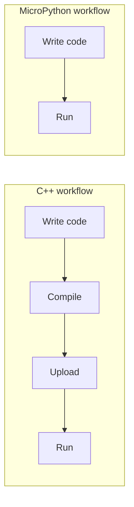

{:class="cover"}

---

By the end of this lesson you will be able to explain three reasons to choose MicroPython for a robot, and one honest reason you might choose something else.

## Easy to read, quick to try

MicroPython is ***easier to write***, ***cleaner*** and ***clearer to read***, and ***faster to get the results you want***, than a language such as C++. Let's make a robot's on-board LED blink in both and compare.

First, a piece of code written in `C++` for an `Arduino` board:

<!-- code-check: skip -->
```c++
void setup() {
  pinMode(LED_BUILTIN, OUTPUT);
}

void loop() {
  digitalWrite(LED_BUILTIN, HIGH);
  delay(500);
  digitalWrite(LED_BUILTIN, LOW);
  delay(500);
}
```

The second piece of code does the same job in `MicroPython` on a Pico (the LED sits on pin `25` of a Pico and Pico 2; a Pico W uses the name `"LED"` instead):

```python
from machine import Pin
import time

led = Pin(25, Pin.OUT)

while True:
    led.value(1)
    time.sleep(0.5)
    led.value(0)
    time.sleep(0.5)
```

You don't need to understand every line yet. Notice that the MicroPython version has no curly braces, no semicolons, and no separate `setup()` and `loop()` functions to remember. By the end of this course you'll know what every line does.

## Three good reasons

1. **Instant feedback.** There is no separate compile and upload step. You type a line, run it, and see the result. We'll use this a lot in the REPL lesson.
2. **Readable code.** When you come back to your robot in six months, Python reads almost like English.
3. **A huge community.** Python is one of the most popular languages in the world, so help is never far away.



## An honest trade-off

MicroPython is interpreted, which means the board reads your code while it runs. It uses more memory and runs slower than carefully written C++. For almost all hobby robots this makes no difference, but if you ever need to do something extremely fast, like drive a high-speed display, you might reach for C. You can learn more in the [C and the Pico course](/learn/c_pico/).

## Try it Yourself

1. Read the MicroPython blink code above out loud. Can you guess what `time.sleep(0.5)` does?
2. Change `0.5` to `0.1` in both versions of the code. Which one took more effort?
3. Challenge: count the lines in each blink program. Which is shorter?

## Common Issues

- **Problem**: My Pico W won't blink using `Pin(25)`.
- **Solution**: Use `Pin("LED", Pin.OUT)` instead.
- **Why**: On the W boards the LED is wired to the wireless chip, not to pin 25.

- **Problem**: Nothing happens when I run the blink program.
- **Solution**: Check the board is connected in your editor, and look for error messages in the shell.
- **Why**: The program runs on the board, so the editor needs a live connection to it.

## Check your understanding


? Which of these is a real benefit of MicroPython?
- [ ] It is always faster than C++
- [x] There is no compile step, so you can run code immediately
- [ ] It needs no board at all
> MicroPython is interpreted, so you can type and run code straight away.

? What is the honest trade-off of MicroPython?
- [ ] It cannot control LEDs
- [x] It uses more memory and runs slower than carefully written C++
- [ ] It only works on Windows
> Interpreted code is slower and uses more memory than compiled code.

? On a Raspberry Pi Pico W, how do you refer to the on-board LED?
- [ ] `Pin(25)`
- [x] `Pin("LED")`
> The LED on the W boards is connected through the wireless chip.

