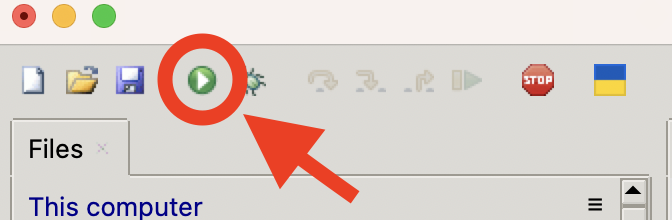
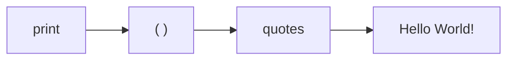

{:class="cover"}

---

By the end of this lesson you will be able to write and run a program that prints a message, and explain what `print`, brackets and quotes do.

Let's create a simple program that will display the message 'Hello World'[^1].

First, here is the code. Type this into your MicroPython editor:


print("Hello World!")



When we run this, we will see the following printed to the screen (also referred to as the console or shell):

``` bash
Hello World!
```

To run it in Thonny, click the green `run` button. In Snakie, click `Run`.

{:class="img-fluid w-100 shadow-lg"}

Congratulations, you're now a MicroPython programmer!

## Anatomy of the line



* `print` is a **function**, a named block of code that is built in to MicroPython, so it already knows how to show things
* The brackets `( )` tell MicroPython to run the function now. What goes inside is what the function should work on
* The speech marks (quotes) mark where the text `starts` and `ends`. Text in a program is called a `string`

You can use single quotes `' '` or double quotes `" "`, as long as you open and close with the same kind. Double quotes are a good habit, because they let you write an apostrophe inside your message: `print("It's alive!")`.

## Case sensitive

Notice that `print` is lowercase. Typing `Print` or `PRINT` gives an error message. We say MicroPython is `case sensitive`, so `print`, `Print` and `PRINT` are three different names, and only the first one exists.

## Why print?

It doesn't come out of my printer? Back in the early days of computing there were no screens, just an electronic typewriter called a `teleprinter` or `teletype` machine, which would `print` out the results of programs. That is also why serial devices in Unix have names starting with `TTY`. The name stuck, even though it now prints to the screen.

## Comments

The hash symbol `#` means the rest of the line is a comment. MicroPython ignores comments, so you can leave reminders for yourself and others:

```python
# this is a single line comment
print("Robot online")  # a comment can follow code, too
```

For longer notes you can wrap text in triple quotes:

```python
"""This note
spans several lines"""
print("Ready")
```

## Try it Yourself

1. Change the message so your program prints the name of your robot.
2. Add a second `print` line underneath. In which order do the messages appear?
3. Print a message that has an apostrophe in it, such as `It's alive!`, in two different ways. Hint: use different quotes.
4. Challenge: print three lines that draw a tiny robot face using symbols such as `[ o_o ]`.

## Common Issues

- **Problem**: `NameError: name 'Print' isn't defined`.
- **Solution**: Change `Print` to lowercase `print`.
- **Why**: MicroPython is case sensitive, so the capital letter makes it a different, unknown name.

- **Problem**: `SyntaxError: invalid syntax` pointing at the end of the line.
- **Solution**: Check every opening quote and bracket has a matching closing one.
- **Why**: MicroPython can't tell where your text or function call ends.

- **Problem**: Nothing is printed.
- **Solution**: Look in the shell or console panel, and check you pressed `Run`.
- **Why**: Output appears in the console, not in the editor window.

## Check your understanding


? What does `print("Hello")` do?
- [ ] Sends the word Hello to a paper printer
- [x] Shows the word Hello in the console
- [ ] Saves the word Hello in a file
> `print` displays its input on the screen (the console).

? Why does `Print("Hi")` give an error?
- [ ] Brackets are not allowed
- [x] MicroPython is case sensitive, and only lowercase `print` exists
- [ ] Hi is too short
> `print`, `Print` and `PRINT` are all different names.

? What does the `#` symbol do in a program?
- [ ] It prints a hash
- [x] It starts a comment that MicroPython ignores
- [ ] It stops the program
> Everything after `#` on the line is a note for people.


---

[^1]: This is a tradition that many programming language tutorials use to help you understand how to write a simple program.
