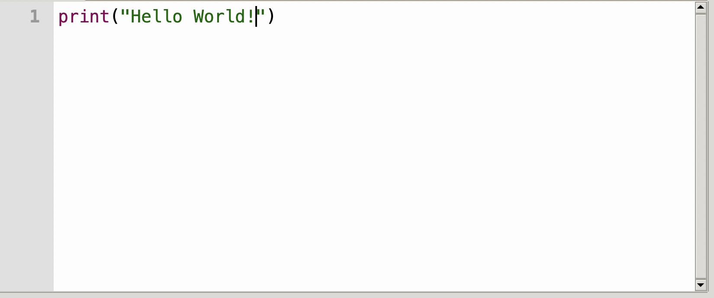
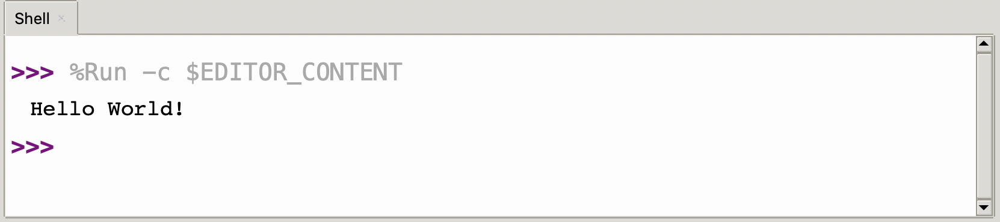
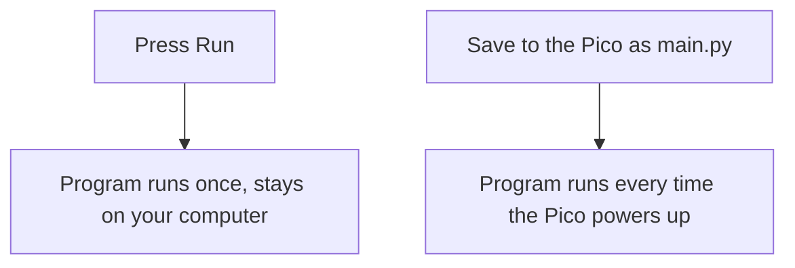

{:class="cover"}

---

By the end of this lesson you will be able to save a program as a file, run it, and explain the difference between running a program and saving it on the Pico.

## Type, save, run

Last lesson we typed a single line. Real programs live in files, so let's make one called `hello_world.py`. The `.py` ending tells your computer it is a Python file.

Type the program below into your MicroPython editor.


# Hello World

print("Hello, world!")



In Thonny, save the file and then run it with the green `run` button. In Snakie, use `Run`.

{:class="img-fluid w-100 shadow-lg"}

{:class="img-fluid w-100 shadow-lg"}

## Where does the program live?

When you press `Run`, your editor sends the program to the Pico over the USB cable, and the Pico runs it. The program isn't stored on the Pico. Unplug it, and the program has gone, although the file is still on your computer.

To make a robot that works on its own, you need the program stored on the board. Save it there with the name `main.py`. MicroPython runs a file called `main.py` automatically every time the board powers up.

In Thonny, choose `File > Save as...` and then pick `Raspberry Pi Pico` as the place to save. To do the same in Snakie, see the lesson [Files, local and on the device](/learn/snakie_getting_started/09_files_local_and_device.html).

> **Teachers**: if boards are shared between classes, a leftover `main.py` will run the next time someone plugs in. Agree a rule for deleting saved files at the end of a lesson, and let learners use `Run` rather than saving to the board until they are building something to keep.

## Try it Yourself

1. Save the program as `hello_world.py` on your computer, run it, then change the message and run it again.
2. Add a second line that prints the name of your robot.
3. Save the program to the Pico as `main.py`, unplug the USB cable, and plug it back in. Does anything happen? (Your program prints to a console, so you need to connect again to see it.)
4. Challenge: how would you see the output from a program that runs by itself?

## Common Issues

- **Problem**: I saved `hello_world.py` but nothing runs when I power the Pico.
- **Solution**: Save the file on the Pico under the name `main.py`.
- **Why**: Only a file called `main.py` is run automatically at power up.

- **Problem**: A program starts running when I connect and I can't get control of the board.
- **Solution**: Press the stop button in your editor, or press `Ctrl + C` in the shell.
- **Why**: A saved `main.py` is already running, and `Ctrl + C` interrupts it.

## Check your understanding


? What file name makes MicroPython run a program automatically at power up?
- [ ] `hello_world.py`
- [x] `main.py`
- [ ] `start.txt`
> MicroPython runs `main.py` at power up.

? You press Run, then unplug the Pico. What happens to the program?
- [ ] It is saved on the Pico forever
- [x] It is gone from the Pico, because it was only sent to run
- [ ] It runs by itself on the next power up
> Run sends the program over USB to run. It is only stored if you save it to the board.

? What does the `.py` ending on a file name mean?
- [ ] It is a picture
- [x] It is a Python file
> The ending tells the computer what kind of file it is.

