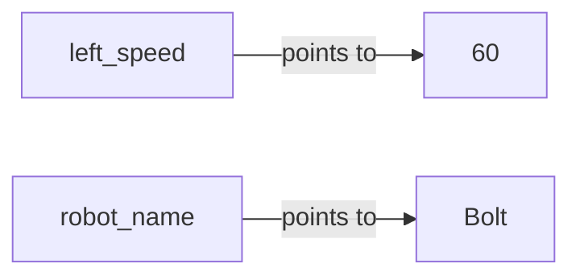

{:class="cover"}

---

By the end of this lesson you will be able to store values in variables, pick good names for them, and define a constant.

## Variables

When we want to store a value we use a `variable`. This stores the number `1` in a variable named `a`:

```python
a = 1
print(a)
```

We assign it using the equals sign `=`. Read it as "a becomes 1", not "a equals 1".

Think of variables as little boxes, like the pigeon holes in the photo. We give each box a name so we can find it again, put something in, look at what's in it, or compare it with another box.

We could name our boxes `a`, `b` and `c`, but we'd soon forget what's in each. Good names say what's inside. Here are some robot examples:

```python
left_speed = 60
right_speed = 60
robot_name = "Bolt"
battery_percent = 87

print(robot_name, "is driving at", left_speed, "with battery at", battery_percent)
```

Boxes can also change. Let's slow the robot down:

```python
left_speed = 60
print("Speed:", left_speed)

left_speed = 30
print("Speed:", left_speed)
```

## Rules for names



* Use letters, digits and underscores only: `motor_1` is fine, `motor-1` and `motor 1` are not
* A name can't start with a digit: `1motor` is an error
* Names are case sensitive: `speed` and `Speed` are different variables
* Use lowercase words joined by underscores, like `left_speed`, a style called `snake_case`
* Don't use a reserved word such as `if` or `while` (the next lessons cover these)

> ## MicroPython Facts
>
> Like Python, MicroPython variables don't actually store the value, they just point to the thing that does.
{:class="blockquote bg-blue"}

## Constants

If `variables` contain values that change, `constants` contain values that don't. For example, a robot's maximum speed or the pin a motor is wired to won't change while the program runs.

MicroPython has a special `const()` function for this. It needs to be imported from the `micropython` module first:

```python
from micropython import const

MAX_SPEED = const(100)
LED_PIN = const(25)

print("Top speed is", MAX_SPEED)
```

By convention, constants are written in UPPERCASE. `const()` is specific to MicroPython and is meant for whole numbers. It saves a little memory on a small board because MicroPython can swap the name for the number as it reads your code. In regular Python, a constant is just a variable written in uppercase, as a hint to other programmers.

## Try it Yourself

1. Make variables for your robot's name, speed and battery percentage, and print them in one sentence.
2. Change the speed and print it again. What is now in the box?
3. Make a constant for a pin number, and print it.
4. Challenge: swap the values of two variables, `a = 1` and `b = 2`, using a third variable as a temporary box.

## Common Issues

- **Problem**: `NameError: name 'speed' isn't defined`.
- **Solution**: Check you spelled the name the same way, including capitals, and that you assigned it before using it.
- **Why**: Names are case sensitive, and a variable only exists after the line that creates it has run.

- **Problem**: `SyntaxError: invalid syntax` when I use a name like `left-speed`.
- **Solution**: Replace the minus sign with an underscore: `left_speed`.
- **Why**: The minus sign means subtract, so Python reads `left-speed` as a sum.

- **Problem**: `NameError: name 'const' isn't defined`.
- **Solution**: Add `from micropython import const` at the top.
- **Why**: `const` lives in the `micropython` module and must be imported.

## Check your understanding


? What does `speed = 60` do?
- [ ] Compares `speed` with 60
- [x] Stores the value 60 in a variable called `speed`
- [ ] Prints 60
> The single equals sign assigns a value.

? Which of these is a valid variable name?
- [ ] `left-speed`
- [ ] `1motor`
- [x] `left_speed`
> Names use letters, digits and underscores, and can't start with a digit.

? What is the convention for naming constants?
- [ ] lowercase with underscores
- [x] UPPERCASE
> Constants are written in uppercase, like `MAX_SPEED`.

