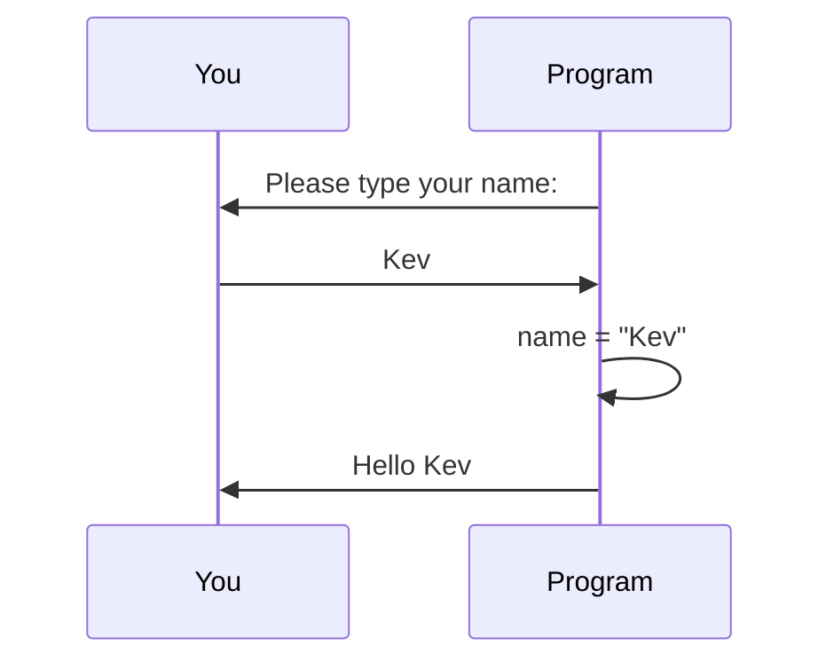
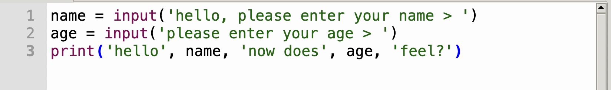
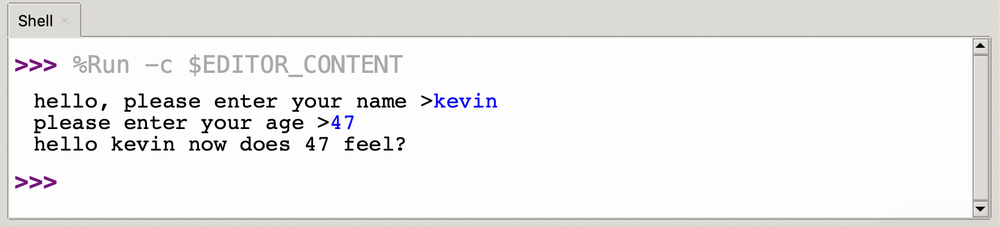

{:class="cover"}

---

By the end of this lesson you will be able to ask the user a question with `input()`, store the answer in a variable, and turn text into a number when you need to do maths.

Let's do something more interesting. We'll make the Raspberry Pi Pico (or whichever board you are using) ask us a question, then reply.

## name.py

Type the program below into your editor:

```python
# Variables
# name.py

print("Please type your name:")
name = input()
print("Hello", name)
```

Save the file, and run it. The program waits until you type something in the shell or console and press `Enter`. The `name` variable holds whatever you typed, stored by the `=` equals sign.

`input` is another built-in function. It gets text typed on the keyboard and returns it to our program, like a box being filled by the user.



## Asking more than one question

`input()` can show a prompt itself, so we don't need a separate `print`. Let's extend the example with a second question:

```python
name = input('hello, please enter your name > ')
age = input('please enter your age > ')
print('hello', name, 'how does', age, 'feel?')
```

{:class="img-fluid w-100"}
{:class="img-fluid w-100"}

## Text is not a number

> ## Note
>
> `input()` only returns text (a `str`). That means if you try to do any maths with the age it will not work in the way you expect.
>
> To make `age` a number, wrap it in `int()`, which changes the type. For example:
{:class="blockquote bg-blue"}

```python
age = int(input('please enter your age > '))
print('next year you will be', age + 1, 'years old')
```

Changing the type of a value is called `casting`, and we'll look at it in the next lesson.

## Maths with variables

We can use variables in sums. If we know two angles of a triangle, the third angle is what is left of 180 degrees. A robot arm could use this to work out a joint angle:


a = 65
b = 42
c = 180 - (a + b)
print('the missing angle is:', c)



The brackets make MicroPython add `a` and `b` first, then take the answer away from 180. Without them, `180 - a + b` would work from left to right and give the wrong answer, 157.

## Try it Yourself

1. Write a program that asks for your robot's name and says hello to it.
2. Ask for a number, and print double that number. Remember `int()`.
3. Change the triangle program to use different angles. Check your answer by adding all three angles. Do they make 180?
4. Challenge: ask for a speed in centimetres per second and a time in seconds, then print how far the robot travels.

## Common Issues

- **Problem**: `TypeError: unsupported types for __add__: 'str', 'int'`.
- **Solution**: Wrap the input in `int()`, for example `int(input('age > '))`.
- **Why**: `input()` returns text, and you can't add a number to text.

- **Problem**: `ValueError: invalid syntax for integer with base 10`.
- **Solution**: Type digits only, with no letters or spaces, when the program asks for a number.
- **Why**: `int()` can't change `"ten"` or `"3 cm"` into a number.

- **Problem**: The program seems to hang and nothing happens.
- **Solution**: Click in the console or shell panel, type your answer, and press `Enter`.
- **Why**: `input()` waits for you, so the program is paused, not broken.

## Check your understanding


? What type of value does `input()` return?
- [ ] An integer
- [x] Text (a string)
- [ ] A float
> `input()` always returns a `str`, even if you type digits.

? How do you turn the text `"21"` into the number 21?
- [ ] `text(21)`
- [x] `int("21")`
- [ ] `print("21")`
> Wrapping a value in `int()` changes its type.

? What does `180 - (a + b)` do?
- [ ] Subtracts `a`, then adds `b`
- [x] Adds `a` and `b` first, then subtracts the answer from 180
> The brackets are worked out first.

