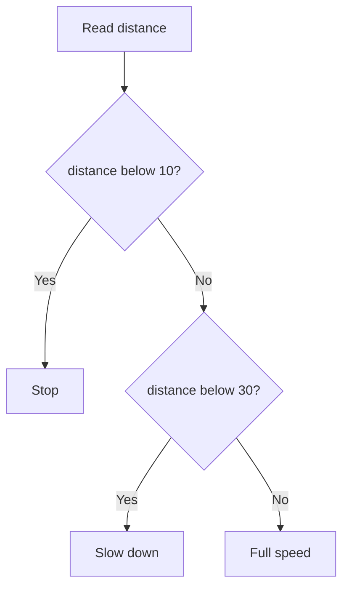

{:class="cover"}

---

By the end of this lesson you will be able to make a program choose between actions using `if`, `elif` and `else`, and compare values with `==`.

## Controlling the flow of our program

So far our programs have been simple lists of jobs that MicroPython does from top to bottom. But a robot needs to react: stop if something is in the way, slow down if it is close, carry on if the path is clear.

We can test the value of a variable with the `if` statement. For this lesson, here's the robot's decision as a flow chart:





## Conditional statements

An `if` statement needs a **condition** to check, and then an action that runs only if the condition is `True`. The action is **indented** underneath (we use 4 spaces):


distance = 8  # centimetres, pretend this came from a sensor

if distance < 10:
    print("Obstacle! Stopping.")

print("Program finished")



The last `print` isn't indented, so it always runs. Try changing `distance` to `50` and run it again.

### Comparing values

Notice we write `distance < 10`. The comparison symbols you'll use most are:

| Symbol | Meaning |
|:--:|---|
| `==` | is equal to |
| `!=` | is not equal to |
| `<` and `>` | less than, greater than |
| `<=` and `>=` | less than or equal, greater than or equal |
{:class="table table-single"}

Notice the **two** equals signs `==`. One equals sign `=` assigns a value to a variable, two `==` compare two values.


a = 1
b = 1

if a == b:
    print('They are the same')



> ## Colons
>
> Notice the `:` colon at the end of the `if` line. It tells MicroPython that an indented block of code follows. Every line in the block must be indented by the same amount.
{:.bg-blue}

## If, else

What if we want a different action when the condition is `False`? We use `else`, which means "otherwise":


distance = 25

if distance < 10:
    print('Stop!')
else:
    print('Keep going')



## elif

`elif`, short for "else if", sits between `if` and `else`, giving us extra checks, each with its own block. MicroPython works down the list and runs only the first block whose condition is `True`.


distance = 25

if distance < 10:
    print('Stop!')
elif distance < 30:
    print('Slow down')
else:
    print('Full speed')



With `distance = 25` this prints `Slow down`. The order matters: if we checked `distance < 30` first, a distance of 5 would also match it, and the robot would only slow down instead of stopping.

> ## Code blocks and indentation
>
> Python and MicroPython know where a block of code starts and ends from its indentation, typically `4` spaces per level. Other languages like `C++` and `JavaScript` use curly braces `{ }` instead.
{:.bg-blue}

## Assumed True

When checking whether a value is `True`, we can shorten the code:

```python
bright = True

if bright == True:
    print('long way')

if bright:
    print('short way')
```

Both work. Numbers count too: `0` is treated as `False`, and any other number is `True`.

## Try it Yourself

1. Change `distance` to `5`, `20` and `50`. Does the robot behave as you expect each time?
2. Add a fourth case: if `distance < 3`, print `Emergency stop!`. Where must it go in the list?
3. Use `input()` to ask for the battery percentage (remember `int()`), and print `Low battery` below 20, otherwise `OK`.
4. Challenge: turn the age program from lesson 9 into one that prints `Child`, `Teen` or `Adult`.

## Common Issues

- **Problem**: `IndentationError: unexpected indent`, or the code runs when it shouldn't.
- **Solution**: Indent each line in the block by 4 spaces, and keep the same amount throughout.
- **Why**: Indentation is how MicroPython knows which lines belong to the `if`.

- **Problem**: `SyntaxError: invalid syntax` on my `if` line.
- **Solution**: Check that the line ends with a colon, and that you used `==` not `=` for comparing.
- **Why**: A single `=` is assignment and isn't allowed as a condition.

- **Problem**: The wrong message prints.
- **Solution**: Put the most specific test first.
- **Why**: Only the first `True` condition runs.

## Check your understanding


? Which symbol compares two values to see if they are equal?
- [ ] `=`
- [x] `==`
- [ ] `=>`
> One equals sign assigns, two equals signs compare.

? With `distance = 25`, what does the `if`, `elif`, `else` program above print?
- [ ] Stop!
- [x] Slow down
- [ ] Full speed
> 25 isn't below 10, but it is below 30, so the `elif` block runs.

? How does MicroPython know which lines belong to an `if`?
- [ ] They are inside curly braces
- [x] They are indented below it
> Python uses indentation to define blocks.

