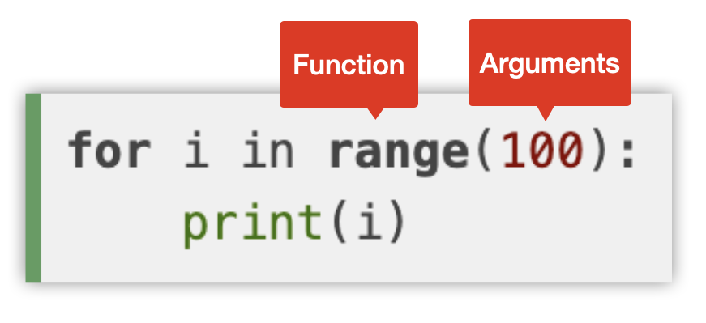

{:class="cover"}

---

By the end of this lesson you will be able to repeat code with `for` and `while` loops, and use `range()`, `break` and `continue`.



## For loops

Often we want to run a piece of code a specific number of times, such as blinking an LED five times. We can use the `for` statement:


for i in range(5):
    print('i is:', i)



The loop gives the variable `i` the value `0`, runs the indented block, then gives it `1`, and so on, and prints:

```text
i is: 0
i is: 1
i is: 2
i is: 3
i is: 4
```

Notice it stops at `4`, not `5`. We'll see why next.

## The range() function

`range()` makes the sequence of numbers a `for` loop counts through. It can take one, two or three **arguments** (the values inside the brackets):

| Call | Counts | Example result |
|---|---|---|
| `range(5)` | from 0 up to, but not including, 5 | 0, 1, 2, 3, 4 |
| `range(2, 6)` | from 2 up to, but not including, 6 | 2, 3, 4, 5 |
| `range(0, 100, 25)` | from 0 to 100 in steps of 25 | 0, 25, 50, 75 |
| `range(5, 0, -1)` | counting down | 5, 4, 3, 2, 1 |
{:class="table table-single"}

The end number is never included. Here is a countdown for a robot launch, using all three arguments:


for count in range(5, 0, -1):
    print(count)
print('Lift off!')



> ## Parameters / arguments
>
> **`Arguments`** are the values you give to a function as inputs. The `5` in `range(5)` is an argument. Arguments are separated by commas, and the order matters. Some can be named, and some are optional, like the step in `range()`.
>
> {:class="img-fluid w-50"}
{:.bg-blue}

## The while loop

If we want to repeat code until something changes, rather than a set number of times, we use the `while` loop. It keeps going while its condition is `True`:


battery = 5

while battery > 0:
    print('battery at', battery)
    battery = battery - 1

print('battery flat')



A loop that never ends is useful on a robot, because it often needs to keep checking its sensors until it is switched off. We write that with `while True:`. This program blinks the on-board LED forever (use `"LED"` instead of `25` on a Pico W):

```python
from machine import Pin
import time

led = Pin(25, Pin.OUT)

while True:
    led.toggle()
    time.sleep(0.5)
```

Press the stop button in your editor to end it. A `while` loop is also good for waiting on a sensor. Here we wait for a button wired between pin GP15 and 3V3, and then carry on:

```python
from machine import Pin
import time

button = Pin(15, Pin.IN, Pin.PULL_DOWN)

print('waiting for the button...')
while button.value() == 0:
    time.sleep(0.1)

print('button pressed!')
```

The `PULL_DOWN` setting keeps the pin at 0 until the button connects it to 3V3. Without it the pin would "float" and give random readings.

## Control statements

| Statement | What it does |
|:--:|---|
| `break` | Leaves the loop straight away |
| `continue` | Skips the rest of this go and starts the next one |
| `pass` | Does nothing. It is a placeholder where a statement is required |
{:class="table table-single"}

Let's use `break` to stop as soon as the robot finds a wall, and `continue` to skip step 3:


for step in range(1, 8):
    if step == 3:
        continue          # skip step 3
    if step == 6:
        print('wall found, stopping')
        break             # leave the loop
    print('step', step)



> **Teachers**: the button example needs one push button and two jumper wires per learner. If you have no hardware, run the countdown and battery examples in the Snakie simulator, where nothing is wired. An infinite loop can look like a crashed program to a beginner, so show the stop button before anyone runs `while True`.

## Try it Yourself

1. Print the numbers from 10 to 20 using `range()`.
2. Print the five times table, `5 x 1 = 5` down to `5 x 10 = 50`, with a `for` loop.
3. Change the battery loop so it drops by 2 each time. What happens if the battery starts at an odd number? (Hint: think about `> 0`.)
4. Challenge: blink the LED exactly 10 times using a `for` loop, then print `done`.

## Common Issues

- **Problem**: My program never stops.
- **Solution**: Press the stop button or `Ctrl + C`, then check that something inside the `while` loop changes the condition.
- **Why**: A `while` loop only ends when its condition becomes `False`, or at a `break`.

- **Problem**: The loop counts one fewer than I expected.
- **Solution**: Add 1 to the end number, such as `range(1, 11)` to count 1 to 10.
- **Why**: `range()` stops before the end number.

- **Problem**: The button loop finishes immediately, or never finishes.
- **Solution**: Check the button is wired between GP15 and 3V3, and that you set `Pin.PULL_DOWN`.
- **Why**: A pin with nothing attached floats and reads random values.

## Check your understanding


? What numbers does `range(3)` produce?
- [ ] 1, 2, 3
- [x] 0, 1, 2
- [ ] 0, 1, 2, 3
> It starts at 0 and stops before 3.

? When is a `while` loop better than a `for` loop?
- [ ] When you know exactly how many times to repeat
- [x] When you want to repeat until something changes, such as a button press
> `while` repeats as long as its condition is `True`.

? What does `break` do inside a loop?
- [ ] Skips to the next go
- [x] Leaves the loop straight away
> `continue` skips to the next go. `break` leaves the loop.

