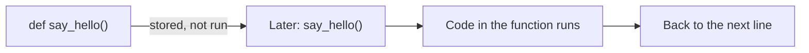

{:class="cover"}

---

{:.cover}

By the end of this lesson you will be able to write your own functions with parameters and return values, and call them as many times as you like.

At some point you will want a block of code that you use many times, perhaps with different values. A robot might need to drive forward, turn left and turn right many times in one program. Putting that code in a **function** saves repeating it, and makes programs easier to read and to fix.

## Defining a function

We use the `def` keyword to define a function. Here is a simple one that prints a message:


def say_hello():
    # This function prints the message hello
    print('hello')

say_hello()



`def` is short for `define`. After the name we need the `()` brackets, and a `:` colon to tell MicroPython that the indented code that follows is the function. Defining the function doesn't run it. The last line, `say_hello()`, **calls** it.

## Parameters

We often want to give a function an input. These are called `parameters`. Let's greet a robot by name:


def greet(name, battery):
    print('Hello', name, '- battery is', battery, 'percent')

greet('Bolt', 87)
greet('Sparky', 42)



The function runs twice, with different values each time. The values you pass in are called `arguments`. They are matched to the parameters in order, so `'Bolt'` goes into `name`.

We can also give a parameter a **default value**, which is used if you leave the argument out:


def drive(left, right, seconds=1):
    print('left', left, 'right', right, 'for', seconds, 'seconds')

drive(60, 60)
drive(60, -60, seconds=2)



## Returning values

Functions can also give an answer back, using `return`. Let's make a function that adds `1` to a number:


def add_one(number):
    number += 1
    return number

a = add_one(1)
print(a)



The function takes `number`, adds `1`, and `return`s it to the caller. So `a` holds `2`. A function that doesn't `return` anything gives back `None`.

Here is a more useful one, which turns a distance sensor's reading into a decision:


def too_close(distance_cm, limit=10):
    return distance_cm < limit

print(too_close(5))
print(too_close(50))
print(too_close(15, limit=20))



Functions can call other functions too. Just don't nest too deeply: a microcontroller has limited memory, and will give a `RuntimeError` (maximum recursion depth exceeded) if a function keeps calling itself.

> ## Challenge
>
> Write your own function that takes a value, multiplies it by `10`, and returns it.
{:.bg-blue}

## Try it Yourself

1. Write a function `say_goodbye()` that prints a message, and call it three times.
2. Write a function `double(number)` that returns the number times 2. Print `double(21)`.
3. Write `drive(left, right)` with a default `seconds=1`, and print what the robot would do.
4. Challenge: write `celsius_to_fahrenheit(c)` that returns `c * 9 / 5 + 32`, and check that `100` gives `212.0`.

## Common Issues

- **Problem**: Nothing happens when I run my program.
- **Solution**: Add a line that calls the function, such as `say_hello()`.
- **Why**: `def` only defines the function, it doesn't run it.

- **Problem**: `TypeError: function takes 2 positional arguments but 1 were given`.
- **Solution**: Pass the same number of arguments as the function has parameters, or give the extra ones a default.
- **Why**: MicroPython can't guess a missing value.

- **Problem**: My function prints the answer but `print(result)` shows `None`.
- **Solution**: Use `return` instead of `print` inside the function.
- **Why**: `print` shows a value but doesn't hand it back to the caller.

## Check your understanding


? What does the `def` keyword do?
- [ ] Deletes a function
- [x] Defines a function without running it
- [ ] Runs a function
> `def` stores the code, and a later call runs it.

? What does `return` do?
- [ ] Prints a value
- [x] Sends a value back to the code that called the function
- [ ] Ends the program
> `return` gives the answer back to the caller.

? What does `def drive(left, right, seconds=1)` mean for `seconds`?
- [ ] It must always be given
- [x] It defaults to 1 if you leave it out
> A parameter with `=` has a default value.

