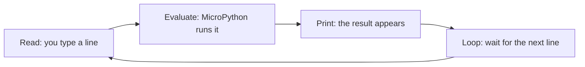
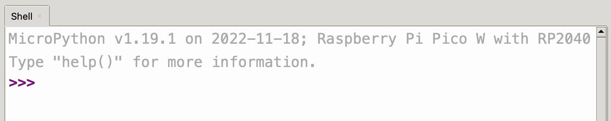

{:class="cover"}

---

{:.cover}

By the end of this lesson you will be able to type code straight into the REPL, use it to test ideas and inspect your board, and interrupt or restart a running program.

## The REPL

MicroPython has an interactive console called the `REPL`, which stands for Read Evaluate Print Loop. It `reads` a command you type, `evaluates` it, `prints` the result and then `loops` back to wait for the next one.



You will have noticed the REPL at the bottom of the screen: it's where we've seen the output of all the programs we've run so far. In Thonny it is called the `Shell`, and in Snakie the console. It shows a prompt, `>>>`, where you can type MicroPython code and get an answer straight away. That makes it perfect for quick experiments, and for checking things on the board.

{:class="img-fluid w-100 shadow-lg"}

A screenshot of the `REPL` showing the installed version of MicroPython.
{:.caption}

## Try typing in it

Type each line after the `>>>` prompt and press `Enter`. You don't need `print` for a plain value, because the REPL shows the answer itself:

```text
>>> 2 + 2
4
>>> robot_name = "Bolt"
>>> robot_name
'Bolt'
>>> print("Hello", robot_name)
Hello Bolt
```

You can ask the board about itself too:

```text
>>> import os
>>> os.uname()
```

That shows the board name, the chip and the MicroPython version. The first line the REPL printed when you connected shows the same information.

## Useful keys

| Keys | What they do |
|:--:|---|
| `Ctrl + C` | Interrupts a running program, giving you the `>>>` prompt back |
| `Ctrl + D` | At the prompt, restarts MicroPython (a soft reset) |
| `Ctrl + E` | Starts paste mode, so you can paste several lines at once |
{:class="table table-single"}

Use `Ctrl + C` any time a program is stuck in a loop, then fix the code and run it again. Your editor's stop button does the same thing.

## Help

The REPL has built-in help. Typing `help()` shows a short guide, and `help(print)` describes a function:

```text
>>> help()
```

> **Teachers**: the REPL is a great place for quick questions, such as "what does this do?", without saving a file. Because learners type directly into it, nothing is kept, so tell them to copy useful lines into a file. If boards are shared, remember that a variable one learner creates in the REPL disappears when the board restarts.

## Try it Yourself

1. In the REPL, work out `7 * 6`, and then `7 / 2`.
2. Store your robot's name in a variable, then type the variable's name on its own. What comes back?
3. Run `os.uname()` and find the MicroPython version.
4. Challenge: write a `for` loop in the REPL. You'll need to press `Enter` twice at the end. What does the prompt look like inside the loop?

## Common Issues

- **Problem**: The REPL doesn't respond to what I type.
- **Solution**: Press the stop button, or `Ctrl + C`, to interrupt any running program.
- **Why**: A program stuck in a loop keeps the REPL busy.

- **Problem**: A variable I made in the REPL has gone.
- **Solution**: Put it in a file if you want to keep it.
- **Why**: The REPL forgets everything when the board restarts.

- **Problem**: Pasting several lines gives an indentation error.
- **Solution**: Press `Ctrl + E` first to enter paste mode, then paste, then `Ctrl + D` to finish.
- **Why**: Normal mode treats each pasted line as a separate, typed line.

## Check your understanding


? What does REPL stand for?
- [ ] Run Execute Process Launch
- [x] Read Evaluate Print Loop
- [ ] Remote Editor Program Link
> It reads a command, evaluates it, prints the result and loops.

? Which keys interrupt a running program?
- [ ] `Ctrl + E`
- [x] `Ctrl + C`
- [ ] `Ctrl + P`
> `Ctrl + C` stops the program and gives you the prompt back.

? What happens to a variable you create in the REPL when the board restarts?
- [ ] It is saved on the board
- [x] It is forgotten
> The REPL doesn't keep anything between restarts.

