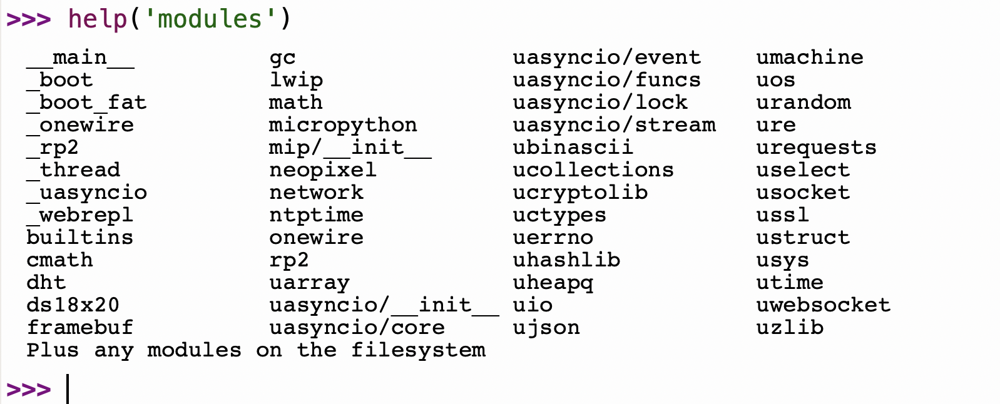

{:class="cover"}

---

{:.cover}

By the end of this lesson you will be able to import a module, list the modules on your board, and write a small module of your own.

## What is a module?

A module is a file of ready-made code that you can use in your own programs: a toolbox of related functions. MicroPython has many modules built into the firmware, and we `import` the ones we need.

We have to import them because when you `import` a module MicroPython reads its code and keeps it in `RAM`. A microcontroller has limited RAM, so we only import what each program needs.

```python
import math

radius_cm = 3.2
print('circumference:', 2 * math.pi * radius_cm)
```

Here `math` gives us `pi`. We write `math.` before the name, so it is clear where it comes from. If we only want one thing, we can pick it out:

```python
from math import sqrt

print(sqrt(144))
```

## What is on my board?

Let's have a look at all the modules on our MicroPython device. Type this directly into the `REPL`:

```text
>>> help('modules')
```

{:class="img-fluid w-100 shadow-lg"}

A screenshot of all the installed modules, from an older MicroPython version. Your list will be a little different.
{:.caption}

## Some useful built-in modules

| Module | What it is for |
|---|---|
| `machine` | board-specific features such as pins, PWM and I2C |
| `time` | `sleep`, and timing |
| `math` | `sqrt`, `sin`, `cos`, `pi` and more |
| `random` | random numbers, for example `random.randint(1, 6)` |
| `gc` | the garbage collector, which frees up unused memory |
| `os` | files, and information about the board |
| `neopixel` | addressable RGB LED strips |
| `network` | Wi-Fi, on boards that have it such as the Pico W |
{:class="table table-single"}

Each board has a slightly different list. You'll see `u` in front of some names (`utime`, `umachine`) in older tutorials. Those are older names for the same modules, so just use `time` and `machine`.

Let's use two modules together, to pretend a robot is picking a random direction:


import random
import time

directions = ['forward', 'left', 'right', 'back']

for turn in range(3):
    choice = random.choice(directions)
    print('turn', turn, 'robot goes', choice)
    time.sleep(0.5)



## dir()

To see what is inside a module, use the `dir()` function in the `REPL`. The module has to be imported first:

```text
>>> import machine
>>> dir(machine)
```

This lists all the functions, classes and constants in the `machine` module.

## Write your own module

A module is just another MicroPython file. Save this as `robot_maths.py` on the Pico:

```python
def wheel_circumference(diameter_cm):
    return diameter_cm * 3.14159


def distance_travelled(turns, diameter_cm):
    return turns * wheel_circumference(diameter_cm)
```

Then, in another file on the same board, import it by name, without the `.py`:

<!-- code-check: skip -->
```python
import robot_maths

print(robot_maths.distance_travelled(10, 6.5))
```

Both files must be saved on the Pico, in the same place, for the import to work.

## Try it Yourself

1. Use `math.sqrt()` to print the square root of 81.
2. Import `random` and print a random whole number from 1 to 6, like a dice.
3. Run `help('modules')` and find three modules you haven't met.
4. Challenge: write the `robot_maths` module above, save it on your board, and import it from a second file.

## Common Issues

- **Problem**: `ImportError: no module named 'robot_maths'`.
- **Solution**: Save `robot_maths.py` on the Pico, in the same folder as the program that imports it.
- **Why**: Python looks for modules on the board, not on your computer.

- **Problem**: `NameError: name 'math' isn't defined`.
- **Solution**: Add `import math` before you use it.
- **Why**: Built-in modules still need to be imported.

- **Problem**: `ImportError: no module named 'statistics'`.
- **Solution**: Check `help('modules')`, and write the calculation yourself, for example with `sum()` and `len()`.
- **Why**: MicroPython leaves out some standard Python modules to save space.

## Check your understanding


? Why must we `import` a module before using it?
- [ ] To make the board turn on
- [x] Because MicroPython loads its code into RAM, and RAM is limited
- [ ] To rename the program
> We only import what each program needs.

? How do you list the modules built into your board?
- [ ] `list('modules')`
- [x] `help('modules')`
- [ ] `import modules`
> Type `help('modules')` in the REPL.

? Where must `robot_maths.py` be saved to import it on the board?
- [ ] Only on your computer
- [x] On the Pico, in the same place as the program importing it
> Python looks for modules on the board.

