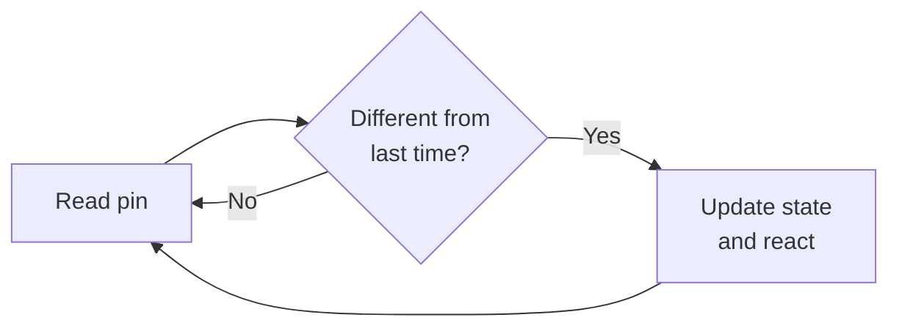

{:class="cover"}

---

Reading a pin is easy. Turning it into something *meaningful*, like "the door just opened", takes a little more thought. In this lesson the buddy learns the difference between **a value** and **a state**.

This is **status buddy stage 1**.

---

## From value to state

The pin gives us 0 or 1. But we want words, and we want to react only when something **changes**. Printing "open" a hundred times a second isn't helpful. Printing it once, at the moment the door opens, is.

The trick is to remember the last state, and compare:



## Which way round is the door?

Kev's door sensor mounts the reed switch on the frame and the magnet on the door edge:

- Door **closed**: magnet is next to the switch, the switch is closed, the pin reads **0**
- Door **open**: magnet has moved away, the switch is open, the pin reads **1**

So for a door, `0` means closed and `1` means open. The opposite of what you might guess, so we'll give it a name in code to stop us getting confused.

## Stage 1 program

This is a complete program. It prints a message when the door changes, and lights the Pico's onboard LED while the door is open.

```python
from machine import Pin
import time

# Reed switch on GP15 with the pull-up on: 0 = magnet near = door closed
reed = Pin(15, Pin.IN, Pin.PULL_UP)

# The onboard LED. On a Pico W it is named "LED"
led = Pin("LED", Pin.OUT)

door_state = "unknown"
print("Door sensor active")

while True:
    if reed.value() == 0:
        new_state = "closed"
    else:
        new_state = "open"

    # Only react when the state actually changes
    if new_state != door_state:
        door_state = new_state
        print("Door", door_state)
        led.value(1 if door_state == "open" else 0)

    time.sleep(0.1)
```

Run it and move the magnet. You should see "Door closed" or "Door open" exactly once per change, and the LED glows while the door is open.

> **Tip:** On a plain Pico (not a W), `Pin("LED")` works on recent MicroPython versions too. If yours complains, use `Pin(25, Pin.OUT)` instead.

## Mounting it on a real door

When you move from the desk to a real door:

- Use hot glue or double-sided tape for the switch on the **frame**
- Put the magnet on the **door edge**, so it sits within 10 to 20mm of the switch when closed
- **Test the alignment** before you stick anything down
- Keep wires long enough that the door can swing freely

## Try it Yourself

1. Change the words to "lid" or "drawer" to suit what you are watching.
2. Make the LED light while the door is *closed* instead.
3. Challenge: count how many times the door has opened, and print the total each time.

## Common Issues

**Problem**: It says "Door open" when the door is shut.

**Solution**: The magnet is probably too far away or too weak when closed. Move it closer, or use a stronger one.

**Why**: With the magnet out of range the switch stays open, and an open switch reads as an open door.

**Problem**: The message repeats a few times for one movement.

**Solution**: That is contact bounce. Lesson 5 fixes it properly.

**Why**: The contacts can make and break several times in a few milliseconds as they close.
