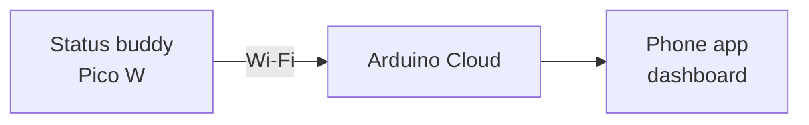

{:class="cover"}

---

Now for the moment that makes Wi-Fi worth having: the buddy tells your phone whether the door is open, from anywhere in the world. This is **status buddy stage 4**, and it finishes the **Connect** section.

---

## Why Arduino Cloud?

Kev's Wi-Fi episode has the reasons. There are plenty of services (Adafruit IO, ThingsBoard, Home Assistant Cloud), but Arduino Cloud has:

- A lovely dashboard
- A free tier
- A polished phone app, so you don't write one
- A pattern that transfers to any other platform

It works like this:



The buddy **pushes**, and your phone **pulls**. They never need to be on the same network.

## Step 1, set up the Thing

Go to [cloud.arduino.cc](https://cloud.arduino.cc/), sign in, and:

1. Create a new **Thing**
2. Add two **Variables**:
   - `door_open`, type **Boolean**, **Read-only**, updated **Periodically** every 10 seconds
   - `open_count`, type **Integer**, **Read-only**, updated **Periodically** every 10 seconds
3. Add a **Device**, choosing a **Manual device**, and **save the Device ID and Secret Key**

> **Important:** the secret key is shown **once**. Save it now. Treat it like a password: keep it out of screenshots, screen recordings and GitHub.

Kev's post makes three float variables for a weather station. We use a boolean and an integer instead, because that is what a door needs. Everything else about setting up is the same.

## Step 2, add the keys to secrets.py

Open `secrets.py` on the Pico and add the Arduino Cloud values. These are placeholders. Use your own:

```python
# secrets.py - lives on the Pico only. Never put this file on GitHub
WIFI_SSID = "YOUR_WIFI_NAME"
WIFI_PASSWORD = "YOUR_WIFI_PASSWORD"
DEVICE_ID = "YOUR_DEVICE_ID"
SECRET_KEY = "YOUR_SECRET_KEY"
```

## Step 3, install the helper packages with MIP

The Arduino Cloud client leans on a few other libraries. **MIP** (MicroPython Install Package) is MicroPython's tiny version of `pip`. It runs on the Pico, downloads over Wi-Fi, and puts packages in `/lib`. Because it needs the internet, the Pico must be on Wi-Fi first.

Save this as `install_requirements.py` on the Pico and run it **once**:

```python
import network
import time
from secrets import WIFI_SSID, WIFI_PASSWORD

# Wi-Fi must be up before MIP can fetch anything
wlan = network.WLAN(network.STA_IF)
wlan.active(True)
wlan.connect(WIFI_SSID, WIFI_PASSWORD)
while not wlan.isconnected():
    time.sleep(1)
    print("Connecting...")
print("Connected:", wlan.ifconfig())


def install_packages():
    import mip

    packages = [
        "logging",         # standard logging API the cloud client uses
        "cbor2",           # compact binary format for sending values
        "senml",           # the data format Arduino Cloud expects
        "umqtt.simple",    # the MQTT client
        "umqtt.robust",    # adds reconnect logic on top of umqtt.simple
    ]
    for pkg in packages:
        try:
            print("Installing", pkg)
            mip.install(pkg)
        except Exception as e:
            print("  Failed:", e)


install_packages()
```

If you skip this, the next program fails on its first import with something like `ImportError: no module named 'cbor2'`. The fix is always to run this script.

## Step 4, copy the client onto the Pico

The `arduino_iot_cloud` library itself is **not** on the MicroPython package index, so MIP can't fetch it. You copy it once by hand. It lives in the companion repository for Kev's Wi-Fi episode:

- [github.com/kevinmcaleer/working_with_wifi](https://www.github.com/kevinmcaleer/working_with_wifi)

Inside is a folder called `arduino_iot_cloud/` with four files: `__init__.py`, `ucloud.py`, `umqtt.py` and `ussl.py`. Copy that **whole folder** into `/lib/` on the Pico:

- **Thonny**: open the Files panel (**View**, **Files**), go into `/lib` on the Pico side (create it if needed), and drag the folder across
- **mpremote**: `mpremote cp -r arduino_iot_cloud :/lib/`

When you're done, the Pico's files should look like this:

```
/
├── main.py
├── secrets.py
├── ssd1306.py
├── sam/
├── sam_render.mpy
├── install_requirements.py
└── lib/
    ├── arduino_iot_cloud/   <- copied by you
    ├── cbor2/               <- installed by MIP
    ├── senml/               <- installed by MIP
    ├── umqtt/               <- installed by MIP
    └── logging.py           <- installed by MIP
```

`/lib` is on MicroPython's import path automatically, so `from arduino_iot_cloud import ArduinoCloudClient` just works.

The client's own project is also on GitHub: [arduino-iot-cloud-py](https://github.com/arduino/arduino-iot-cloud-py).

## Step 5, push the door state

This is a complete test program. It reads the reed switch, connects to Wi-Fi, and hands the door state to Arduino Cloud every 10 seconds.

```python
import network
import time
from machine import Pin
from arduino_iot_cloud import ArduinoCloudClient
from secrets import WIFI_SSID, WIFI_PASSWORD, DEVICE_ID, SECRET_KEY

# Reed switch: 0 = magnet near = door closed
reed = Pin(15, Pin.IN, Pin.PULL_UP)
open_count = 0

# Wi-Fi
wlan = network.WLAN(network.STA_IF)
wlan.active(True)
wlan.connect(WIFI_SSID, WIFI_PASSWORD)
while not wlan.isconnected():
    time.sleep(1)

# Cloud
client = ArduinoCloudClient(
    device_id=DEVICE_ID.encode(),
    username=DEVICE_ID.encode(),
    password=SECRET_KEY.encode(),
)


def read_door_open(client):
    return reed.value() == 1


def read_open_count(client):
    return open_count


# "Every 10 seconds, call this function and push the result to that variable"
client.register("door_open", value=None, on_read=read_door_open, interval=10)
client.register("open_count", value=None, on_read=read_open_count, interval=10)

client.start()
```

The program has three blocks, and you have met two of them: Wi-Fi from lesson 11, and the reed switch from lesson 3. The new block is the cloud client, which takes your credentials, and the `register()` calls, which say "every 10 seconds, call this function and send the result to this variable".

Two things to know:

- `client.start()` **never returns**. It runs the cloud connection for ever. That is fine for this test, but our full gadget also needs to draw on the screen and speak. Lesson 14 solves that.
- `open_count` isn't updated here, because this test doesn't watch for changes. It's in the program so the variable exists. The full gadget in lesson 14 counts openings properly.

## See it on your phone

1. Run the program
2. Install the **Arduino IoT Cloud Remote** app on your phone and log in
3. Open your Thing's dashboard and add a widget for `door_open`, choosing one that suits a true or false value
4. Open and close the door, and wait up to 10 seconds. The widget changes

Now the magic moment: **turn off Wi-Fi on your phone**. The widget still updates, because the data is coming from the internet, not your router.

## Add Wi-Fi to (almost) anything

The pattern you just wrote, *read a thing, push it to the cloud, see it on your phone*, is the same for everything. Kev's list includes a cat flap monitor, a mailbox notification (tilt switch), a plant that needs watering and a garage door checker. Swap the sensor, change the variable name, and you are done.

## Try it Yourself

1. Add a third variable called `uptime_seconds`, and send `time.ticks_ms() // 1000`.
2. Use the Arduino Cloud dashboard to set up a phone notification when `door_open` becomes true. Kev notes this is done in the dashboard, with no extra code.
3. Challenge: put the buddy on a real door, and ask a friend to open it while you watch your phone from the garden.

## Common Issues

**Problem**: `ImportError: no module named 'cbor2'` (or `senml`, `umqtt`, `logging`).

**Solution**: Run `install_requirements.py` first, with the Pico on Wi-Fi.

**Why**: The cloud client needs those packages, and MIP is how you get them.

**Problem**: `ImportError: no module named 'arduino_iot_cloud'`.

**Solution**: Copy the whole `arduino_iot_cloud` folder to `/lib/` on the Pico.

**Why**: MIP can't fetch this one, so it must be copied by hand.

**Problem**: The dashboard never changes.

**Solution**: Check `DEVICE_ID` and `SECRET_KEY` in `secrets.py` against the Arduino Cloud device. If you lost the secret key, make a new device.

**Why**: The key is shown once, and a wrong key means a silent rejection.

**Problem**: The widget updates slowly.

**Solution**: This is normal. We told the variable to update every 10 seconds.

**Why**: `interval=10` means the client only reads and sends every 10 seconds.

## Check your understanding


? Why must the Pico be on Wi-Fi before you run MIP?
- [ ] MIP only works on the Pico W's Bluetooth
- [x] MIP downloads packages from the internet
- [ ] MIP needs the OLED
> MIP fetches packages from the MicroPython package index, so it needs a connection.

? How do you get the `arduino_iot_cloud` library onto the Pico?
- [ ] `mip.install("arduino_iot_cloud")`
- [x] Copy the folder from the companion repository into `/lib/`
- [ ] It's built into MicroPython
> The library isn't on the MicroPython package index, so you copy it across once by hand.

? Where should your Arduino Cloud secret key live?
- [ ] At the top of `main.py`
- [x] In `secrets.py`, which stays off GitHub
- [ ] In the OLED's memory
> Keeping keys in `secrets.py` keeps them out of programs you might share or screenshot.

