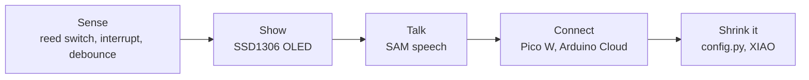

{:class="cover"}

---

You did it. You started with a switch and ended with a gadget that **senses**, **shows**, **talks** and **connects**. That is a real project, and the pattern in it applies to almost anything you build next.

---

## What you built

| Section | What you learned |
|---|---|
| Sense | Pull-ups, active-low switches, interrupts that only set a flag, and debouncing |
| Show | I2C wiring, the `ssd1306.py` driver, `framebuf` drawing, and redrawing from state |
| Talk | SAM's three stages, `pitch`, `mouth` and `throat`, and speaking from the main loop |
| Connect | Wi-Fi in four lines, `secrets.py`, MIP, and pushing variables to Arduino Cloud |
| Shrink it | The XIAO family, and keeping pin numbers in `config.py` |
{:class="table table-single"}

## Habits worth keeping

- **Build in stages.** Add one part, test it, then add the next
- **Keep handlers tiny.** Set a flag in the interrupt, and do the real work in the loop
- **Draw from state.** If the screen is always drawn from variables, it never disagrees with them
- **Keep secrets in `secrets.py`.** And keep that file out of GitHub and screenshots
- **Keep pins in one place.** Your future self, porting to a new board, will be grateful

## Where next?

The buddy is a starting point. Swap the reed switch for a different sensor and you have a brand new gadget: a cat flap monitor, a mailbox alert, a talking plant monitor. Kev's Wi-Fi post even notes that "every one of those is the same code".

## What's Next?

- [Working with I2C and SPI](/learn/i2c_spi/): go deeper into the protocol behind your OLED, including SPI and reading datasheets
- [Intermediate MicroPython](/learn/intermediate_micropython/): classes, modules and structuring larger programs, which will help as `main.py` grows
- [MicroPython Robotics](/learn/micropython_robotics/): take your Pico into motors, sensors and robots

And if you build a buddy for your own door, cat flap or mailbox, share it. Kev would love to see it.

Happy making!
