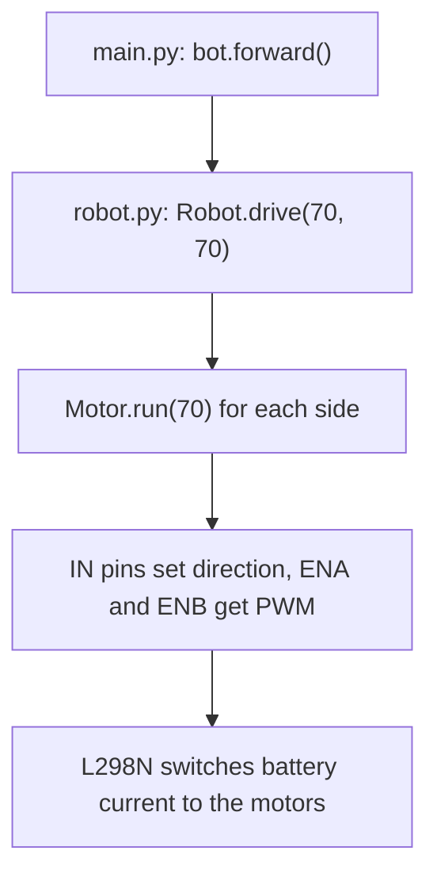

{:class="cover"}

---

By the end of this lesson you will be able to explain how an H-bridge reverses a motor, and drive two motors together with a reusable `robot.py` module that gives you `forward()`, `backward()` and spin turns.

An **H-bridge** is a circuit that lets current flow through a motor in either direction. Without one, you would have to swap the motor wires by hand to reverse it. With one, a couple of control pins do it for you.

## How the H-bridge works

The name comes from the shape of the circuit: four switches arranged like the letter H, with the motor as the crossbar.



Close the top-left and bottom-right switches and current runs left to right through the motor. Close the other diagonal pair and it runs right to left, so the motor reverses. The L298N has these switches built in, and you control them with IN1 and IN2 (and IN3 and IN4 for the second motor). Here is the truth table from the L298 datasheet, in terms of our pins:

| ENA | IN1 | IN2 | Motor does |
|-----|-----|-----|------------|
| high (PWM) | high | low | Spins one way |
| high (PWM) | low | high | Spins the other way |
| high | low | low | Brakes (both sides pulled to ground) |
| high | high | high | Brakes (both sides pulled high) |
| low | any | any | Free running, it coasts to a stop |
{:class="table table-single"}

So PWM on the enable pin switches the whole bridge on and off quickly, which sets the speed. In our code, "stop" sets duty to 0, so the motor coasts.

## Wiring two motors



The L298N has two H-bridges, one for each motor. Keep motor A wiring from lesson 2 and add motor B:

| L298N | Pico pin | Physical pin |
|-------|----------|--------------|
| IN1 | GP0 | 1 |
| IN2 | GP1 | 2 |
| ENA | GP2 | 4 |
| IN3 | GP3 | 5 |
| IN4 | GP4 | 6 |
| ENB | GP5 | 7 |
| GND | GND | 3 |
{:class="table table-single"}

Remove the jumper from ENB as well as ENA. Motor A is the robot's left motor, motor B its right.



## A reusable robot module

Two motors with four direction functions each gets messy fast. So let's wrap the details in a small module, `robot.py`, and from now on every lesson just says `bot.forward()`.

Create a new file on the Pico called `robot.py` (in Thonny, File, Save as, choose Raspberry Pi Pico) and paste this in:

```python
# robot.py - two-motor drive for an L298N
from machine import Pin, PWM

MAX_DUTY = 65535


class Motor:
    """One L298N channel: two direction pins and a PWM enable pin."""

    def __init__(self, in_a, in_b, enable, invert=False):
        self.in_a = Pin(in_a, Pin.OUT)
        self.in_b = Pin(in_b, Pin.OUT)
        self.enable = PWM(Pin(enable))
        self.enable.freq(1000)
        self.invert = invert
        self.stop()

    def run(self, speed):
        """speed runs from -100 (full reverse) to 100 (full forward)."""
        speed = max(-100, min(100, speed))
        if self.invert:
            speed = -speed
        self.in_a.value(1 if speed > 0 else 0)
        self.in_b.value(1 if speed < 0 else 0)
        self.enable.duty_u16(abs(speed) * MAX_DUTY // 100)

    def stop(self):
        self.in_a.value(0)
        self.in_b.value(0)
        self.enable.duty_u16(0)


class Robot:
    """Left motor on GP0, GP1, GP2. Right motor on GP3, GP4, GP5."""

    def __init__(self, invert_left=False, invert_right=False):
        self.left = Motor(0, 1, 2, invert_left)
        self.right = Motor(3, 4, 5, invert_right)

    def drive(self, left_speed, right_speed):
        self.left.run(left_speed)
        self.right.run(right_speed)

    def forward(self, speed=70):
        self.drive(speed, speed)

    def backward(self, speed=70):
        self.drive(-speed, -speed)

    def spin_left(self, speed=70):
        self.drive(-speed, speed)

    def spin_right(self, speed=70):
        self.drive(speed, -speed)

    def stop(self):
        self.left.stop()
        self.right.stop()
```

The speed maths is one line: `abs(speed) * 65535 // 100`. For a speed of 70 that is 70 x 65535 / 100 = 45874 (the `//` throws away the fraction). The sign of the speed picks the direction, so the same number does both jobs.

Now a short test. Save this as `main.py` or run it from Thonny, with the robot lifted off the table so the wheels can spin freely:

```python
from time import sleep
from robot import Robot

bot = Robot()

bot.forward()
sleep(1.5)
bot.backward()
sleep(1.5)
bot.spin_left()
sleep(1)
bot.spin_right()
sleep(1)
bot.stop()
print("Done")
```



**Why spinning works:** a two-wheeled robot turns when its wheels go at different speeds. If the left wheel runs backwards and the right runs forwards, the robot spins on the spot. This "tank steering" is the basis of every lesson from here on.

> If a wheel turns the wrong way, do not rewire anything: make the robot with `Robot(invert_left=True)` (or `invert_right`).

## Common Issues

- **Problem**: `ImportError: no module named 'robot'`.
- **Solution**: Check `robot.py` is saved on the Pico itself (not your computer) and that the file name is exactly lowercase `robot.py`.
- **Why**: MicroPython can only import files that live on the board's own storage.

- **Problem**: The robot spins when you ask it to go forward.
- **Solution**: One motor is wired the opposite way. Use `Robot(invert_left=True)` or `invert_right=True` to flip it.
- **Why**: Motors mounted facing opposite directions need opposite polarity to turn the wheels the same way.

- **Problem**: One motor runs and the other stays silent.
- **Solution**: Check the ENB jumper is removed and that GP3, GP4 and GP5 go to IN3, IN4 and ENB.
- **Why**: Each motor has its own set of three signals, and one loose wire silences it.

## Try it Yourself

1. Add a `turn_left()` method that runs the left motor at half the speed of the right, so the robot curves instead of spinning.
2. Change the default speed to 50 and find the slowest speed at which both wheels turn.
3. Write a loop that drives a square: forward for one second, spin for the time it takes to turn 90 degrees, four times.
4. Challenge: add a `speed` argument that slowly ramps up, so the robot does not jerk off the line.

## Check your understanding


? What does the H-bridge let a controller do?
- [ ] Make a motor run faster than its rating
- [x] Reverse the direction of current through a motor using control pins
- [ ] Measure the motor's speed
> Switching which diagonal pair of transistors is closed reverses the current, and the motor.

? With the enable pin high and both IN1 and IN2 low, what does the L298N do?
- [ ] Spins forward
- [ ] Spins backward
- [x] Brakes the motor
> The truth table in the lesson shows equal inputs with the enable high pull both motor wires to the same level, which stops the motor quickly.

? How does a two-wheeled robot spin on the spot?
- [x] One wheel goes forward and the other goes backward
- [ ] Both wheels go forward at the same speed
- [ ] Both wheels stop
> Opposite wheel directions turn the chassis around its centre, which is what `spin_left()` does.

