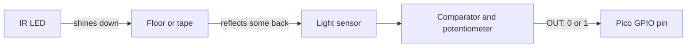

{:class="cover"}

---

By the end of this lesson you will be able to calibrate an infrared line sensor and write a loop that steers the robot along a black line.



Line-following robots are one of the classic, satisfying robotics projects. The robot looks down at the floor, sees where the line is, and steers to stay on it. It's the first time your robot makes its own decisions, and it takes only a few lines of code.

## How IR line sensors work

A reflective IR sensor such as the common **TCRT5000 module** has an infrared LED and a light sensor side by side. It shines infrared at the surface and measures how much comes back. A light surface reflects a lot, and black tape absorbs most of it. A small comparator chip on the board turns that difference into a digital signal, and a little blue potentiometer sets the switching point.



**Here is the catch:** different modules disagree about which level means "black". On many boards the output goes low over a reflective (white) surface and high over black, and on others it is the other way round. Rather than trust any diagram, including ours, we'll measure it.

## Wiring the sensors

| Sensor pin | Pico pin | Physical pin |
|------------|----------|--------------|
| VCC | 3V3(OUT) | 36 |
| GND | GND | 38 |
| Left sensor OUT | GP6 | 9 |
| Right sensor OUT | GP7 | 10 |
{:class="table table-single"}

Most of these modules run happily from 3.3 V to 5 V. We use 3.3 V so the output can never go above what a Pico pin can take. Mount the sensors on the front of the robot pointing down, about 1 cm above the floor, one either side of where the line will run. The beam only reaches a short way, so too high is the most common reason for a sensor that never changes.

## Step 1: calibrate

Run this on its own and watch the shell:

```python
from machine import Pin
from time import sleep

left = Pin(6, Pin.IN)
right = Pin(7, Pin.IN)

while True:
    print("left:", left.value(), "right:", right.value())
    sleep(0.3)
```

Hold each sensor over white paper, then over black tape. Write down the number you see over the **black** tape. Turn the little potentiometer with a screwdriver until the number changes cleanly between white and black. On the sensor module you can often see an LED that lights when it's reflecting, which makes this much easier.

## Step 2: follow the line

With a sensor on each side of the line, the logic is simple. When the line is centred, both sensors see white and the robot drives straight. If the line drifts under one sensor, steer towards that side.

| Left sees line | Right sees line | Meaning | Action |
|----------------|-----------------|---------|--------|
| no | no | Line is centred | Drive forward |
| yes | no | Line drifted left | Turn left |
| no | yes | Line drifted right | Turn right |
| yes | yes | Wide marker or junction | Stop |
{:class="table table-single"}

```python
from machine import Pin
from time import sleep_ms
from robot import Robot

LINE = 1      # the value your sensor shows over BLACK tape. Change it to 0 if needed.
SPEED = 55    # percent

bot = Robot()
left = Pin(6, Pin.IN)
right = Pin(7, Pin.IN)

while True:
    on_left = left.value() == LINE
    on_right = right.value() == LINE

    if on_left and on_right:
        bot.stop()                 # wide marker: stop here
    elif on_left:
        bot.drive(0, SPEED)        # left wheel stops, right wheel pushes: turn left
    elif on_right:
        bot.drive(SPEED, 0)        # turn right
    else:
        bot.forward(SPEED)         # line is between the sensors
    sleep_ms(20)
```

You'll need `robot.py` from lesson 3 on the Pico. Put the robot on a loop of black electrical tape, about 2 cm wide, on a light floor, and press run. Keep SPEED low at first: a fast robot overshoots corners, because it takes a moment for the wheels to answer.

Why is it `sleep_ms(20)`? The loop checks the sensors 50 times a second. That is plenty, and it stops the loop running flat out.

## Common Issues

- **Problem**: The robot turns away from the line instead of towards it.
- **Solution**: Change `LINE = 1` to `LINE = 0`, or swap the left and right sensor wires.
- **Why**: Your module may report black as the opposite level, so the code has the situation backwards.

- **Problem**: The sensor value never changes.
- **Solution**: Lower the sensor to about 1 cm from the surface and turn the potentiometer.
- **Why**: The IR beam is weak and short, and the potentiometer sets where the comparator flips.

- **Problem**: The robot works in one room and fails in another.
- **Solution**: Shade the sensor, and re-tune the potentiometer in the new lighting.
- **Why**: Sunlight and some lamps contain plenty of infrared, which swamps the sensor's own LED.

## Try it Yourself

1. Run the calibration program on a table with a black marker line and record the values over white and black.
2. Lower SPEED to 40, then raise it until the robot starts to lose the line. What is its top speed on your track?
3. Make the turn gentler: use `bot.drive(20, SPEED)` instead of `bot.drive(0, SPEED)`. Is it smoother?
4. Challenge: add a counter so the robot stops after crossing three wide markers.

## Check your understanding


? Why do we run a calibration program before the line follower?
- [ ] To warm up the sensor
- [x] Different modules report black as 0 or 1, so we measure what yours does
- [ ] The Pico needs it to find the pin
> The lesson explains that some boards output low over white and high over black, and others the opposite, so you set LINE from your own readings.

? With the two sensors either side of the line, what should the robot do when only the left sensor sees the line?
- [ ] Stop
- [x] Turn left, towards the line
- [ ] Reverse
> The line has drifted towards the left sensor, so steering left brings the robot back over it.

? What is the job of the potentiometer on the sensor module?
- [ ] Setting the robot's speed
- [x] Setting the point at which the sensor switches between white and black
- [ ] Powering the IR LED
> The comparator flips when the reflected light crosses the level set by the potentiometer.

